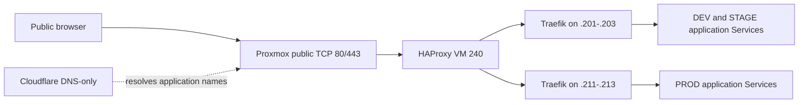
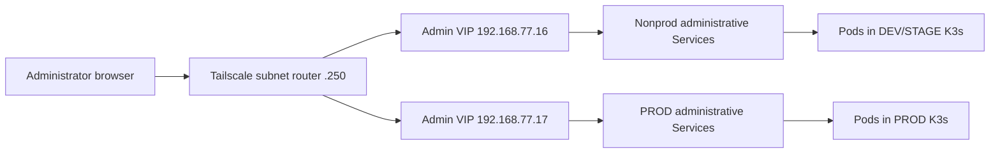

# Infrastructure architecture

Updated **2026-10-22**. This document describes the implemented infrastructure
and the agreed target architecture. Sections explicitly distinguish
**Implemented**, **In progress**, **Agreed, not deployed**, and **In development**.
Agreement on a design does not establish its operational readiness or tested availability.

The implemented application, GitOps and public HTTPS topology is documented in
the Phase 0–7 reports. Phase 8 has deployed separate Admin VIP controllers and
monitoring in both clusters and a persistent, isolated Jenkins foundation in
NONPROD. Native browser/API checks passed from the execution host, and the
operator confirmed all interfaces and passwords through Tailscale on 2026-10-22.
Phase 8 is complete. See the
[Phase 8 report](testreports/PHASE8_REPORT.md) and
[implementation plan](testreports/IMPLEMENTATION_PLAN.md).
Phase 9 has restored Jenkins state to a separate NONPROD home while retaining
the current administrator login. The CI/DinD worker and separate publisher are
connected; a Docker build/bind-path smoke passed and imported state is retained.
The first Phase 9 controlled CI/publication cycle passed and Argo deployed
STAGE; manual running-digest and HTTPS checks passed. The main polling proof
remains pending; unrelated imported jobs remain disabled. See the
[Phase 9 report](testreports/PHASE9_REPORT.md).

## Host and private network

**Status: Implemented.**

One Proxmox VE 9 host provides `vnet77` (`192.168.77.0/24`), gateway
`192.168.77.1`, and outbound NAT. Its public IPv4 address is a recovery input,
not a fixed part of the topology. Debian 13 Cloud-Init template **9013** is the
source for the managed VMs. The operator selects VM-capable disk storage on the
current host before creating the template.

| Component | VM IDs | Private address or API VIP | Provisioning |
| --- | --- | --- | --- |
| Management | 200 | `192.168.77.200` | Proxmox clone and Cloud-Init |
| Application edge | 240 | `192.168.77.240` | Terraform VM; Ansible HAProxy |
| Tailscale subnet router | 250 | `192.168.77.250` | Terraform VM; Ansible guest setup |
| Dev/stage K3s servers | 201–203 | `192.168.77.201–203`; VIP `192.168.77.11` | Terraform VMs; Ansible K3s |
| Prod K3s servers | 211–213 | `192.168.77.211–213`; VIP `192.168.77.12` | Terraform VMs; Ansible K3s |

## Access and cluster control

**Status: Implemented, with the kubeconfig observation noted below.**

- Proxmox host nftables forwards public TCP `22200` to VM 200 port `22` for
  initial SSH access. Tailscale VM 250 advertises `192.168.77.0/24` for private
  administration after its route is approved in the tailnet.
- VM 200 holds the working checkout and runs Terraform and Ansible. Each
  Terraform module keeps its own state. Local credentials and SSH keys reside
  in ignored files under `recovery/`; that directory also contains tracked
  examples and helpers.
- Both clusters have three K3s server nodes with embedded etcd. Ansible
  installs kube-vip for each cluster's **API** VIP; remaining servers join
  through that VIP. Cluster tokens are separate and stored locally in
  `recovery/`. The playbooks do not disable K3s packaged Traefik or ServiceLB.
- The K3s VM Terraform defaults are two vCPUs and Proxmox memory ballooning
  from 2 GiB to 8 GiB. Ansible prepares the guest OS and installs the pinned
  K3s version from each inventory.
- VM 200 stores the separate kubeconfigs `~/.kube/config-dev-stage` and
  `~/.kube/config-prod`, with contexts `dev-stage` and `prod`. The Ansible
  playbooks include a merge step, but the default `~/.kube/config` on VM 200
  had no contexts during the documentation review on 2026-10-21. Use the
  explicit cluster kubeconfig for every operation; do not assume the default
  configuration selects either target cluster.

### Address roles

| Purpose | DEV/STAGE | PROD | Status |
| --- | --- | --- | --- |
| Kubernetes API | `192.168.77.11:6443` | `192.168.77.12:6443` | Implemented; API kube-vip |
| Public application ingress | `.201`–`.203:80/443` | `.211`–`.213:80/443` | Implemented; Traefik/ServiceLB behind HAProxy |
| Private administrative Services | `192.168.77.16` | `192.168.77.17` | Implemented in both clusters; native status-ownership guard |

The operator confirms `.16` and `.17` are free and allocated to private
administration. They are distinct from both API VIPs and public ingress
addresses. Both Admin VIPs are active; their independent ownership is recorded
in the Phase 8 report.

## Repository boundaries

| Path | Responsibility |
| --- | --- |
| `scripts/proxmox/` | Debian template creation |
| `edge/nftables/` | Proxmox SSH DNAT examples |
| `edge/tailscale/` | Subnet router VM and Tailscale configuration |
| `edge/haproxy/` | Implemented application edge, routing and certificate distribution configuration |
| `infrastructure/k3s-cluster/terraform/` | Six K3s server VMs |
| `infrastructure/k3s-cluster/ansible/` | Guest preparation, two K3s clusters, kubeconfigs |
| `kubernetes/apps/liora/` | Current application manifests, environment overlays, and imported deployment history; DEV/STAGE/PROD deployed and privately verified |
| `kubernetes/gitops/argocd/` | Implemented independent Argo CD installations and cluster-specific GitOps definitions |
| `kubernetes/platform/nonprod/` | Implemented NONPROD administrative access, monitoring and Jenkins foundation/held restore overlays |
| `kubernetes/platform/prod/` | Implemented independent PROD administrative access and monitoring |
| `scripts/kubernetes/` | Reusable deployment, certificate and verification helpers |
| `recovery/` | Local recovery inputs and examples; live credentials stay out of Git |
| `runbooks/` | Operator steps for installation and recovery |
| `docs/testreports/` | Implementation plans, provenance and phase reports |
| `.local-work/` | Existing ignored operator tools, browser dependencies and generated output |

The platform paths above now contain Phase 8 configuration and preserved
upstream source history; actual deployment is recorded in its report. Work uses
the original infrastructure checkout and its ignored local workspace, without
an additional migration worktree. See
the [local workspace guide](LOCAL_WORKSPACE.md) for tool and archive locations.

The application repository owns application code, tests, image builds and
release pipeline source. The infrastructure repository owns deployed image
references, Kubernetes/GitOps resources and the target Jenkins platform
configuration. Jenkins deployment sources currently remain in the application
repository's `infra/jenkins-host/` proof of concept until their staged import.
Promotion changes targeting infrastructure overlays are planned for Phase 9;
they are not described here as already implemented.

Start with the [installation](../00-Installation_from-0.md) or
[disaster recovery](../01-Disaster_recovery.md) navigator. The documented
infrastructure flow continues with the
[application deployment procedure](../runbooks/13-deploy-application-manifests.md).

## Application environments and storage

**Status: Implemented; database replacement and backup/restore are later work.**

DEV and STAGE run in `app-dev` and `app-stage` on the dev/stage cluster. PROD
runs in `app-prod` on its separate cluster, with two backend and two frontend
replicas. Each environment retains PostgreSQL, its separate 1Gi local-path PVC,
Adminer, prestart, backend and frontend from the imported stack. All backend
Pods use one worker; PROD required the same explicit command as DEV/STAGE.

| Environment | Cluster / namespace | Public application URL | Backend / frontend replicas |
| --- | --- | --- | --- |
| DEV | DEV/STAGE / `app-dev` | `https://dev.liora.aprt.info` | 1 / 1 |
| STAGE | DEV/STAGE / `app-stage` | `https://stage.liora.aprt.info` | 1 / 1 |
| PROD | PROD / `app-prod` | `https://liora.aprt.info` | 2 / 2 |

Each namespace has its own frontend, backend, PostgreSQL and Adminer Services.
Prestart is a migration Job, not a browser service. PostgreSQL and other
application internals remain on the cluster service network. The agreed
administrative endpoints expose Adminer, not PostgreSQL directly.

Current `local-path` volumes are node-local; they do not replicate data across
the three cluster nodes. A three-server control plane or movable VIP does not
make these volumes or database instances highly available. Data restore and
storage failover have not been established by the functional application checks.

Database readiness, migrations, private UI login and item persistence are
verified in the [Phase 3](testreports/PHASE3_REPORT.md),
[Phase 4](testreports/PHASE4_REPORT.md), and [Phase 5](testreports/PHASE5_REPORT.md)
reports. All three environments passed mutual database-marker and token
isolation checks; synthetic acceptance items were removed afterward. Data
restoration and target platform replacements remain later work. Public HTTPS
routing is now verified in Phase 7 below.

## GitOps ownership

**Status: Implemented for the current application deployments.**

Independent Argo CD v3.5.6 installations in each cluster's `argocd` namespace
source this infrastructure repository. Nonprod manages app-dev/app-stage; PROD
manages app-prod. Each destination is the local Kubernetes API. Separate roots
manage the cluster-specific Application and AppProject definitions; no external
cluster credentials or shared ApplicationSet are configured.

Both roots and all children have automated reconciliation and self-healing.
Nonprod child pruning is enabled after inventory review; PROD and both roots
keep pruning off. Database PVC retention annotations remain. Registry and
application Secrets stay external prerequisites. The controllers have the
upstream cluster RBAC; AppProject restrictions scope applications rather than
providing a controller service-account boundary against cluster administrators.

Private Argo CD UI access, root/child reconciliation, hook migrations and
ConfigMap drift correction passed in the [Phase 6 report](testreports/PHASE6_REPORT.md).
Use [runbook 14](../runbooks/14-install-argocd.md) for bootstrap and adoption,
including the manual-policy render required before enabling a fresh deployment.

Administrative exposure must retain a single declarative owner for each
Service. The exact resources and ownership for the new platform are **in
development**; the current application reconciliation must not undo, or compete
with, a separately managed copy of the same Service.

## Public application ingress and certificates

**Status: Implemented for DNS-only public-origin HTTPS access.**

All three application hostnames resolve directly to the current Proxmox public
origin (`151.115.96.5` at acceptance), using Cloudflare DNS-only records. Proxmox
forwards public TCP 80/443 to dedicated HAProxy VM 240. Existing SSH and unrelated
forwarding rules remain intact. HAProxy allows the three application Host/SNI
names and rejects unknown/admin names; Argo CD and Adminer gain no public route.

TLS passes through to Traefik over disjoint ServiceLB node endpoint pools:
nonprod `.201`–`.203`, PROD `.211`–`.213`. API VIPs `.11`/`.12` are not ingress
addresses. Dedicated floating ingress VIPs and a second edge are not installed.
This is a single-edge deployment without a tested failover/reboot guarantee.

Certbot HTTP-01 on the edge issues separate trusted certificates for DEV, STAGE
and PROD. The management VM's daily certificate-sync service privately fetches
and validates each pair and updates only that environment's `app-tls` Secret.
Certbot renewal simulations and a service execution passed; the reports do not
establish a later unattended real renewal/distribution cycle. Certificate state
and Terraform state remain external operator data. DEV's HTTPS origin/CORS is
active in its restarted backend; STAGE/PROD retain their existing HTTPS settings.

The operator confirmed external warning-free loads of all three URLs. Canonical
HTTPS UI persistence, health, redirects and mutual database/token isolation
passed. See [Phase 7](testreports/PHASE7_REPORT.md) and
[runbook 15](../runbooks/15-publish-application.md). Cloudflare's proxy/Full (strict)
path remains optional follow-up and was not part of this DNS-only acceptance.

## Permanent private administrative access

**Status: Implemented; external Tailscale access confirmed on 2026-10-22.**

Both Admin VIPs serve the agreed endpoints. Argo/Grafana/Jenkins native logins,
all Adminer database logins, Prometheus/Alertmanager browser UIs and all four
Grafana dashboards per cluster passed direct-VIP checks from the execution host.
The approved [status ownership guard](testreports/PHASE8_ADMIN_VIP_DECISION.md)
prevents K3s ServiceLB from clearing their VIP status.

Trusted administrators use the existing Tailscale route to
`192.168.77.0/24`. The agreed browser path is Tailscale → Admin VIP →
Kubernetes Service → Pod. It requires no private ingress, DNS configuration,
additional reverse proxy, SSH tunnel or manually started port-forward.

All endpoints below are deployed and locally verified. The operator also
confirmed the external Tailscale browser path and working passwords.

| Interface | DEV/STAGE | PROD |
| --- | --- | --- |
| Argo CD | `https://192.168.77.16:8080` | `https://192.168.77.17:8080` |
| Grafana | `http://192.168.77.16:3000` | `http://192.168.77.17:3000` |
| Prometheus | `http://192.168.77.16:9090` | `http://192.168.77.17:9090` |
| Alertmanager | `http://192.168.77.16:9093` | `http://192.168.77.17:9093` |
| Adminer DEV | `http://192.168.77.16:8081` | — |
| Adminer STAGE | `http://192.168.77.16:8082` | — |
| Adminer PROD | — | `http://192.168.77.17:8081` |
| Jenkins | `http://192.168.77.16:8085` | — |

Use each service's native HTTP/HTTPS and authentication. Argo CD currently
provides HTTPS with its bootstrap self-signed certificate; the agreed IP URL
does not imply a trusted, warning-free certificate. Grafana and Jenkins use
their native logins; Adminer uses database credentials. No additional TLS
termination, certificate issuance, SSO or authentication proxy is agreed.
Prometheus and Alertmanager rely on their native access model within the
trusted private subnet. Native base URLs and redirects must match the final
external IP and port.

The agreed access policy gives trusted administrators subnet access through
Tailscale. Additional Tailscale ACL/grants restrictions and firewall hardening
are outside this increment. Admin VIP Services must not receive public NAT or
public HAProxy routes. Proxmox administration and management SSH retain their
own addresses; they are not routed through these Kubernetes Admin VIPs.

### Services-only kube-vip

**Status: Implemented.**

Each cluster runs its own services-only kube-vip v1.2.3 DaemonSet named
`kube-vip-admin`, with dedicated selectors/service account/RBAC. Global service
election uses `svc_election=false` and `kube-system/liora-admin-services`,
independent of the API instance's `plndr-cp-lock`. The shared Admin VIP has one
leader across all administrative Services. Reads of all three nodes in each
cluster confirmed exactly one physical owner, matching its lease and Service
annotations. Metrics use `2113`, separate from the API instance's `2112`.

Each Service explicitly sets `kube-vip.io/loadbalancerIPs`, class
`liora.aprt.info/admin-vip`, `externalTrafficPolicy: Cluster`, and
`allocateLoadBalancerNodePorts: false`. No new NodePorts are allocated. Strict
class handling keeps kube-vip away from public Traefik and avoids administrative
ServiceLB DaemonSets. K3s v1.36.5+k3s1 nevertheless has a separate EndpointSlice
status worker that ignores class; a native ValidatingAdmissionPolicy allows only
the dedicated kube-vip identity to update this class's Service status. Other
classes and workload admission are unaffected. ServiceLB may log/retry denied
writes; this prevents corruption rather than patching K3s. See the decision
record for enforcement, rollback and its limits.

Existing application Services are preserved; separately named `adminer-private`
Services are declared in their environment overlays. They are currently applied
by the operator and can be adopted by the existing Argo Application when reviewed
source changes are published. Helm owns monitoring chart resources; operator
manifests own the additional private Services and scrape/dashboard/rule resources.
There is no second platform Argo owner. A VIP path does not isolate other trusted
private-network paths or host listeners.

API VIPs, their DaemonSets and public ingress remain unchanged. VIP failover,
reboot and outage-duration tests are deferred. A common VIP leader does not
establish availability of the services, their storage or the single Proxmox host.

## Cluster monitoring

**Status: Implemented independently in both clusters.**

Each cluster has its own monitoring namespace, Grafana, Prometheus and
Alertmanager. The agreed stack includes Prometheus Operator, kube-state-metrics,
Node Exporter, Argo CD/Traefik monitoring, dashboards and alert rules adapted
from the application repository's existing `monitoring/` configuration.
DEV/STAGE and PROD have separate data, credentials and environment-specific
monitoring configuration. Exporter and operator endpoints remain internal.

Phase 8 pins kube-prometheus-stack 92.2.0 and retains the bounded PoC budgets:
Prometheus retention is three days/1500MB with a 2Gi local-path PVC; Alertmanager
uses a 256Mi local-path PVC. Grafana state is ephemeral with provisioned dashboards
and datasource. Helm owns its release; separately applied configuration owns
custom monitors/rules/dashboards and private Services. Direct-VIP checks found
26/26 targets up, eight healthy rules, a healthy Grafana datasource and four loaded
dashboards in each cluster. The inherited Grafana 384Mi limit caused an OOM kill;
both clusters now request 100m/256Mi, limit 500m/768Mi and allow up to 15 minutes
for cold startup. The replacement instances remained Ready without restarts at
the 2026-10-22 follow-up. These observations do not constitute a load/HA test.
Exact resource limits are tracked in the per-cluster values and
[runbook 16](../runbooks/16-private-platform-access.md).

An existing Slack destination is configured in the
legacy kind deployment, but the destination for new-cluster notifications
has not been agreed. Alert delivery configuration is **in development**;
notification receipt is not yet verified.

## Jenkins and CI

**Current state: Jenkins state and worker agents in K3s; application jobs held.**

The legacy Jenkins ran in Docker on VM 100 at private address
`192.168.77.100:8085`. Its source configuration is in the application repository
under `infra/jenkins-host/`. It has a controller with zero executors, a CI
agent, a separate trusted registry publisher and an isolated Docker-in-Docker
build daemon. This proof of concept is the migration source. Its controller,
agents, daemon and local kind node were stopped with operator authorization.
The operator subsequently ran `docker system prune -a --volumes` on the local
execution host on 2026-10-22. The stopped containers and local images were
removed; the seven named Jenkins volumes and private backups remain. Legacy
Docker recovery now requires recreating containers and restoring missing bind
inputs from the private archives. It cannot use `docker start` on the removed
containers. This cleanup did not affect either remote K3s cluster or its PVCs.
The old kind node's anonymous data volume was removed too; the Jenkins backups
do not preserve that cluster's state.

One Jenkins controller now runs in the DEV/STAGE cluster's `jenkins` namespace,
with a separate 5Gi local-path `JENKINS_HOME` PVC and native HTTP/login at
`192.168.77.16:8085`. It reuses the unchanged PoC image/plugin set, published to
GHCR and pinned by digest. The restoration baseline contained 30 configured items,
139 build records and three persisted users; subsequent reviewed CI adds records
and related PR jobs without pruning imported history. The current K3s admin
account and password are retained; legacy admin data remains only in the
recovery archive.
Native browser/API login passed, credential IDs/scopes and decryption were checked,
and original encryption/user-directory keys were retained. It requests 100m/512Mi,
limits 1 CPU/768Mi and caps its heap at 384Mi. No PROD controller is planned.
The restored baseline held all jobs, multibranch scanning and Pipeline resume.
Authorized Phase 9 controlled execution now enables only the existing main CI,
trusted publisher and one-time related PR checks; unrelated jobs and recurring
indexing/nightly schedules remain disabled. Controller executors remain zero.
Two agents are connected, each with one executor and its preserved label.
The startup quiet-mode hook is retained; a controller GitHub egress policy
permits DNS/public HTTPS for the authorized cycle.
An init check prevents the restored-state overlay from starting on an incomplete
home. The original foundation PVC and a consistent foundation backup are retained.
Migration is staged:

- Phase 8 installs the controller, storage and private access. Working jobs,
  polling, schedules, publication and promotion are not activated there.
- Phase 9 moves working CI and its private state. Preserve as much as possible
  from the existing image/plugin/tool locks, Dockerfiles, JCasC, Job DSL,
  pipelines, users, credential IDs/scopes, history and artifacts. Keep CI and
  trusted publication separate. Current pipeline sources/settings remain preserved
  with the reviewed promotion adaptation installed for controlled execution.
  The current target supersedes human review for every GitOps PR: successful CI
  of the exact resulting application main commit publishes immutable images, directly commits
  the pair to infrastructure main and lets Argo CD deploy STAGE automatically.
  DEV/PROD remain manual; PROD reuses a successfully STAGE-accepted pair without
  rebuilding. Application code/build pipelines stay in the application repository.
  Serialize STAGE promotion, recheck application main before each push and skip
  superseded builds. Automatic Argo health, running-digest and HTTPS smoke evidence
  tied to source/pair is mandatory before PROD. Rollback remains manual.
  The trusted writer restricts direct commits to STAGE image, promotion and
  acceptance files; unrelated concurrent infrastructure changes are preserved.
  App grants were verified; the owner confirmed no infrastructure main
  protection. Application integration used its required real CI check and
  normal PR merge, without changing branch rules or permissions.
  The first minimal live cycle passed with main #15 and publisher #34:
  Argo automatically deployed `b8caf7e`, with exact running-digest and strict
  HTTPS checks through the private edge route. Main-only SCM polling and its
  automatic demonstration remain pending. The publisher stops after the STAGE
  update; deployment verification is currently manual. The separate
  observer/automatic acceptance and expanded promotion workflows are preserved
  but deferred outside that initial path. PROD is explicitly blocked until the
  agreed automated acceptance gate is implemented and live-verified. This is a
  staged implementation of the target above, not an alternative architecture.

Controller resources and image provenance are tracked in
`kubernetes/platform/nonprod/jenkins/`. Its default overlay supports a fresh
foundation; `held/` selects the restored home and zero-agent execution guard,
and the current `agents/` overlay adds the connected workers. Do not apply
the foundation overlay over the restored controller as routine reconciliation.
The CI Pod in `jenkins-ci` co-locates the original `host-ci` agent with privileged
DinD, sharing a 5Gi work PVC at `/home/jenkins/agent` and using a fresh 20Gi cache
PVC. Its limits are 500m/384Mi for the agent and 1500m/2560Mi for DinD.
The separate `registry-publisher` Pod in `jenkins-publisher` has a 5Gi work PVC,
500m/512Mi limit and read-only immutable helper source from the reviewed application
commit. Neither worker mounts an API token or host Docker socket. Only the CI Pod
receives generated Docker TLS certificates; basic network policies retain the
build/publication separation. Both agents connect by WebSocket, with no new
browser or daemon Service. Native admin login and retained state passed again;
the Docker smoke did not execute a Jenkins job or publish application images.

The recovered worker images are published to GHCR and pinned by digest. The
operator deferred vulnerability remediation and further image scans for this
educational deployment; the failed DinD result remains recorded as a failure.
See the [worker report](testreports/PHASE9_WORKERS.md) for provenance and checks.
Application CI, trusted publication activation and pipeline/promotion review
remain **in development** for Phase 9. Stored publisher/App credentials have
been restored, but publication is inactive and imported Job DSL is not executed.
Live credentials, encryption keys and home archives remain private operator data
outside Git. Successful state restore does not establish CI or promotion readiness.

VM 100 retirement and legacy public NAT cleanup are operator work outside
this implementation's scope. Phase 8 does not complete the working CI
migration required before the operator retires the old environment.

## Later platform components

### Database platform and backup/restore

**Status: Target agreed; section in development.**

CloudNativePG is the target database platform, introduced one environment at
a time after backup/restore verification. Current PostgreSQL Deployments and
PVCs remain in service. Backup destination, retention, database migration
procedure and storage/availability design are in development. Adminer remains
until an alternative operational path is available and its removal is agreed.

### Cluster-specific Secret encryption

**Status: Target agreed; section in development.**

Separate Sealed Secrets controllers and recovery keys are planned for the two
K3s clusters. They have not been deployed there. Existing application and
registry Secrets were provisioned from private recovery inputs. Controller
deployment, key recovery and the migration procedure are in development.

### Future ingress and resilience changes

**Status: Section in development.**

Dedicated floating public-ingress addresses and further platform changes
appear in the later implementation plan. Their detailed design is not
settled. The agreed Admin VIPs do not implement public ingress failover,
replicated storage or host redundancy. Existing public certificate automation
remains as described above; no additional mechanism is selected here.
