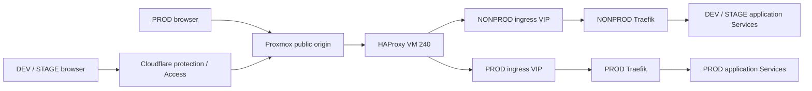
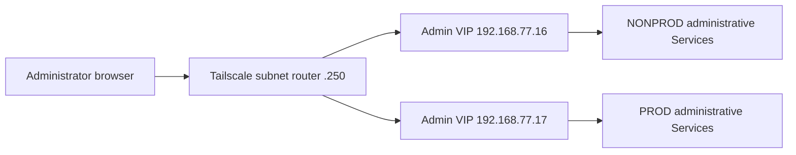
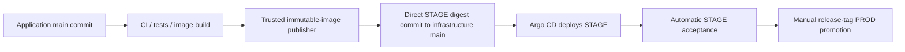

# Infrastructure architecture

This document defines the desired architecture of the Liora platform.
Implementation order, migration procedures and execution results belong in the
[implementation plan](testreports/IMPLEMENTATION_PLAN.md), [runbooks](../runbooks/)
and [phase reports](testreports/).

## Platform topology

One Proxmox host runs two independent, three-server K3s clusters. DEV and STAGE
share the NONPROD cluster and have separate namespaces, databases and Secrets.
PROD has its own cluster, data and administrative configuration.

| Component | VM IDs | Private addresses |
| --- | --- | --- |
| Proxmox gateway | Host | `192.168.77.1` |
| Management | 200 | `192.168.77.200` |
| Public application edge | 240 | `192.168.77.240` |
| Tailscale subnet router | 250 | `192.168.77.250` |
| NONPROD K3s servers | 201–203 | `192.168.77.201`–`192.168.77.203` |
| PROD K3s servers | 211–213 | `192.168.77.211`–`192.168.77.213` |

The private network is `192.168.77.0/24` on Proxmox `vnet77`. VM addresses are
static. DHCP allocation excludes static VM addresses and all floating addresses.
Proxmox provides outbound NAT. The public IPv4 address is a
recovery/configuration input.

Terraform manages infrastructure resources; Ansible configures guest operating
systems, K3s and the edge. VM 200 is the operator host for these tools and holds
separate NONPROD and PROD kubeconfigs. Each infrastructure module has its own
state and recovery procedure. Credentials, private keys and state stay outside Git.

Each K3s cluster uses embedded etcd across its three server nodes. CPU, memory,
replicas and storage requests are explicit configuration within the resource
budget of the single Proxmox host.

## Address roles and traffic ownership

| Purpose | NONPROD | PROD |
| --- | --- | --- |
| Kubernetes API | `192.168.77.11:6443` | `192.168.77.12:6443` |
| Public application ingress | Dedicated NONPROD ingress VIP | Dedicated PROD ingress VIP |
| Private administrative Services | `192.168.77.16` | `192.168.77.17` |

API, public ingress and administrative addresses have separate roles and
controller ownership. Public ingress VIP addresses are network configuration
parameters; they must not overlap API VIPs, Admin VIPs, static VMs or DHCP.

API kube-vip instances serve cluster control-plane access. Separate
services-only kube-vip instances serve administrative Services. Public ingress
has its own address ownership; neither an API nor an Admin VIP is reused for it.
Each LoadBalancer Service has one controller responsible for its status and
address advertisement. LoadBalancer classes and admission rules enforce that
ownership without competing ServiceLB updates.

## Public application access

| Environment | Cluster / namespace | Application URL |
| --- | --- | --- |
| DEV | NONPROD / `app-dev` | `https://dev.liora.aprt.info` |
| STAGE | NONPROD / `app-stage` | `https://stage.liora.aprt.info` |
| PROD | PROD / `app-prod` | `https://liora.aprt.info` |

Cloudflare manages public DNS. DEV and STAGE use Cloudflare protection/Access;
PROD uses DNS-only public-origin access. The origin path is Proxmox public
TCP 80/443 forwarding to HAProxy VM 240, then the selected cluster's dedicated
ingress VIP and Traefik. HTTP requests redirect to HTTPS. HAProxy routes only
application hostnames and rejects unknown and administrative names.

HAProxy passes TLS through using SNI. Traefik terminates origin HTTPS using
certificates managed inside its cluster. DEV/STAGE Access restrictions apply
at the Cloudflare edge; the direct-origin path is not restricted to Cloudflare.

### Certificate lifecycle

Each cluster has its own cert-manager installation and issuer configuration.
Let's Encrypt issues application certificates through ACME DNS-01 validation.
cert-manager creates the required TXT records through the Cloudflare DNS API
and renews certificates into the environment's TLS Secret.

Cloudflare credentials are scoped to the required zone and permissions. Private
recovery inputs provision those credentials into Kubernetes. Each TLS Secret
has one certificate-management owner. Certificate issuance and renewal are
cluster-local.

## Private administrative access

Trusted administrators access `192.168.77.0/24` through Tailscale VM 250.
Administrative browser access uses IP and port through each cluster's Admin VIP.
No private ingress, private DNS service, additional reverse proxy, SSH tunnel
or manually started port-forward is required.

| Interface | NONPROD | PROD |
| --- | --- | --- |
| Argo CD | `https://192.168.77.16:8080` | `https://192.168.77.17:8080` |
| Grafana | `http://192.168.77.16:3000` | `http://192.168.77.17:3000` |
| Prometheus | `http://192.168.77.16:9090` | `http://192.168.77.17:9090` |
| Alertmanager | `http://192.168.77.16:9093` | `http://192.168.77.17:9093` |
| Jenkins | `http://192.168.77.16:8085` | — |

Services provide their native HTTP/HTTPS and authentication. Argo CD uses its
native HTTPS endpoint; an IP endpoint does not require a publicly trusted
certificate. Grafana, Jenkins and Argo CD retain native logins. Prometheus and
Alertmanager use their native access model within the trusted private subnet.
No additional SSO, authentication proxy or private certificate authority is part
of this access design.

Tailscale gives trusted administrators subnet access. Additional per-service
ACL/grant restrictions are outside the agreed access model. Administrative
interfaces have no public NAT or HAProxy route. PostgreSQL, Redis, build daemons
and internal exporter endpoints stay on their internal networks. Proxmox and
management SSH use their own addresses outside the Admin VIPs.

### Administrative VIP ownership

Each cluster runs a services-only `kube-vip-admin` DaemonSet with dedicated
selectors, service account and RBAC. All Services sharing an Admin VIP use one
common leader. Its election lease is independent of the API VIP lease.
API and administrative instances have distinct host-network listeners.

Administrative Services explicitly declare their VIP and use LoadBalancer
class `liora.aprt.info/admin-vip`, `externalTrafficPolicy: Cluster` and
`allocateLoadBalancerNodePorts: false`. Only the dedicated administrative
kube-vip identity may update their Service status. API and public ingress
Services belong to their respective controllers.

## Application and database platform

Application configuration uses a shared Kustomize base and separate DEV,
STAGE and PROD overlays. Each environment owns its configuration, runtime
Secrets, database credentials and image digest pair. Frontend and backend
images are immutable and referenced by digest.

CloudNativePG manages PostgreSQL separately for each environment. Database
instance counts, storage and resource budgets are environment-specific.
Application migrations use the prestart/migration lifecycle and preserve
compatibility with the deployed application. Database administration uses a
private operational access path; Adminer is excluded from the final application
stack.

Persistent storage has explicit ownership, retention and recovery rules.
Node-local `local-path` storage does not replicate volume contents. Database
replication, backups and application replica placement are separate from
control-plane and VIP availability. PROD application scaling and disruption
budgets are environment configuration, independent of the number of K3s servers.

### Backup and recovery

Database backups have a restore procedure and a destination outside the
physical Proxmox host failure domain. Storage backend, retention and recovery
objectives are explicit database/recovery configuration parameters. Recovery procedures cover
application data, etcd, infrastructure state, cluster credentials and encryption
keys. Backup copies and the private recovery kit stay outside Git.

The recovery kit contains the inputs and procedures needed to recreate the
Proxmox guests, both clusters, GitOps and platform services, then restore data.
Jenkins recovery includes controller state, credential encryption material,
users, jobs and retained history. Secret-controller keys and registry access
are recoverable independently of an application deployment.

## GitOps ownership

Each cluster has its own Argo CD installation, root Application and AppProject.
NONPROD manages DEV/STAGE; PROD manages PROD. Each controller deploys to its
local Kubernetes API and reads the infrastructure repository.

Argo CD automatically reconciles approved Git state and repairs drift.
NONPROD application pruning is enabled under the resource ownership policy.
PROD and root Applications do not automatically prune. Database volume retention
is explicit. Every Service and platform resource has one declarative owner;
application namespace resources belong to their environment definitions and
platform resources to their platform definitions.

STAGE image updates are direct automated commits after successful main CI.
DEV and PROD promotion use manual, reviewed GitOps changes. Git rollback is an
explicit operator action; Argo CD reconciles the selected rollback state.

## Jenkins and delivery

One persistent Jenkins controller runs in NONPROD with zero executors.
Application builds run on the separate `host-ci` agent alongside an isolated,
privileged Docker-in-Docker daemon. The trusted `registry-publisher` agent has
its own workspace and executes pinned publisher helpers. Application build code
does not receive registry-publishing or infrastructure-writing credentials.
The privileged build daemon's isolation does not provide a separate physical
security boundary from its K3s node.

The controller preserves operator identities, credential scopes and retained
build history. Its startup configuration restores normal execution of the
approved jobs and triggers. Agent images, plugins and tools are pinned;
workspaces, Docker cache and controller state have separate storage lifecycles.

### Build and promotion policy

Main SCM polling runs approximately every two minutes. Automation is limited
to the agreed main pipeline and explicit promotion entrypoints; nightly
schedules and recurring multibranch indexing are disabled.

- **DEV:** an operator requests deployment of a selected application branch.
  DEV is independent of STAGE and is not a mandatory promotion step.
- **STAGE:** a merge into application main runs CI for the resulting main
  commit. Successful CI exports its tested images to the trusted publisher,
  which publishes immutable frontend/backend images and directly commits the
  pair to infrastructure main. Argo CD deploys that state without a STAGE PR
  or human approval.
- **PROD:** an operator selects a release tag and the exact image digest pair
  accepted in STAGE. A reviewed GitOps change promotes that pair without
  rebuilding either image.

Publication, STAGE promotion and acceptance are serialized through one publisher
lock. The writer rechecks exact application main immediately before each
infrastructure push. Superseded builds are skipped, including when a newer
commit fails CI. A failed newer build leaves the deployed STAGE version intact.
Infrastructure updates preserve unrelated concurrent changes. Automated writes
are limited to the intended STAGE image, promotion and acceptance files.

### Automatic STAGE acceptance

A separate observer checks Argo CD Synced/Healthy, the ready running
frontend/backend digest pair and a STAGE HTTPS smoke request. Acceptance records
bind the application SHA, both digests and infrastructure/Argo revisions.
The observer has only the read access needed for observation; the trusted
writer records the acceptance result.

PROD promotion requires a successful automatic acceptance record for the exact
pair and release source. Failed or superseded acceptance cannot qualify a
release. Rollback remains manual.

## Monitoring and operational configuration

Each cluster has independent Prometheus, Alertmanager and Grafana configuration,
credentials and metrics storage. Prometheus Operator, kube-state-metrics and
Node Exporter provide cluster monitoring. Argo CD, Traefik and application
monitoring use internal endpoints, provisioned dashboards and alert rules.
Exporter endpoints are not administrative browser services.

Resource limits, retention, dashboard provisioning and storage budgets are
explicit per-cluster configuration. Alert delivery has configured destinations
and routing; notification channels, log collection and external uptime checks
are selected within the observability design and resource budget.

## Secrets and repository boundaries

Each cluster has a separate Sealed Secrets controller and recovery key.
Git-managed Secret resources contain encrypted data; controller private keys
and live credentials remain private recovery inputs. Application, database,
registry, GitHub App and Cloudflare credentials have distinct purposes and
scopes. Public manifests and logs contain no live credential values.

| Repository or path | Responsibility |
| --- | --- |
| Application repository | Application code, tests, image builds, release tags and Jenkins pipeline/publisher source |
| Infrastructure repository | Infrastructure provisioning, Kubernetes/platform resources, image references, GitOps, Jenkins deployment/bootstrap and recovery procedures |
| `kubernetes/apps/liora/` | Shared application base, environment overlays and promotion/acceptance records |
| `kubernetes/gitops/argocd/` | Independent roots, Applications and AppProjects for both clusters |
| `kubernetes/platform/nonprod/` | NONPROD administration, monitoring and Jenkins platform |
| `kubernetes/platform/prod/` | PROD administration and monitoring |
| `recovery/` | Tracked examples/helpers and ignored private recovery inputs |
| `runbooks/` | Installation, operation and disaster recovery procedures |
| `docs/testreports/` | Implementation plan, migration history and execution reports |
| `.local-work/` | Ignored operator tools, generated output and private working data |

Application and infrastructure Git histories remain independent. Pipeline checks
of application ancestry and release tags use application history; deployment
writes use infrastructure history. Live credentials, private keys, Terraform
state and operator data are never committed.

## Availability boundaries

Two clusters provide separate control planes and environment ownership on one
physical Proxmox host. The HAProxy edge and Tailscale router each have their own
VM. Common power, host and storage remain shared failure domains.

API/VIP elections, application replicas, database replication and persistent
storage recovery solve different availability problems. None substitutes for
host-independent backups or a complete recovery procedure. Physical-host
redundancy is outside this topology.
