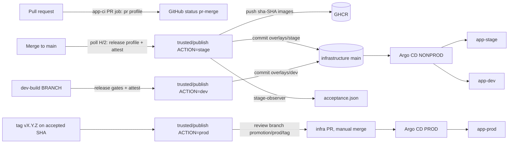

# CI/CD: Jenkins → GHCR → GitOps → Argo CD

How the Liora application gets from a pull request to DEV, STAGE and PROD, how to set the
pipeline up from zero and how to use and operate it. Owner of the Jenkins setup: Tatiana
Zainullina. Detailed history and evidence: [Phase 9](testreports/IMPLEMENTATION_PLAN.md#current-cicd-state--2026-10-25).

## 1. Overview

| Environment | How it is deployed | Gate |
| --- | --- | --- |
| DEV | manual: job `dev-build` with any branch | release gates (secrets, audits, image smoke, Trivy) |
| STAGE | automatic: every new commit on application main | release gates, then automatic acceptance |
| PROD | manual release: `vX.Y.Z` tag + reviewed infrastructure PR | accepted STAGE receipt for the exact SHA and image pair; no rebuild |

Key rules:

- **Only the trusted publisher holds write credentials** (`ghcr-write`, `gitops-app`). Builds run
  on `host-ci` without them. The publisher executes helpers only from an immutable, commit-pinned
  ConfigMap, never from a build checkout.
- **Images are immutable.** Tags are `sha-<full git sha>`, write-once in GHCR; deployments pin
  digests. PROD reuses exactly the digests that STAGE accepted.
- **Infrastructure Git is the desired state.** Jenkins only commits overlay files
  (`kubernetes/apps/liora/overlays/<env>/kustomization.yaml`, `promotion.json`,
  STAGE `acceptance.json`); Argo CD deploys.

## 2. Components

| Component | Where | Purpose |
| --- | --- | --- |
| Jenkins controller | NONPROD K3s, ns `jenkins`, `http://192.168.77.16:8085` (Tailscale) | jobs, credentials, history; zero executors |
| Agent `host-ci` + DinD | ns `jenkins-ci` | all builds and gates; no write credentials |
| Agent `registry-publisher` | ns `jenkins-publisher` | GHCR publication, infrastructure commits; mounts the helper bundle at `/opt/phase1-ci` |
| Agent `stage-observer` | ns `jenkins-acceptance` | read-only STAGE acceptance (Argo app, Deployments, Pods) |
| Job `app-ci` | multibranch, application repository | PR checks; `app-ci/main` builds main |
| Job `dev-build` | Pipeline from SCM, `Jenkinsfile.dev` | manual DEV deployment of any branch |
| Job `trusted/publish` | inline Pipeline, `Jenkinsfile.promote` | publication and promotion (`stage`, `dev`, `prod`) |
| Job `migration-ci` | manual checkpoint | functional-only candidate (historical), disabled in normal use |
| Argo CD | `https://192.168.77.16:8080` (NONPROD), `https://192.168.77.17:8080` (PROD) | deploys infrastructure main |

Source files:

| Repository | Path | What |
| --- | --- | --- |
| application | `Jenkinsfile` | profile selection (`pr` / `full` nightly / `release`), triggers, hand-off to the publisher |
| application | `Jenkinsfile.dev`, `Jenkinsfile.promote` | `dev-build` and `trusted/publish` definitions |
| application | `ci/phase1.py` | the 19 steps (18 gates + `attest`) and the profiles |
| application | `ci/registry.py`, `ci/promote.py`, `ci/publisher-action.sh` | trusted publication and GitOps writer |
| application | `ci/stage_acceptance.py` | acceptance checks run by the observer |
| application | `ci/validate.sh`, `ci/crd_schema.py`, `ci/crd-*.json` | strict validation of all overlays |
| application | `ci/RELEASE.md` | PROD release and rollback procedure |
| infrastructure | `kubernetes/platform/nonprod/jenkins/` | controller, agents, observer, JCasC, network policies |
| infrastructure | `scripts/kubernetes/prepare-jenkins-publisher-source.py` | builds the pinned helper bundle |
| infrastructure | `kubernetes/apps/liora/overlays/` | desired state written by the publisher |

### Gate profiles

| Profile | Used by | Steps |
| --- | --- | --- |
| `full` | nightly main (`H 2 * * *`) | all 18 gates + `gitops` |
| `pr` (temporary) | pull requests | `full` without `backend-integration` and `frontend-tests` |
| `release` | new commits on main | config, secrets, dependency installs and audits, image builds, non-root smokes, Trivy, `attest` |
| `dev` | `dev-build` | same as `release` |

`gitops` validates a fresh clone of infrastructure main with the change's validator.
`attest` writes `gates.json`; the publisher refuses main/DEV candidates without it.

## 3. Set up from zero

Run everything from management VM 200 in the infrastructure checkout, NONPROD kubeconfig
`$HOME/.kube/config-dev-stage`. Follow the linked runbooks for the exact commands.

1. **Prerequisites.** NONPROD and PROD K3s with Argo CD and Admin VIPs (Phases 6–8),
   Tailscale access ([runbook 16](../runbooks/16-private-platform-access.md)), GHCR packages
   `fastapi-backend` and `fastapi-frontend`, and the two GitHub Apps:
   - CI App (`github-ci-app`): application Contents/PR read, commit-status write;
   - `fastapi-gitops` (`gitops-app`): Contents and Pull requests read/write on **both** repositories.
2. **Controller.** Fresh install or restore
   ([runbook 17 §1](../runbooks/17-migrate-jenkins-ci.md),
   [runbook 23](../runbooks/23-restore-jenkins-controller.md)). Do not apply the fresh foundation
   over a restored home.
3. **Credentials** in Jenkins ([runbook 17 §2](../runbooks/17-migrate-jenkins-ci.md)):
   `github-ci-app` (CI scope), `gitops-app` and `ghcr-write` (trusted scope only).
4. **Agents and nodes** ([runbook 22](../runbooks/22-install-fresh-jenkins-agents.md)). The three
   inbound nodes `host-ci`, `registry-publisher`, `stage-observer` (one executor each, matching
   labels, remote root `/home/jenkins/agent`) must be declared in
   `agents/controller-config.yaml` (JCasC replaces the node list on every start). Create each
   agent's connection Secret; the observer's is `stage-observer-connection`, key `agent-secret`.
5. **Helper bundles** (§5 below), then apply the agent overlays:
   `kubectl apply -k kubernetes/platform/nonprod/jenkins/initial-cycle` and
   `kubectl apply -k kubernetes/platform/nonprod/jenkins/acceptance`.
6. **Jobs:**
   - `app-ci`: Multibranch Pipeline, GitHub source `fastapi-traefik-liora-application` with
     `github-ci-app`; discover branches and PRs (merge with target); filter `main PR-*`;
     property *Suppress automatic SCM triggering* (PR builds are started manually, main is
     driven by the Jenkinsfile triggers); optional periodic scan every 5 minutes so new PRs
     appear; orphaned item strategy: keep old items.
   - `trusted/publish`: folder `trusted`, Pipeline, definition *Pipeline script* = contents of
     `Jenkinsfile.promote`; approve it in *In-process Script Approval*.
   - `dev-build`: top-level Pipeline, *Pipeline script from SCM*, Git URL of the application
     repository (public, no credentials), branch `*/main`, script path `Jenkinsfile.dev`,
     **lightweight checkout on**.
7. **Activate** ([runbook 17 §4](../runbooks/17-migrate-jenkins-ci.md)): one controlled main
   build → publication → STAGE acceptance `accepted`; the first main build installs its own
   triggers from the Jenkinsfile.
8. **Release the startup hold:** if the controller shows the quiet-mode banner, check that only
   `app-ci`, `trusted/publish` and `dev-build` are enabled, then *Cancel Shutdown*.

## 4. Daily use

### Pull request
Open the PR → Jenkins `app-ci` → `PR-<n>` (or *Scan Multibranch Pipeline Now*) → *Build Now*.
GitHub shows `continuous-integration/jenkins/pr-merge`; merge only when it is green.

### STAGE
Nothing to do: merging to main triggers `app-ci/main` within ~2 minutes, then
`trusted/publish` (`ACTION=stage`). Expect two infrastructure commits
`chore(gitops): update stage for <sha>`; the second adds `acceptance.json` with
`"status": "accepted"`. A newer main commit supersedes an older one; failed acceptance
leaves the publisher build red and STAGE unchanged (no automatic rollback).

### DEV
Announce that DEV is taken → `dev-build` → *Build with Parameters* → `BRANCH=<branch>` →
publisher commits `update dev for <sha>` → Argo `app-dev` → `https://dev.liora.aprt.info`.
Deploying the SHA that DEV already runs is a no-op. Migrations of the branch apply to the DEV
database and cannot be rolled back.

### PROD release and rollback
See application `ci/RELEASE.md`: tag an accepted SHA, run `trusted/publish` with
`ACTION=prod`, `APP_SHA`, `RELEASE_TAG`, merge the generated infrastructure PR, verify
`https://liora.aprt.info`. Roll back by re-releasing the previous tag (a
`promotion/prod/<tag>-redeploy-<sha>` branch); check forward-only Alembic migrations first.

### Typical durations
`pr` ~20 min; `release` ~15 min; publisher ~20 min (archive copy) + acceptance ~3–5 min;
DEV end to end ~40 min; PROD release ~10 min plus PR review and Argo sync.

## 5. Changing the CI helpers (bundle pinning)

`ci/` changes affect builds immediately but the **publisher** only after re-pinning:

1. Infrastructure PR: `SOURCE_COMMIT` in `prepare-jenkins-publisher-source.py` and the ConfigMap
   name `jenkins-publisher-ci-<sha[:12]>` in `agents/workloads.yaml`.
2. VM 200: generate the bundle, compare `data_sha256`.
3. `kubectl apply -f <bundle>` **first**, confirm the ConfigMap exists, **then** `kubectl diff`
   and `apply -k …/initial-cycle`, `rollout status deploy/registry-publisher`.
4. If `Jenkinsfile.promote` changed: paste it into `trusted/publish` and approve it.

Old ConfigMaps remain for rollback. The observer bundle changes only when
`stage_acceptance.py` changes.

## 6. Troubleshooting

| Symptom | Likely cause | Action |
| --- | --- | --- |
| Quiet-mode banner after a restart | startup hold hook | check allowed jobs, *Cancel Shutdown* |
| Agent offline, `Handshake error` | node missing from JCasC or wrong secret | declare node in JCasC; recreate it with the same name |
| Publisher Pod `ContainerCreating` | bundle ConfigMap not applied | `kubectl apply -f <bundle>` |
| `Promotion failed (RuntimeError)` | validation of overlays failed (e.g. a new operator kind) | run `ci/validate.sh` locally against infrastructure main; regenerate CRD schemas |
| `could not find schema for <Kind>` | new CRD without a schema | `python3 ci/crd_schema.py <crd.json> v1`, commit the JSON |
| `secrets` gate fails | gitleaks finding | inspect `secrets-*.json` artifact; real secret → rotate; false positive → `.gitleaksignore` |
| `backend-security` / `*-image-security` fails | new CVE | upgrade the dependency or base image; never skip the gate on main |
| Acceptance `failed` | Argo not synced, wrong running digest or STAGE URL down | inspect Argo, Pod image IDs and `https://stage.liora.aprt.info` through HAProxy |
| PROD refused: "requires successful STAGE acceptance" | SHA/pair never accepted on STAGE | release an accepted SHA |
| Unit tests fail with `failed to resolve host 'db'` | DB test in the unit path | move it to the integration tests |

Collect for any failure: Console Output of the failed build, its time (UTC) and the
infrastructure commit, if any.

## 7. Known limitations

- Pull requests temporarily skip integration and e2e tests (nightly `full` runs them).
- No webhooks: Jenkins is private; main is polled, PR builds are started manually.
- Acceptance checks the health endpoint, which does not prove database connectivity.
- Bundle re-pinning is manual.
- The controller still starts in quiet mode after every restart.
