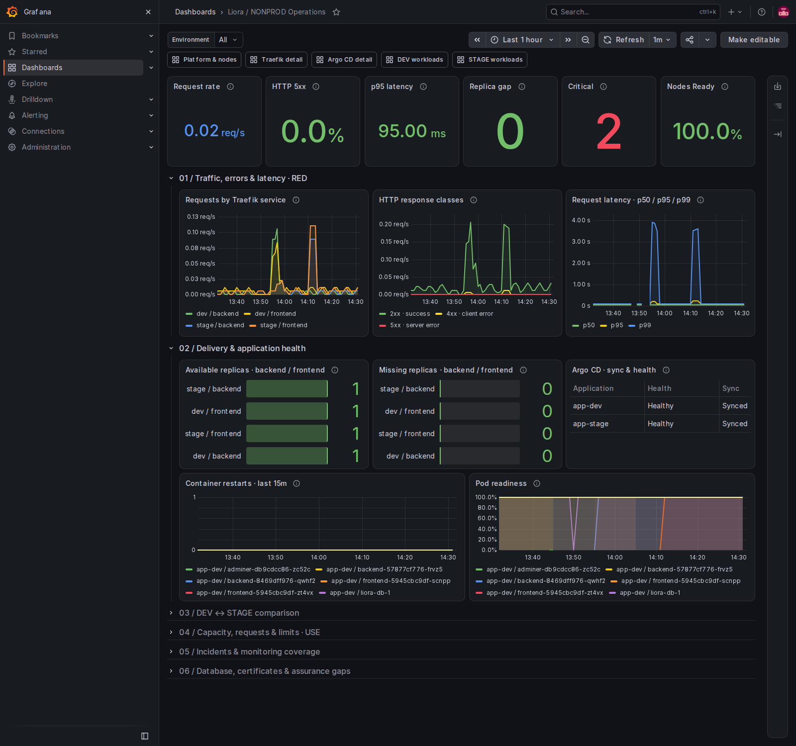
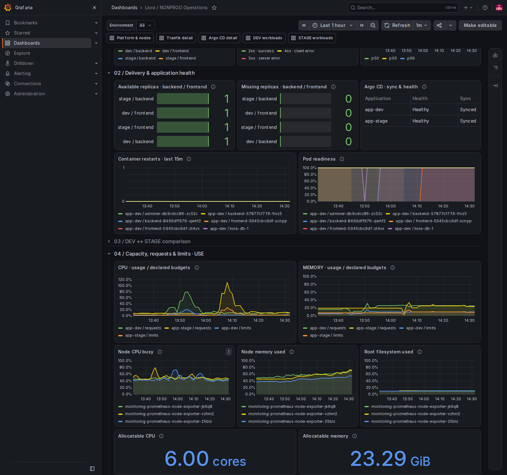
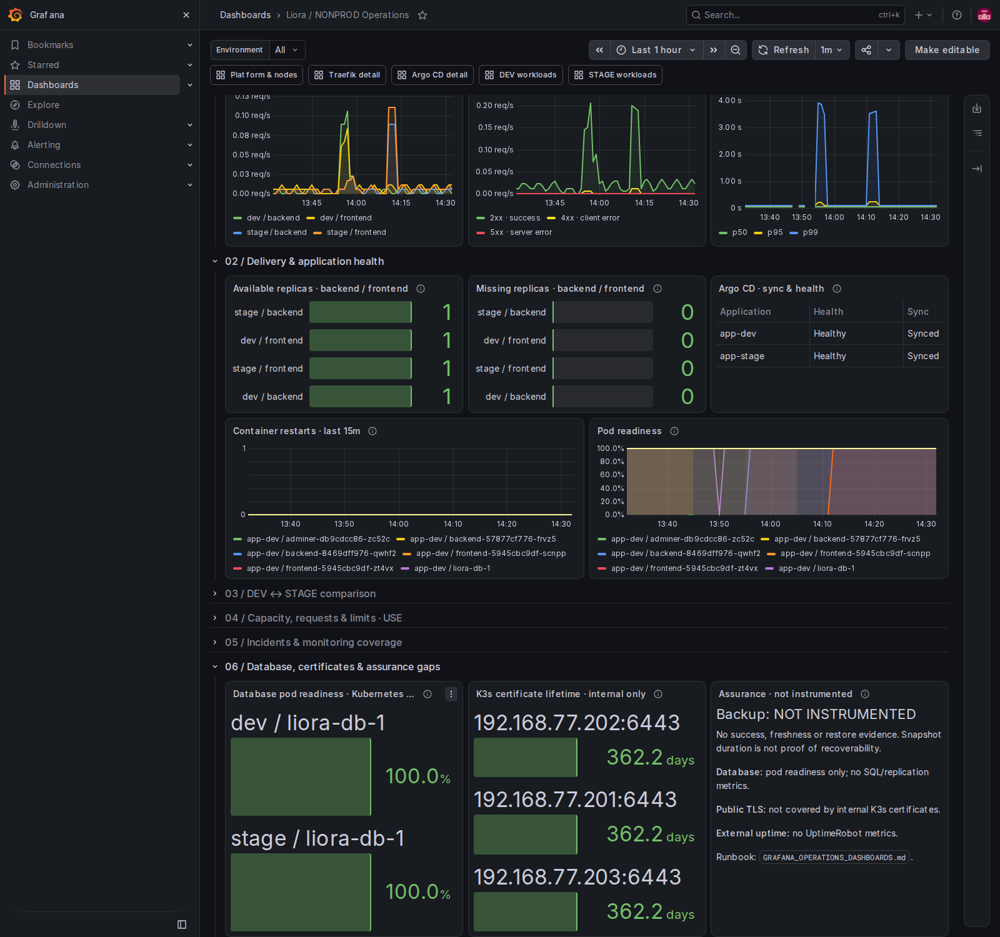

# Liora Grafana Operations dashboards

## Status and architecture

Prepared on **2026-10-23** using the existing Grafana **13.2.3** installations.
The two dashboards use the already supported **classic JSON schema 39**, native
Grafana panels and datasource UID **`prometheus`**. No new plugin, Helm setting,
scrape configuration, alert rule or application workload is required.

| Cluster | Operations dashboard | Stable UID | Status |
| --- | --- | --- | --- |
| NONPROD — DEV / STAGE | Liora / NONPROD Operations | `liora-nonprod-operations` | Deployed and browser-verified |
| PROD | Liora / PROD Operations | `liora-prod-operations` | Defined and query-validated; **not deployed**, approval required |

Live NONPROD URL: [Operations](http://192.168.77.16:3000/d/liora-nonprod-operations).
PROD's future URL is `http://192.168.77.17:3000/d/liora-prod-operations`;
it will exist only after approved deployment. There is no new PROD screenshot
because the dashboard has not been imported or deployed there.

NONPROD is a preview deployed from the reviewed feature-branch bundle. Merge the
PR to align `main` with that preview. The shared server checkout's concurrent
commits/edits were left intact; review and verification files were staged in
isolated temporary directories.

Each Grafana queries its own cluster's Prometheus. The datasource UID is the same
in these independent installations; it does not imply a shared datasource.
Application/service filters are explicit. Cluster-wide panels are labeled and
described as such, rather than pretending to be DEV/STAGE-specific measurements.

The [reference screenshot](https://github.com/dionis1/liora-devops-platform/blob/main/docs/screenshots/07-monitor-the-application/grafana-request-latency-errors.jpg)
inspired the dark palette, prominent KPI row and adjacent traffic/error/latency
charts. The new layouts add operational drill-downs and explicit telemetry gaps.

## Layout and operator workflow

Six first-row cards show request rate, 5xx fraction, p95 latency, replica gap,
cluster critical alerts and node readiness. Traffic is informational blue;
counts needing action are red above zero. Error-fraction guides are 1% warning
and 5% red; p95 guides are 300 ms and 1 second. These are display guides, **not
new SLOs or changes to Prometheus alert thresholds**.

The initial view contains 14 panels. Additional sections remain collapsed until
needed: 32 panels total in NONPROD, 31 in PROD. Refresh is one minute, matching
the cluster scrape/evaluation cadence; every new query declares a one-minute
Min step so `$__rate_interval` uses at least four scrape intervals.

| Section | Signals and scope |
| --- | --- |
| Traffic, errors & latency — RED | Per-service requests/sec, HTTP 2xx/4xx/5xx rates, aggregate p50/p95/p99 |
| Delivery & application health | Available/missing backend/frontend replicas, Argo CD health and sync, recent pod restarts, pod readiness |
| NONPROD comparison | Separate DEV/STAGE throughput, 5xx fraction and p95; narrowed by Environment selection |
| PROD investigation | 5xx request rate and p95 latency by actual production Traefik service |
| Capacity — USE | Namespace CPU/memory usage versus requests/limits; node CPU, memory and root-filesystem saturation; allocatable capacity |
| Incidents & monitoring coverage | Cluster warning/critical counts, firing alert labels, discovered target availability and per-job health |
| Database, certificates & assurance | Kubernetes readiness of observed database pods, internal K3s certificate lifetime, explicit instrumentation gaps |

Start with RED symptoms, identify the environment/service, inspect delivery and
readiness, then open capacity and incident sections. Links at the top lead to
the four existing detailed dashboards. NONPROD has separate DEV and STAGE
workload links, avoiding an invalid `app-dev|stage` value in the legacy selector.

## Metrics and important expressions

Live metadata and series were inspected in both Prometheus installations.
Traefik actually exposes:

- NONPROD: `app-dev-backend-80@kubernetes`, `app-dev-frontend-80@kubernetes`,
  `app-stage-backend-80@kubernetes`, `app-stage-frontend-80@kubernetes`.
- PROD: `app-prod-backend-80@kubernetes`, `app-prod-frontend-80@kubernetes`.

NONPROD's custom Environment selector supports DEV, STAGE and All.
Its namespace/application filter is `app-(${environment:regex})`; the Traefik
filter is `app-(${environment:regex})-(backend|frontend)-80@kubernetes`.
PROD uses literal `app-prod` selectors and
`app-prod-(backend|frontend)-80@kubernetes`; it has no NONPROD selector.
Prometheus regex matchers are anchored. Display transformations shorten legends
to `dev / backend`, for example, while queries retain the real service labels.

Representative PROD queries (NONPROD substitutes the selected environment):

```promql
sum by(service) (
  rate(traefik_service_requests_total{
    service=~"app-prod-(backend|frontend)-80@kubernetes"
  }[$__rate_interval])
)

histogram_quantile(0.95,
  sum by(le) (
    rate(traefik_service_request_duration_seconds_bucket{
      service=~"app-prod-(backend|frontend)-80@kubernetes"
    }[$__rate_interval])
  )
)

min by(instance) (
  k3s_certificate_expiration_seconds{job="apiserver"}
) / 86400
```

Other metric families are `kube_deployment_*`, `argocd_app_info`,
`kube_pod_container_status_restarts_total`, `kube_pod_status_ready`,
`kube_pod_status_phase`, cAdvisor CPU/working-set memory, container resource
requests/limits, node-exporter CPU/memory/filesystem metrics,
`kube_node_info`, `kube_node_status_condition`, `kube_node_status_allocatable`,
`up` and `ALERTS`.

The replica KPI counts missing availability as unavailable while desired replica
counts exist. It suppresses its value if desired-series coverage differs from
two backend/frontend deployments per observed Argo environment application.
Per-workload panels retain resource identity. This cross-check is not an
independent inventory if both GitOps and Kubernetes telemetry disappear together.

## Zero, absent and uninstrumented states

- Observed idle request counters produce **0 requests/sec**. No counter series
  produces **No telemetry**. Error classes absent from otherwise observed traffic
  may safely contribute zero; an error fraction requires a positive total rate.
- No requests can yield undefined histogram quantiles and no error fraction.
  Those KPI cards say **No traffic / telemetry**, rather than suggesting low
  latency or perfect success. Histograms provide bucket-based estimates;
  low-volume quantiles can be coarse and should not be treated as exact timings.
- A zero warning/critical count requires a healthy Prometheus self-scrape;
  there is no unconditional `or vector(0)` fallback. Incident tables may be empty
  when no matching alerts fire. Synthetic `purpose=test` alerts are excluded.
- Resource ratios require positive declared budgets. Missing budgets stay
  undefined. Namespace usage includes all observed application containers, so
  usage/request ratios can legitimately exceed 100%.
- Target availability describes **discovered** endpoints. An undiscovered job
  needs the existing missing-target/missing-metric alerts; a 100% discovered
  ratio alone does not establish complete monitoring coverage.
- Database panels measure **Kubernetes pod readiness only** for observed
  `liora-db-N` pods. No SQL connectivity, replication health, backup success,
  RPO or restore verification is inferred from that gauge.
- The certificate panel converts remaining K3s certificate lifetime from
  seconds to days. It uses API-server scrape instances to avoid duplicating
  embedded-component endpoints. It is **not public HTTPS certificate validity**.
- No CNPG/Postgres exporter, backup-health, public-certificate or UptimeRobot
  integration metrics were observed during validation. The assurance text says
  **NOT INSTRUMENTED**. K3s snapshot duration is not evidence of recoverability.

The final NONPROD screenshot's critical count of **2** was checked against live
`ALERTS`: `CNPGBackupTelemetryMissing` was firing for `app-dev` and `app-stage`.
Those are observed missing-telemetry alerts. Their presence does not establish
backup failure or successful recovery, and this dashboard task did not modify
the backup system or alert rules.

## Existing dashboard fixes

The four existing dashboard UIDs remain intact in each cluster:
`platform-nodes`, `ingress-traefik`, `gitops-argocd`, and
`dev-stage-workloads` (NONPROD) / `prod-workloads` (PROD).
NONPROD's original ConfigMap was not changed by the deployment.

The PR fixes three PROD definitions while preserving their UIDs:

1. Traefik service request and p95 queries now match actual PROD services,
   replacing the copied DEV/STAGE regex.
2. Platform Overview expects **one `app-prod` Argo application** for Healthy and
   Synced counts; green begins at 1, with matching descriptions.
3. `PROD / PROD Workloads` becomes `PROD / Workloads`. The historical ConfigMap
   data key is retained to avoid unnecessary provisioning churn.

These PROD corrections remain **undeployed until approval**, along with the
new PROD Operations dashboard. Existing PROD browser checks establish that the
current dashboards load, not that these pending corrections are live.

## Provisioning, validation and deployment

Each cluster has a separate `operations-dashboard.yaml` ConfigMap named
`monitoring-operations-dashboard`, labeled `grafana_dashboard: '1'` in namespace
`monitoring`. The corresponding monitoring Kustomization includes it. The
existing Grafana sidecar discovers the file; its provider polls every 30 seconds.
No Helm-managed object or Prometheus Operator resource was edited.

Rebuild and validate from the infrastructure root:

```sh
python3 scripts/kubernetes/build-operations-dashboards.py
python3 scripts/kubernetes/validate-operations-dashboards.py \
  --promtool /path/to/promtool --kustomize /path/to/kustomize
```

This checks JSON/YAML, manifest rendering, datasource and dashboard UIDs, panel
IDs/grid bounds, generated-source consistency and PromQL syntax. Behavioral
fixtures check idle/absent traffic, error fractions, anchored incident counts,
missing replica telemetry, incomplete desired inventory and missing Ready data.

Live validation on the management server:

```sh
python3 scripts/kubernetes/validate-operations-dashboards.py \
  --cluster nonprod --prometheus-url http://192.168.77.16:9090 \
  --report .local-work/grafana-nonprod-validation.json
python3 scripts/kubernetes/validate-operations-dashboards.py \
  --cluster prod --prometheus-url http://192.168.77.17:9090 \
  --report .local-work/grafana-prod-validation.json
```

The validator verifies Prometheus cluster identity and executes every query
variant, including DEV/STAGE/All substitutions and one-hour range queries for
time series. It requires finite results for critical operational panels, while
recording legitimate empty/undefined results separately. A passing query is not
evidence that an uninstrumented service is healthy.

**Validation results:** 140 NONPROD and 79 PROD query variants passed; all four
legacy dashboards remain present. Browser verification loaded all four old
dashboards in each cluster without datasource query errors. NONPROD's new
dashboard was checked with DEV/STAGE selection and real query interpolation,
all collapsible sections, and screenshots. See
[the verification record](evidence/grafana-operations-validation.json) for final
timings, observations and deployment scope.

Chrome released four completed HTTP-200 response bodies during navigation in
the final browser pass. The verifier records those observation limits separately
from datasource failures; they are not evidence of query errors. All dashboard
queries were also validated directly against Prometheus, and native panel error
states and actual DEV/STAGE query interpolation were checked in the browser.

Twelve bounded, read-only NONPROD login/health GETs were served through the
documented private HTTPS edge with certificate validation. Public DNS-based
probes from the management host failed; they were not used as evidence of
external availability. No production application traffic or application writes were generated.

After **explicit PROD approval**, save the existing PROD dashboard ConfigMap
privately, then apply only the dashboard resources:

```sh
kubectl --kubeconfig "$HOME/.kube/config-prod" -n monitoring \
  apply --dry-run=server -f kubernetes/platform/prod/monitoring/operations-dashboard.yaml
kubectl --kubeconfig "$HOME/.kube/config-prod" -n monitoring \
  apply -f kubernetes/platform/prod/monitoring/dashboards.yaml \
        -f kubernetes/platform/prod/monitoring/operations-dashboard.yaml
```

Wait for sidecar provisioning, verify five UIDs and the corrected titles/queries,
then run the browser verifier through the existing local Python/browser runtime:

```sh
bash scripts/local-python.sh scripts/kubernetes/verify-operations-dashboard-ui.py \
  --cluster prod --screenshots .local-work/grafana-prod-screenshots
```

Before PROD approval, `--legacy-only` safely checks just its existing dashboards.
Do not import via the Grafana API as a second persistent resource manager, reset
the shared server checkout, restart Grafana unnecessarily, or apply unrelated
monitoring resources just to update dashboards.

## Screenshots, exam demonstration and rollback

Actual NONPROD screenshots from the deployed dashboard:







For an exam, show Environment All, DEV and STAGE; explain a traffic/error/latency
change; open replica and GitOps detail links; expand capacity and incident
sections; show that database readiness, internal certificates and backup gaps
have distinct meanings. Explain the PROD approval boundary. Capture PROD only
after approved deployment and verification. Keep credentials and browser sessions
out of evidence; the browser helper never logs filled password values.

The initial NONPROD rollback snapshot is on the management server at
`/home/root-admin/.local/state/liora-grafana/20261023T135346Z/nonprod`.
It records the four unchanged legacy dashboards and the previously absent
Operations ConfigMap. To undo this addition, revert its Kustomization entry in
Git, then deliberately remove **only** the new Operations ConfigMap in the
approved cluster. The existing provider has `disableDelete: true`, so a stored
dashboard may persist after its file disappears; verify this and, if necessary,
approve cleanup of only the new UID after the file source is removed. Never
delete the Grafana namespace, datasource, legacy dashboards, PVCs or Secrets.

For a bad revision, prefer reapplying the last known-good Operations ConfigMap
with its stable UID. For the PROD legacy fixes, restore only the saved legacy
ConfigMap/reverted Git version. Dashboard rollbacks need no Helm rollback.

References: [Grafana file provisioning](https://grafana.com/docs/grafana/latest/administration/provisioning/#dashboards),
[classic JSON models](https://grafana.com/docs/grafana/latest/dashboards/build-dashboards/view-dashboard-json-model/),
[Prometheus rate intervals and Min step](https://grafana.com/docs/grafana/latest/datasources/prometheus/template-variables/).
