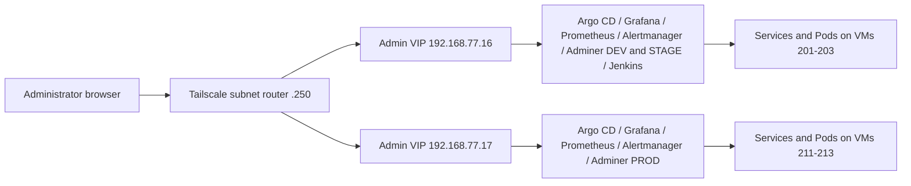

# Kubernetes implementation plan

Implementation update: **2026-10-22**. Phases 0–7 are complete within their
recorded acceptance boundaries. Phase 8 is deployed in both clusters and local
functional/browser checks passed, including the NONPROD Jenkins foundation.
The approved status guard resolved the ServiceLB incompatibility. The operator
confirmed that all interfaces work through Tailscale and all passwords succeed
on 2026-10-22. **Phase 8 is complete.**
See [the Phase 8 report](PHASE8_REPORT.md).

## Target architecture

The final state uses two independent K3s clusters and three application
environments. DEV and STAGE share one cluster but have separate namespaces and
data. PROD runs on its own cluster.

| Component | Dev/stage cluster | Prod cluster |
| --- | --- | --- |
| K3s | VMs 201–203; API VIP `192.168.77.11` | VMs 211–213; API VIP `192.168.77.12` |
| Private administration | Admin VIP `192.168.77.16`; services-only kube-vip | Admin VIP `192.168.77.17`; independent services-only kube-vip |
| Application | `app-dev` and `app-stage` namespaces | `app-prod` namespace |
| GitOps | Own Argo CD, AppProject, and root Application | Independent Argo CD, AppProject, and root Application |
| Sync | Reviewed PR, then auto-sync, self-heal, and reviewed pruning | Reviewed PR, then auto-sync and self-heal; no automatic pruning |
| Secrets | Cluster-specific Sealed Secrets key; GHCR pull credentials per namespace | Separate controller key and GHCR pull credentials |
| Data | Separate DEV and STAGE databases | PROD database with tested backups and restore |
| Monitoring | Cluster monitoring and administrative Grafana | Separate monitoring and controlled access to PROD metrics |
| Jenkins | One controller in namespace `jenkins`; own persistent volume; CI migration in Phase 9 | No separate Jenkins controller; reviewed promotion and local Argo CD deploy PROD |

The existing public path is Cloudflare DNS-only → Proxmox TCP/80,443 DNAT →
HAProxy edge VM 240 → the selected cluster's Traefik ingress → application
Services. Public ingress uses node pools `.201`–`.203` and `.211`–`.213`,
separate from API VIPs and the new Admin VIPs. Keep this working path unchanged
while adding private administration.

The target database platform is CloudNativePG. The initial deployment below
deliberately retains the application's current PostgreSQL Deployment and PVC;
database migration is a later, separately verified change. The original kube-vip
DaemonSets serve the API only, and K3s ServiceLB serves public Traefik. Independent
services-only DaemonSets now serve administrative Services in each cluster;
do not repurpose the API DaemonSets or change public ingress ownership.

### Agreed private access and service addresses

Trusted administrators reach the whole `192.168.77.0/24` subnet through the
existing Tailscale router. Use browser access by IP and port, with no private
ingress, DNS records, additional reverse proxy, SSH tunnel or manual
port-forward. The operator confirms `.16` and `.17` are available and assigns
them to this purpose. Both are now deployed and locally verified; external
Tailscale browser access and passwords were confirmed by the operator on
2026-10-22.



| Interface | DEV/STAGE endpoint | PROD endpoint | Current state / native service |
| --- | --- | --- | --- |
| Kubernetes API | `https://192.168.77.11:6443` | `https://192.168.77.12:6443` | Existing; API VIPs stay unchanged |
| Argo CD | `https://192.168.77.16:8080` | `https://192.168.77.17:8080` | Deployed; native HTTPS server |
| Grafana | `http://192.168.77.16:3000` | `http://192.168.77.17:3000` | Deployed; native HTTP and Grafana login |
| Prometheus | `http://192.168.77.16:9090` | `http://192.168.77.17:9090` | Deployed; native HTTP |
| Alertmanager | `http://192.168.77.16:9093` | `http://192.168.77.17:9093` | Deployed; native HTTP |
| Adminer DEV | `http://192.168.77.16:8081` | — | Existing `app-dev/adminer:80`; database login |
| Adminer STAGE | `http://192.168.77.16:8082` | — | Existing `app-stage/adminer:80`; database login |
| Adminer PROD | — | `http://192.168.77.17:8081` | Existing `app-prod/adminer:80`; database login |
| Jenkins | `http://192.168.77.16:8085` | — | Controller/UI deployed; working CI migration in Phase 9 |

Use the HTTP/HTTPS and authentication supplied by each service. Do not add TLS
termination, a private CA, new certificates, SSO or an authentication proxy for
Admin VIP access. Argo CD currently has its bootstrap self-signed certificate;
an IP URL is not a promise of warning-free browser TLS. Configure native base
URLs and redirects for the chosen external IP and port where required.
Retain native logins for Argo CD, Grafana, Jenkins and Adminer. Prometheus and
Alertmanager retain their native access model inside the trusted subnet.

No additional Tailscale grants/ACL restrictions or firewall hardening are part
of this increment. Do not create public NAT or HAProxy routes to Admin VIPs.
Record any NodePort allocation required by the implementation; do not describe
VIP access as restricting other private access paths. PostgreSQL, Redis, Docker
daemons and metrics endpoints do not receive administrative browser endpoints.

### Admin VIP ownership and implementation constraints

- Use kube-vip **v1.2.3**, services-only mode, with one common service leader
  per cluster for all Services sharing its Admin VIP. Its election and lease
  must be independent of the existing API leader and `plndr-cp-lock`.
- Set the intended VIP explicitly on every administrative LoadBalancer
  Service; use distinct exposed ports on each shared VIP, including the two
  nonprod Adminer Services in their separate namespaces.
- Check the exact v1.2.3 configuration and shared-VIP election behavior before
  applying it. Do not assume independent per-Service leaders can safely own
  the same address. If the agreed ownership cannot be implemented as planned,
  report the discrepancy before changing the architecture.
- Give the new DaemonSet distinct names, labels/selectors and appropriate
  service-account/RBAC resources. Avoid hostNetwork listener conflicts: the
  existing API kube-vip exposes metrics on `2112`.
- Use strict LoadBalancer class handling so services-only kube-vip does not
  claim public Traefik and ServiceLB creates no administrative DaemonSets.
  The installed K3s EndpointSlice worker still attempts foreign status writes;
  the operator approved a native status-owner admission guard, verified on
  NONPROD before PROD. Only kube-vip-admin may update this class's status.
  Record its denied-write retries and preserve both API DaemonSets, their
  leases and public ingress. See the [decision](PHASE8_ADMIN_VIP_DECISION.md).
- One shared leader is an address-ownership choice. It does not establish
  service, storage or host high availability. Failover, reboot, outage timing,
  load and resilience tests are deferred and are not Phase 8 acceptance gates.

### Remaining infrastructure and later target components

| Component | Address / placement | Target or current responsibility |
| --- | --- | --- |
| Public application | `dev.liora.aprt.info`, `stage.liora.aprt.info`, `liora.aprt.info` over HTTPS | Existing application-only HAProxy/Traefik path |
| Proxmox | `192.168.77.1`; native management UI on 8006 | Existing host administration; outside Admin VIPs |
| Management VM 200 | `192.168.77.200` | Terraform, Ansible, explicit cluster kubeconfigs and certificate distribution |
| HAProxy / Certbot VM 240 | `192.168.77.240` | Existing public routing and ACME renewal |
| Tailscale router VM 250 | `192.168.77.250` | Existing subnet access |
| Application internals | Separate namespaces and PVCs | Frontend, backend, PostgreSQL, Adminer and prestart Job remain |
| Cluster internals | Each independent K3s cluster | API/etcd, CoreDNS, Metrics Server, local-path provisioner, Traefik and ServiceLB remain |
| Argo CD internals | Each cluster's `argocd` namespace | Independent controller, repo server, Redis, Dex, ApplicationSet and notifications components |
| Monitoring internals | Each cluster's `monitoring` namespace | Prometheus Operator, kube-state-metrics, Node Exporter, scrape configuration, dashboards and alerts |
| CI agents / registry publisher / build daemon | DEV/STAGE CI platform; Phase 9 | Preserve existing CI/publisher separation; no extra browser ports |
| GitHub / GHCR | External existing services | Source, reviewed promotion changes and container registry |
| Slack | Existing kind destination available; new-cluster destination not yet confirmed | Configure delivery only after destination agreement; no assumption of verified notification receipt |
| Sealed Secrets | Separate controllers and keys; later platform phase | Cluster-specific encrypted Secret management |
| CloudNativePG and backups | Later database phase | Replace PostgreSQL incrementally after backup/restore verification; backup destination remains to be selected |

VM 100, its legacy kind deployment and existing public administrative NAT
rules are outside this implementation's change scope. The operator will retire
them after the replacement platform and CI are working. Phase 8 alone does not
make VM 100 ready for shutdown, because working CI moves in Phase 9.

### Target repository layout

```text
docs/testreports/           Plans and phase reports
kubernetes/
  apps/liora/
    base/
    overlays/dev/
    overlays/stage/
    overlays/prod/
  gitops/argocd/
    nonprod/                 root app, project, DEV/STAGE apps, bootstrap
    prod/                    independent root app, project, PROD app, bootstrap
  platform/
    base/                    shared platform resources where appropriate
    nonprod/
      admin-access/          services-only kube-vip and private access resources
      monitoring/            nonprod storage, retention, dashboards and alerts
      jenkins/               controller, JCasC, storage and administrative Service
    prod/
      admin-access/          independent VIP ownership and private access resources
      monitoring/            independent PROD monitoring configuration
scripts/kubernetes/          reusable operator helpers
runbooks/                    installation and recovery procedures
.local-work/                 ignored tools, rendered output and operator evidence
```

The Phase 8 platform directories now exist alongside preserved upstream source. Keep
namespace-specific administrative Services with clear, single ownership:
application namespace exposure belongs with its environment overlay; platform
configuration must not silently compete with an existing Argo CD owner.

The Phase 0 baseline report and migration instructions accompany this plan.
The application base and overlays have been imported with selected history;
see [Phase 1 report](PHASE1_REPORT.md). All three overlays render with real,
pinned images, including the approved PROD pair. DEV, STAGE and PROD are
deployed and privately verified in Phases 3–5, including mutual isolation.
PROD uses one backend worker per Pod with two replicas after its compatibility
fix. The migration is integrated into the original checkout on `main`. Never
commit live credentials, controller private keys, or state.

### Target ownership and source files

- The application repository retains application code, tests, image builds,
  release tags, and the Jenkins pipeline that publishes images. This
  infrastructure repository owns deployed image digests, Kustomize overlays,
  Argo CD configuration, cluster services and Jenkins deployment/bootstrap
  configuration. Work in the original infrastructure checkout with ignored
  `.local-work/` tools; no temporary working checkout is needed.
- The first migration copies `deploy/base/` and
  `deploy/overlays/{dev,stage,prod}/` from the application repository. The
  later CloudNativePG migration replaces `configmap-db.yaml`,
  `deployment-db.yaml`, `service-db.yaml`, and `pvc-db.yaml` in the active
  base. Remove Adminer only after an alternative operational path works.
- Adapt `argocd/app-dev.yaml`, `app-stage.yaml`, and `project.yaml` for
  the nonprod cluster. Create independent PROD equivalents, bootstrap
  resources, and root Applications. Each Argo CD points to this repository
  and deploys to its own cluster via `https://kubernetes.default.svc`.
  The existing `argocd/applicationset.yaml` cannot be copied unchanged:
  it creates all three environments in one cluster.
- Adapt `monitoring/values.yaml`, `kustomization.yaml`,
  `dashboards/platform.yaml`, `monitors/{argocd,traefik}.yaml`, and
  `rules/dev-stage.yaml` when adding monitoring. Replace kind-specific
  storage assumptions and create distinct PROD settings.
- Treat `infra/jenkins-host/` in the application repository as the source of
  the working Jenkins proof of concept. Preserve as much as possible: pinned
  controller/agent/build-daemon images, Dockerfiles and tool/plugin locks,
  JCasC, Job DSL, pipeline definitions, credential IDs/scopes and the separation
  between CI and trusted publication. Adapt deployment details for K3s rather
  than replacing the working design. Record source revisions, path mappings
  and intentional deviations; preserve selected source history when importing
  platform files. The currently reviewed application source is
  `b98a22e48527c256193ed65c10307eb574b27ab6`; recheck before importing.
- Keep live Jenkins home, build history, artifacts, credentials and encryption
  keys as private operator data. Preserve them during Phase 9 migration and
  keep a consistent recovery copy; do not copy them into tracked manifests.
  Phase 8 must not start migrated polling, builds or publication alongside the
  existing jobs on VM 100.
- Move promotion to reviewed changes in this repository. Adapt
  `ci/promote.py`, `promote-stage.sh`, `publish.sh`, `registry.py`, and
  `Jenkinsfile.promote` without executing trusted publishing code from an
  untrusted application checkout. Add rendering and placeholder-image checks
  for all three overlays. The GitOps GitHub App needs access to this repository.
- Do not deploy the application's historical `k8s/` tree, old SealedSecret
  ciphertext, or application `.env` files. Review `infra/jenkins-host/`
  separately from the Kubernetes manifests.

## Implementation order

Write all new implementation plans and phase reports in `docs/testreports/`.

First run the application's **current deployment** on the new clusters with the
fewest necessary changes. Verify DEV, STAGE, and PROD independently. Add GitOps,
public access, monitoring, and platform replacements in later, separate steps.
Complete the check for each phase before starting the next.

The operator authorized execution of this plan on 2026-10-21. Execute Phase 8
substeps in order, keep changes small and report actual readiness separately
from deferred tests. VM 100 retirement and legacy NAT removal remain operator
work outside these steps. Do not begin Phase 9 as part of Phase 8.

Copy deployment files from the
[application repository](https://github.com/fastapi-traefik-devops/fastapi-traefik-liora-application).
It was reviewed at commit `3a610ebb14f265fcdeb5a1d4d59da9fa543648c5`;
record the actual source commit when copying. Its historical `k8s/` tree and
this repository's `examples/kubernetes/` are references, not deployment sources.

## Phase 0 — Establish the baseline

Status on 2026-10-21: **complete, including the storage verification subsequently
performed in Phase 2**. Phase 0 itself was read-only. The operator authorized
Phase 1 before live storage checks, then explicitly authorized Phase 2.
See the [Phase 0 baseline](PHASE0_BASELINE.md) for the original observations and
[Phase 2 report](PHASE2_REPORT.md) for completed namespace, Secret and storage
verification.

- [x] Confirm both K3s contexts work from management VM 200 and all six nodes
      are Ready. Keep the dev/stage and prod contexts distinct.
- [x] Record the source commit, DEV/STAGE image digests, and image digests
      selected for the first PROD deployment.
- [x] Confirm each cluster has a working StorageClass and enough capacity for
      the existing PostgreSQL PVCs and application replicas.
- [x] Locate the credentials needed for `ghcr-pull-secret`, `backend-secrets`,
      and `db-secrets` in each application namespace. Keep live values in the
      external recovery archive, not Git.

Verified: both contexts and all six Ready nodes; all source overlays render;
source/image references and approved PROD digests recorded. Both default
local-path provisioners are Running and reported capacity is sufficient.
Phase 2 created a temporary 1Gi RWO PVC and consumer Pod in each target namespace;
all bound to local-path and passed write/read checks. Probe resources and PVs
were removed. A STAGE runtime interruption passed on retry and is documented
in the Phase 2 report.

Fresh, separate backend/database credentials reside in ignored
`recovery/recovery.yaml`, with registry credentials in ignored `recovery/.env`.
Phase 2 created and verified the corresponding live Secrets in each namespace.
No credential values were committed. Phases 3–5 subsequently deployed and
verified all three application environments.

**Pass:** both clusters, storage, image versions, and credentials are ready.

## Phase 1 — Copy the current application deployment

Status on 2026-10-21: **complete for local import and rendering**. The operator
approved the current STAGE pair for PROD; both images are pinned by digest.
See [Phase 1 report](PHASE1_REPORT.md). Phase 1 used the isolated branch
`migration/liora-phase0` at `/home/root-admin/liora-infrastructure-migration`.
It was later integrated without rewriting imported history; that temporary
worktree and fully merged branch were removed. Work now uses the original checkout.
The deployment source is upstream `b98a22e48527c256193ed65c10307eb574b27ab6`;
its newer STAGE promotion matches kind. The selected history was scanned and
imported, and the new runbook and navigator links are present. No live application deployment was attempted.

- [x] Copy **all** of `deploy/base/` to `kubernetes/apps/liora/base/`, including
      PostgreSQL, its PVC and Service, Adminer, the prestart Job, backend,
      frontend, Ingress, and the existing `kustomization.yaml`.
- [x] Copy `deploy/overlays/{dev,stage,prod}/` to matching directories in
      `kubernetes/apps/liora/overlays/`. The Kustomize files are required;
      DEV/STAGE `promotion.json` files are records, not deployment inputs.
- [x] Render all three overlays with explicit-kubeconfig `kubectl kustomize`;
      inspect namespaces, images, replicas, Secret references, and Ingress hosts.
- [x] Replace PROD's `sha-000000...` placeholders with **existing, selected**
      backend and frontend digests. Limit other edits to K3s compatibility
      and the operator-requested domain/administrator configuration.

Operator-requested configuration is now `dev.liora.aprt.info`,
`stage.liora.aprt.info`, and `liora.aprt.info`, with initial administrator
`admin007@liora.aprt.info`. The ignored recovery file uses the same identity.
DEV retains HTTP and its source `ENVIRONMENT: staging`; STAGE/PROD retain
HTTPS and the `app-tls` dependency. PROD uses tag
`sha-c375967ac5b3dd7a0a6867758e16b057c733bb2d`, backend digest
`sha256:f1a896fbc915f1f19416882fee62bf4db275860f9225d9004ac59ba9a005dc5d`,
and frontend digest
`sha256:7d1ac191287e0498434049d4e569aa8f8a8ed2dbd19921e20bc566c95b2a4c91`.
No DNS, TLS or public ingress was set up.

**Pass:** three overlays render with real images and the active base retains
the current working stack. Do not copy Argo CD, monitoring, Jenkins, or the
historical `k8s/` tree in this phase.

## Phase 2 — Prepare namespaces and credentials

Status on 2026-10-21: **complete**. See [Phase 2 report](PHASE2_REPORT.md).
Namespaces are Active, all nine required Secrets match local recovery material,
and temporary default-StorageClass PVC probes passed in every namespace. The
probe Pods, PVCs and dynamically provisioned PVs were removed. All six nodes
are Ready. The subsequent DEV deployment is recorded in Phase 3 below.

- [x] Create `app-dev` and `app-stage` on the dev/stage cluster and `app-prod`
      on the prod cluster.
- [x] Restore or create `ghcr-pull-secret`, `backend-secrets`, and `db-secrets`
      in each namespace; ensure backend and database credentials agree.
- [x] Confirm PVC provisioning uses the intended K3s StorageClass.

**Pass:** every target namespace has the required Secret names and can
provision its own PVC. Do not print Secret values into logs.

## Phase 3 — Deploy and verify DEV

Status on 2026-10-21: **complete**. See [Phase 3 report](PHASE3_REPORT.md).
DEV's application PVC is Bound, PostgreSQL and all application Deployments are
Ready, prestart completed, and private browser login plus persisted item
creation/read/update passed. The initially generated administrator passwords
exceeded the application limit; they were corrected to 32 characters in ignored
recovery and the three backend Secrets. No database passwords or signing keys
changed. A bootstrap length guard now prevents that error.

At Phase 3 completion the DEV marker was recorded in
`/home/root-admin/liora-render/dev/acceptance.json` for Phase 4 isolation checks.
All synthetic markers were subsequently removed, and old evidence was archived;
see [local workspace guidance](../LOCAL_WORKSPACE.md). Public routing and
trusted TLS were unverified at that point and were completed in Phase 7.
At Phase 3 completion STAGE/PROD application workloads were not deployed.
STAGE was subsequently deployed and verified in Phase 4 below.

- [x] Deploy the DEV overlay to `app-dev` on the dev/stage cluster. Bring up
      PostgreSQL before relying on the prestart migration Job.
- [x] Check PVC Bound, PostgreSQL Ready, prestart Complete, and backend,
      frontend, and Adminer Ready.
- [x] Through private access, check backend health, UI login, and a basic
      read/write operation against the DEV database. Record applied digests.

**Pass:** DEV works end to end without public DNS or TLS. With direct
`kubectl apply`, Argo CD sync-wave and hook annotations do not order the
prestart Job; verify database readiness and Job completion explicitly.

## Phase 4 — Deploy and verify STAGE

Status on 2026-10-21: **complete**. See [Phase 4 report](PHASE4_REPORT.md).
STAGE's separate 1Gi local-path PVC is Bound, all four Deployments have one
Ready replica, and prestart completed. Private browser login, item creation,
editing and persistence passed. Both environments return their own marker and
404 for the other marker; direct SQL confirms one own row and zero foreign
rows. Cross-environment tokens are rejected with HTTP 403. DEV stayed healthy
with unchanged workloads and zero restarts. All six nodes are Ready.

Both synthetic markers were retained through Phase 5, then removed after all
three environments passed mutual isolation. PROD deployment is recorded below;
public routing and trusted TLS remain pending.

- [x] Deploy the STAGE overlay to `app-stage` on the dev/stage cluster, with
      its own Secrets and PVC. Verify PostgreSQL before the prestart Job.
- [x] Check workloads, backend health, UI login, and a database read/write
      operation through private access.
- [x] Confirm DEV stays healthy and STAGE data remains isolated.

**Pass:** DEV and STAGE work independently on VMs 201–203.

## Phase 5 — Deploy and verify PROD

Status on 2026-10-21: **complete**. See [Phase 5 report](PHASE5_REPORT.md).
PROD's own 1Gi local-path PVC is Bound and prestart completed. PostgreSQL and
Adminer are Ready; two backend and two frontend replicas are Ready on k3s-2
nodes. Initial four-worker backend Pods repeatedly lost child workers, with no
recorded cgroup OOM kills. The explicit single-worker command used by DEV/STAGE
resolved readiness while retaining two PROD replicas and the approved digests.
The underlying multiworker failure remains unconfirmed; this is not a load test.

Private browser login and item creation/editing/persistence passed. All six
directed marker checks and six foreign-token checks passed. SQL found only each environment's own
marker. The three synthetic items were then removed, with API/SQL absence and
health rechecked. DEV/STAGE workload snapshots stayed unchanged, with zero
restarts; all six nodes are Ready. Public routing and trusted TLS remain pending.
Phase 6 followed this acceptance and is recorded below.

- [x] Deploy the PROD overlay with real, selected image digests to `app-prod`
      on the prod cluster, with its own Secrets and PVC.
- [x] Check prestart, both application replicas, backend health, UI login,
      and a database read/write operation through private access.
- [x] Confirm PROD runs on VMs 211–213 and both nonprod environments remain
      healthy. Record the deployed digests.

**Pass:** all three environments run the current stack on their assigned
clusters. Public routing and real domains come later.

## Phase 6 — Install separate Argo CD instances

Status on 2026-10-21: **complete**. See [Phase 6 report](PHASE6_REPORT.md).
Both independent Argo CD v3.5.6 installations and private UI logins passed.
Manual, hook-enabled application adoption and both root reconciliations passed.
The operator authorized integration and publication; the history-preserving
branch was fast-forwarded into original `main` and published. The latest
operator runbook edits were preserved.

Both roots and all three children are Synced/Healthy with automation and
self-healing enabled. Nonprod child pruning was enabled after reviewing the
12-resource inventories with no unexpected prune candidates. PROD and both
roots keep pruning disabled; PVC retention annotations remain. Each environment
passed an automated ConfigMap drift correction. Original application Pod, PVC,
Secret and Deployment identities, data bindings and schema revision remain
unchanged; private application login/health checks passed. Phase 7 followed this
acceptance and is recorded below.

- [x] Install one Argo CD in dev/stage and another in prod; check both admin
      UIs through private access.
- [x] Adapt application-repository `argocd/app-dev.yaml`,
      `app-stage.yaml`, and `project.yaml` into
      `kubernetes/gitops/argocd/nonprod/`. Create the PROD Application and
      project in `kubernetes/gitops/argocd/prod/`. Source this repository.
- [x] Target each Application at its **local** cluster and correct namespace.
      Inspect diffs before Argo CD takes ownership of the manual deployment;
      enable automation only after correct reconciliation. Review the effects
      of pruning separately.
- [x] Verify correct digests, healthy workloads, and no unexpected deletion
      in each Argo CD instance.

**Pass:** each Argo CD manages only its own cluster. Do not copy
`argocd/applicationset.yaml` unchanged: it targets all three environments
in one cluster.

## Phase 7 — Publish the application

Status on 2026-10-21: **complete for direct DNS-only origin access**. See
[Phase 7 report](PHASE7_REPORT.md). The three real domains resolve to the public
Proxmox origin. VM 240 at `192.168.77.240` runs application-only HAProxy routing;
public 80/443 DNAT preserves the existing SSH and unrelated host rules. Distinct
node ingress pools reuse ServiceLB rather than the API VIPs or new floating VIPs.

Trusted per-host certificates are installed in each app namespace. DEV now uses
HTTPS CORS/origin and its backend was rolled to load the new environment.
Canonical HTTPS browser login/item persistence and mutual API/SQL/token isolation
passed for all three environments. The operator independently confirmed all three
URLs load externally without certificate warnings. Test items were removed.
Certbot renewal simulations and the management certificate-distribution service
passed; both timers are enabled. Argo CD remains Synced/Healthy.

Cloudflare currently supplies DNS only: proxied traffic and Full (strict) mode
were not configured or verified. Dedicated floating ingress VIPs, edge failover,
reboot persistence and a later unattended renewal cycle remain untested.
Phase 8 progress is recorded below.

- [x] Configure real DEV, STAGE, and PROD hostnames, DNS, ingress, and TLS.
      Replace `*.example.com`; align backend CORS and frontend settings.
- [x] Establish distinct ingress addresses and edge routing. Current kube-vip
      covers the **API VIPs only** and K3s ServiceLB is enabled. Decide ingress
      addressing before adding HAProxy and Proxmox TCP/443 DNAT.
- [x] Verify each hostname reaches only its intended environment and that
      valid TLS, UI login, and the API work.

**Pass:** the application works at its real URLs. Keep Argo CD, Adminer, and
other admin interfaces behind Tailscale or equivalent private access.

## Phase 8 — Add monitoring and operational access

Status: **complete on 2026-10-22**. NONPROD then PROD were verified with the
operator-approved [status guard](PHASE8_ADMIN_VIP_DECISION.md). Both monitoring
stacks and the NONPROD Jenkins foundation work. The operator confirmed all
interfaces and passwords through Tailscale. See the [Phase 8 report](PHASE8_REPORT.md).
Working CI migration remains a separate Phase 9 and has not started.

### 8.1 — Prepare manifests and ownership

- [x] Record the actual source revisions and current cluster resources.
      Adapt monitoring inputs from the application repository and import the
      Jenkins foundation from `infra/jenkins-host/`, preserving useful source
      configuration and history. Keep the application checkout read-only in
      this phase.
- [x] Prepare independent nonprod/PROD resources for the agreed Admin VIPs.
      Resolve v1.2.3 election/lease, selectors, RBAC, hostNetwork port separation
      and LoadBalancer class handling before applying either DaemonSet.
- [x] Review Service ownership against Argo CD inventories. Use reviewed
      environment changes for existing managed Services or separately named
      administrative Services; do not introduce two declarative owners for
      one resource or allow self-healing to undo the intended exposure.
- [x] Write the implementation and recovery runbooks alongside manifests.
      Provide standalone files for substantive operator scripts. Keep new
      reports/plans under `docs/testreports/` and generated data ignored.

### 8.2 — Establish DEV/STAGE Admin VIP

- [x] Deploy its services-only kube-vip and explicit VIP Services. Keep the
      existing API kube-vip and public Traefik/ServiceLB unchanged.
- [x] Expose Argo CD at `.16:8080`, Adminer DEV at `.16:8081` and Adminer
      STAGE at `.16:8082` using the native service protocols and logins.
- [x] Check ordinary readiness, one agreed VIP owner, the separate service
      lease, correct Service status and no ServiceLB administrative workloads.
      Confirm browser access from a Tailscale client without a tunnel or
      manual port-forward. This is a functional check, not a failover test.

Local readiness/browser/ownership checks passed. The operator confirmed external
Tailscale browser access and passwords on 2026-10-22; failover is untested.

### 8.3 — Install DEV/STAGE monitoring

- [x] Adapt source `monitoring/` values, monitors, dashboards and alert rules
      to actual K3s labels/namespaces and `local-path` storage. Pin the chart
      and images as appropriate; size CPU/RAM, retention and PVCs for this
      single-host lab before installation. Do not copy kind `standard` storage.
- [x] Install its own Prometheus, Alertmanager, Grafana, operator,
      kube-state-metrics and Node Exporter. Provision credentials outside Git.
- [x] Expose only the agreed browser ports: Grafana `.16:3000`, Prometheus
      `.16:9090`, Alertmanager `.16:9093`. Keep exporter/operator endpoints
      internal. Configure native URLs/redirects for IP-and-port access.
- [x] Confirm loaded dashboards, useful node/application/Argo CD/Traefik
      metrics and alerts identify DEV/STAGE correctly. Agree any external
      alert destination before enabling delivery; do not treat API acceptance
      as proof of notification receipt. Synthetic notification tests are not
      a gate for this implementation increment.

### 8.4 — Establish PROD administration and monitoring

- [x] Apply the independent services-only kube-vip and explicit `.17` Services
      after nonprod functional readiness. Keep API VIP `.12` and public ingress
      unchanged; do not share election or monitoring state across clusters.
- [x] Expose Argo CD `.17:8080`, Adminer PROD `.17:8081`, Grafana `.17:3000`,
      Prometheus `.17:9090` and Alertmanager `.17:9093`.
- [x] Install separate monitoring with explicit PROD retention/storage,
      credentials, datasource identity and PROD alert rules. Confirm no
      DEV/STAGE application selectors were copied into PROD configuration.
- [x] Confirm ordinary readiness and browser access through Tailscale;
      record that VIP failover and local-volume recovery remain untested.

Local readiness/browser/ownership checks passed. The operator confirmed external
Tailscale browser access and passwords on 2026-10-22; failover is untested.

### 8.5 — Install the Jenkins foundation in DEV/STAGE

- [x] Deploy one controller in namespace `jenkins`, with its own persistent
      `JENKINS_HOME` PVC, explicit resource budget and no controller executors.
      Reuse the proof-of-concept image/plugin/JCasC configuration wherever
      compatible. Keep existing Jenkins and its data unchanged during setup.
- [x] Make the controller image available to K3s using the source Dockerfile
      and image/plugin locks; the proof of concept's host-local image tag is
      not a pullable cluster image. Record the reviewed registry image digest
      and required pull credentials without changing Jenkins core/plugins
      merely as part of the deployment migration.
- [x] Expose native HTTP/login at `http://192.168.77.16:8085`, with the native
      Jenkins base URL set accordingly. Do not create a PROD controller.
- [x] Keep build agents, trusted publisher migration, build cache and
      operational jobs for Phase 9. Do not activate polling, scheduled jobs,
      publication or promotion imported by JCasC/Job DSL during foundation
      startup; make this disabled initial state explicit and reviewable.
      Initially load only controller/login configuration and defer
      job-generating DSL and its publishing credentials until Phase 9.
- [x] Confirm controller/PVC readiness and private login, and document the
      exact reusable source, deferred components and Phase 9 migration inputs.

### 8.6 — Record functional completion and boundaries

- [x] Record the actual address/port/protocol map and ordinary readiness for
      both clusters, Adminer environments, monitoring and Jenkins foundation.
      Confirm no new public administrative NAT/ingress routes were introduced
      and check the new interfaces are not reachable from the public origin.
- [x] Record GitOps/application health after the changes; preserve existing
      database PVCs, credentials, API VIPs and the public application path.
- [x] Publish the Phase 8 report with completed items and remaining limits.
      Do not claim tested failover, recovery or notification delivery. No
      stress, node-failure, reboot or failover tests are required in this phase.

**Pass:** both clusters have their own useful monitoring and permanent
IP-and-port administrative access through Tailscale; the nonprod Jenkins
foundation is reachable with persistent storage. Working CI, failover tests,
VM 100 retirement and legacy NAT removal are outside this phase. The operator
confirmed external Tailscale browser access and passwords; Phase 8 is closed.

## Phase 9 — Move promotion and CI ownership

Status: **in progress; migration decisions and legacy stop authorized on 2026-10-22**. Runtime inventory,
read-only GitHub App checks and a private online preservation copy are complete.
The authorized legacy stop, consistent source/foundation backups and restore to
a separate NONPROD PVC are complete. Runtime and browser checks verified the
current K3s admin login, retained users/history/credential scopes and decryption,
and the execution/egress hold. Both worker agents are now connected and the Docker
build/shared-bind smoke passed. After correcting the observed nested Docker MTU
mismatch, the approved second manual CI build passed all 13 functional gates
and 96 tests. All jobs are held again and application publishing remains disabled.
See [worker acceptance](PHASE9_WORKERS.md),
[Phase 9 report](PHASE9_REPORT.md)
and [runbook 17](../../runbooks/17-migrate-jenkins-ci.md).

The [pipeline review](PHASE9_PIPELINE_REVIEW.md) is complete as a technical
inspection; the operator approved its CI-only proposal. It checked live disabled
jobs and the pinned source, and found application GitHub `main` four commits
ahead at `13aa29eb27abac01e9638cdf45f1414a4c3002a1`. No source, job, trigger or
controller policy was changed during that read-only review. The approved
checkpoint is one manual functional CI build without scans, publication, promotion or deployment.
The [first attempt](PHASE9_MANUAL_CI.md) stopped at a nested-network stall.
The operator approved MTU alignment and one further attempt; [build #2](PHASE9_CI_RETRY.md)
passed all 13 functional gates and 96 tests, including both runtime-image smoke
checks. Native JSON/JUnit reporting, cleanup and hold restoration passed.
Publication/promotion and full/release attestation remain outside this checkpoint.

Operator cleanup update, 2026-10-22: `docker system prune -a --volumes`
removed the stopped local legacy containers and images. Seven named Jenkins
volumes and the private stopped-source archives remain; all 14 archive size/hash
checks passed after cleanup. Remote K3s homes and the retained-foundation rollback
are unaffected. Legacy Docker recovery requires container recreation and private
bind-input restoration, not restarting retained containers. Do not remove any
remaining source volumes or archives.
The legacy kind node's anonymous data volume was removed as well; its cluster
state is not part of the Jenkins backups or the K3s foundation rollback.
The operator confirmed that kind's demo/STAGE/PROD applications contained only
default installation data. No application/database transfer from kind is needed;
retain the current PostgreSQL content in K3s without replacement or reseeding.

Vulnerability deferral, 2026-10-22: the operator explicitly accepted proceeding
with deployment for this educational setup and deferred remediation/further
vulnerability scanning. Preserve the failed DinD scan as a failed result and do
not run further image audits in this increment. This does not change the
disabled-job/promotion boundary or current-admin preservation requirement.

Preserve the maximum working behavior from the application's Jenkins proof of
concept while adapting it to the nonprod K3s foundation and repository split.
GitOps App access and Contents/Pull requests write grants on both repositories
were verified on 2026-10-22 after the operator updated the installation.

### Initial working cycle — latest implementation priority

Get the existing CI/CD working on K3s first, then complete the target below.
Reuse the current agents/DinD, 13 functional gates, tested-image export and trusted
immutable publisher. Keep the prepared split-history writer, exact-main rechecks,
serial STAGE lock, file allowlist and concurrent-infrastructure retry behavior.

The first approved live cycle is application main → existing main Jenkins CI →
immutable image publication → direct STAGE digest update in infrastructure main →
Argo automatic deployment. Verify that first deployment MANUALLY: Argo
Synced/Healthy, running pair and STAGE URL. Do not call that automated acceptance.

- [ ] After separate live approval, adapt the existing app-ci source/main job and
      trusted publisher definitions/pins. Main uses one SCM poll every two minutes;
      keep recurring folder indexing/nightly schedules off. Filter discovery to
      main before any one-time index; keep all imported PR/other jobs disabled.
- [x] Verify GitHub App repository write grants and main protection. The App
      grants were verified by API; the repository owner confirmed that the
      infrastructure repository currently has no protected branch. Combined
      with empty rulesets/effective main rules, no branch exception is needed
      for the initial STAGE writer. The earlier API 403 is an inspection limit,
      now resolved by owner confirmation; no push was used as a test. Recheck
      if rules change. No permission or branch-rule changes are authorized.
- [ ] Approve and run the first minimal live cycle, then record manual STAGE
      verification tied to application SHA and both published/running digests.
      Keep the current admin, PostgreSQL data, history and recovery inputs intact.
- [ ] After that cycle, integrate the preserved separate observer, automatic
      acceptance receipts and lock coverage through observation. Its manifests
      and fixture-tested helpers remain outside the initial activation path;
      no observer node, new RBAC or acceptance receipts are prerequisites now.
- [ ] Implement AND verify the agreed automatic STAGE acceptance gate live before
      enabling PROD. Initial publisher offers no PROD action and the writer/CLI
      explicitly blocks it. A manual first-deployment check does not bypass this.
- [ ] Extend manual DEV/PROD workflows incrementally after the working cycle;
      retain immutable PROD digest reuse and manual rollback. Reuse prepared
      helpers and the same pipelines; do not create another migration or rewrite.

Only LOCAL implementation/testing is authorized now. No live jobs, polling,
publication, deployment, pushes or branch-rule changes until explicit approval.
Automatic acceptance remains the agreed final architecture; its activation is
simply deferred behind the first working cycle. See
[implementation report](PHASE9_PUBLICATION_IMPLEMENTATION.md).

### Confirmed migration scope and activation boundary

- Keep the existing DinD approach with a privileged daemon alongside the CI
  agent; keep the trusted publisher separate. Measure resource/storage needs.
  Recreate the disposable Docker cache; preserve build history and artifacts.
- Preserve required Jenkins state, credential IDs and encryption keys, and other
  users, but **exclude the legacy `admin` login/account data**. Retain the current
  K3s administrator account and password; verify it after transfer.
- The original restore preserved Jenkins settings/pipeline sources. The current
  approved local adaptation changes only what the initial K3s STAGE cycle needs;
  retain originals and useful prepared target work. Imported jobs remain disabled
  until live approval. Never execute the obsolete publisher unchanged.
- Confirmed current target (supersedes the earlier requirement for human review
  of every GitOps PR): successful CI of the resulting application `main` commit
  publishes immutable images, then automatically commits the exact digest pair
  directly to infrastructure `main`; Argo CD automatically deploys STAGE. There
  is no STAGE PR or human approval. DEV and PROD remain manual; PROD uses a
  release tag and the exact successfully STAGE-accepted pair without rebuilding.
- Serialize STAGE promotion and acceptance. Recheck application `main` immediately
  before each infrastructure push; skip superseded candidates, including when
  newer commits fail CI. Never fall back to an older candidate automatically.
  Preserve unrelated concurrent infrastructure changes through bounded retries.
- Automatically verify Argo CD Synced/Healthy, ready running frontend/backend
  digest pair and the STAGE HTTPS URL. Record evidence tied to application SHA,
  both digests and infrastructure/Argo revisions. Successful acceptance is a
  mandatory PROD gate. Rollback remains manual.
- The trusted direct writer may modify only STAGE `kustomization.yaml`,
  `promotion.json` and `acceptance.json`. Verify App permissions and applicable
  main-branch rule exceptions before activation; repository write permissions
  alone do not restrict paths. DEV/PROD use manual reviewed changes.
- Local pipeline/helper/validator implementation is authorized. All jobs,
  polling, schedules, publication and deployment remain disabled until an
  explicitly approved live checkpoint. No pushes or branch-rule changes now.
- The operator authorized immediate stopping of the local legacy kind cluster
  and its Jenkins stack. Preserve containers, volumes, all recovery inputs and
  source; do not delete anything or change Proxmox NAT/VMs or remote K3s.
- Activate gradually after state verification: manual inert smoke, CI, then
  reviewed publication/promotion and finally polling/schedules. Preserving
  pipeline source does not authorize executing its old promotion behavior.

- [x] Inventory and privately back up the existing Jenkins home, jobs,
      plugin versions, build history/artifacts, encryption keys and required
      credential files before migration. Plan a consistent transfer/cutover
      without losing or duplicating active work. Keep source copies intact
      until the replacement is accepted. The operator's immediate-stop instruction
      superseded draining active work; interrupted executions were recorded and
      retained, not claimed successful. Both original homes remain intact and a
      concrete K3s foundation rollback object/procedure is prepared, not run-tested.
- [x] Restore required private state into a separate new controller home with
      compatible minimal JCasC and disabled execution. Preserve credential IDs/
      scopes, non-admin users, history/artifacts and original encryption keys;
      retain the current K3s admin login instead of importing the legacy admin.
      Verify the existing password in API/browser and check credential decryption.
      Keep all private state outside Git and diagnostics. Preserve original
      Job DSL/pipeline sources without executing them or redesigning promotion.
- [x] Review the preserved Job DSL/pipelines and settings with the operator
      before adapting old repository targets or enabling their behavior. Required
      initial CI-only runtime changes were approved there; the later local
      promotion adaptation is authorized by the current decisions above.
      Findings and the proposed minimal CI-only path are recorded in
      [the review](PHASE9_PIPELINE_REVIEW.md); operator agreement received.
- [x] After agreement, prepare the reviewed CI-only source/profile and manually
      trigger one build on `host-ci`, keeping every imported job and all polling,
      schedules, publication/promotion and legacy direct STAGE pushes disabled.
      Preserve existing admin login and K3s PostgreSQL content. Record exact source,
      functional test/build outcomes and deferred checks; restore the execution
      hold afterward. Leave release attestation unchanged in this CI-only increment.
      Attempt #1 is ABORTED after a nested-network stall; this checkbox records
      execution of the agreed single attempt, not passing full CI acceptance.
- [x] Review the [observed network stall and proposed MTU alignment](PHASE9_MANUAL_CI.md)
      before changing CI worker settings or requesting another build. Verify
      nested HTTPS connectivity after any agreed change, review the source-only
      report fix, then explicitly authorize one new attempt with its own receipt.
      Preserve the first request guard/history and keep all publication held.
      Completed: both bridge MTUs are 1450, nested HTTPS probes passed, and
      [build #2](PHASE9_CI_RETRY.md) passed all functional gates and 96 tests.
      First-attempt history/archives and all imported job/user state are retained.
- [x] Move CI agents, isolated build daemon and separate registry publisher
      into the nonprod CI platform with bounded resources and fresh cache.
      Both preserved labels are online with one executor each; all new PVCs
      are Bound, helper source matches the reviewed commit and the Docker
      build/bind smoke passed. Current admin API/browser login and retained state
      passed again. Docker deployment details are adapted for K3s without giving
      application builds deployment credentials or using a host Docker socket.
      The operator accepted the existing privileged DinD requirement explicitly.
- [x] Review the retained publisher/promotion implementation for the repository
      split. [Findings and proposed changes](PHASE9_PUBLICATION_REVIEW.md) identify
      required artifact evidence and separate Git histories. Its original STAGE PR
      proposal is superseded by the confirmed direct-commit policy above.
      Current jobs, credentials, policies and publication remain held.
- [x] Agree the explicit functional-artifact admission mode and proposed local
      implementation before editing pipelines. Operator approval includes exporting
      tested images with explicit deferred-scan evidence, adapting the trusted
      publisher, separating histories and updating pinned helpers/validators.
- [x] Implement and test locally with two independent fixture repositories and
      mocked remote APIs. Preserve read-only STAGE observation/evidence work for
      later; the initial publisher does not call it and PROD stays blocked.
      Verify App permissions/rules without changing them. See
      [implementation and activation boundary](PHASE9_PUBLICATION_IMPLEMENTATION.md).
- [ ] Obtain explicit approval for the next live checkpoint before any new CI
      artifact build, job activation, image publication, Git push or deployment.
- [ ] After pipeline review, verify application build/publication credential
      separation, artifact provenance, SHA image tags and existing CI gates in
      controlled execution. Image vulnerability handling follows the explicit
      educational-project deferral above; no further scans in this increment.
- [x] Keep build/test and image publication source in the application repository.
      Change promotion tooling to update infrastructure STAGE directly, with
      manual DEV/PROD review, rather than application `deploy/overlays/`.
- [x] Add local checks to render all overlays and reject placeholder/mixed-source
      images. PR-validation workflow is prepared for later; not an initial-cycle
      dependency.
- [ ] Complete live promotion validation incrementally after the first STAGE
      cycle; DEV/PROD remain manual and PROD is blocked pending its gate.
- [ ] Verify Argo CD deploys the reviewed digests and can roll back. Retire
      old GitOps source paths only after this succeeds.
- [ ] Enable polling/schedules and trusted publication only at the reviewed
      cutover. Demonstrate the replacement can build/publish/promote without
      VM 100 agents, bind mounts or Docker services, and preserve a private
      recovery copy of the migrated Jenkins state.

**Pass:** working CI and the agreed automatic STAGE/manual DEV/PROD promotion
run from nonprod K3s, reuse the
proof of concept, preserve required state, and respect the two repository
boundaries. Report readiness for the operator's later VM 100/legacy NAT cleanup;
do not perform that cleanup as part of this implementation.

## Phase 10 — Replace temporary components incrementally

Status: **direction agreed; detailed scope and execution plan pending**. The
items below describe future work, not authorization to select unspecified
parameters or start implementation automatically after Phase 9.

### Before starting Phase 10 — Refine and approve the scope

- [ ] After Phase 9, reconcile the deferred ADR backlog with the working
      system, including accepted replacements and completed improvements.
      Identify which remaining changes are still needed.
- [ ] Agree the order, resource budget and concrete parameters for the
      selected work: CloudNativePG, R2 backup/restore and retention, logging,
      external uptime checks, alert delivery, HPA/PDB, Secret encryption and
      the recovery kit. Record deferred items without silently dropping them.
- [ ] Expand the selected work into explicit subphases with prerequisites,
      acceptance criteria and recovery procedures. Present the updated plan
      to the operator and obtain confirmation before implementation.

### Planned implementation areas — Subject to the scope review above

- [ ] Test database backup and restore before replacing the current
      PostgreSQL Deployment. Introduce CloudNativePG one environment at a
      time, beginning with DEV.
- [ ] Add per-cluster Secret encryption and recovery keys and dedicated
      ingress addresses in separate changes. Retain the working Certbot
      automation until the final Phase 11 certificate migration.
      Check each on DEV, then STAGE, then PROD.
- [ ] Remove Adminer and other lab-only resources only after a replacement
      operational path works. Recheck both clusters' recovery procedures.

**Pass:** target services replace the initial stack without losing data,
access, or a tested recovery path.

## Phase 11 — Доведення до ідеалу або полірування

Status: **planned final phase, after the working platform and preceding
migrations**. Refine the detailed procedure before implementation; this work
does not block the current deployment phases.

### Kubernetes-native certificate management

The agreed later improvement is to replace edge Certbot issuance and the
management VM's SSH/systemd certificate-distribution pipeline with a separate
cert-manager installation in each K3s cluster. This makes certificate lifecycle
management declarative and cluster-local, reduces custom integration and
removes renewal/distribution dependence on the management VM. The existing
Certbot solution remains the working implementation until migration.

Cloudflare API credentials will be supplied in an agreed local, Git-ignored
secret file and provisioned into the required Kubernetes Secret references.
The exact file and supported fields must be documented before implementation;
no credential values belong in tracked manifests or logs. Use credentials
scoped to the required DNS zone and permissions.

cert-manager will obtain certificates from Let's Encrypt through ACME and
complete **DNS-01** validation by publishing TXT records through the Cloudflare
DNS API. Planned Cloudflare protection/Access for DEV and STAGE will restrict
unauthenticated HTTP access. Once that protection blocks the public HTTP-01
challenge path, the current webroot validation cannot work without an exception.
DNS-01 removes that HTTP-path dependency; Cloudflare proxying alone is not a
claim that HTTP-01 is impossible.

- [ ] Prepare independent cert-manager/issuer configuration for both clusters
      and the Cloudflare API credential provisioning/recovery procedure.
- [ ] Migrate DEV, then STAGE, then PROD, with one active writer for each TLS
      Secret. Coordinate ownership with the legacy distribution helper rather
      than letting both mechanisms overwrite the same Secret.
- [ ] Verify issuance, renewal and the certificates served by Traefik before
      retiring the corresponding legacy automation. Establish DNS-01 before
      enabling DEV/STAGE protection that blocks HTTP-01 validation.
- [ ] Retire the superseded Certbot/distribution components once migration is
      complete, and update architecture, runbooks and recovery documentation.

### DHCP and static address alignment

The current Proxmox DHCP range `.201`–`.241` overlaps statically configured
cluster and edge VM addresses. Its correction is deferred to this final
polishing phase; it is not a prerequisite for the current static deployment.

- [ ] Inventory static addresses and actual DHCP use, then agree a
      non-overlapping allocation or disable unused DHCP service as appropriate.
      Preserve the existing static VM addresses and API/Admin VIP assignments.
- [ ] Apply the reviewed DHCP correction and update network/address
      documentation with the resulting allocation.

**Pass:** public application certificate issuance and renewal use per-cluster
cert-manager with Cloudflare DNS-01, superseded certificate automation is
retired, and the documented DHCP allocation no longer overlaps static addresses.
