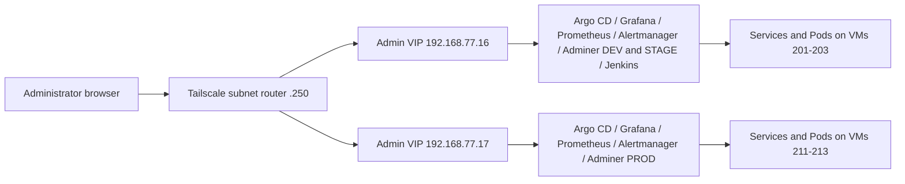

# Kubernetes implementation plan

Documentation alignment update: **2026-10-24**. Permanent procedures now
separate [fresh deployment](../../00-Installation_from-0.md),
[disaster recovery](../../01-Disaster_recovery.md) and
[backup/recovery operations](../../runbooks/19-cnpg-r2-backup-pitr.md).
Historical transitional commands/evidence remain in phase reports and their
[procedure archives](OPERATIONAL_DOCUMENTATION_REVIEW_2026-10-24.md#historical-procedure-preservation).

Phases 0–8, fresh CNPG installation (10.1), R2 backups/isolated PITR (10.2)
and the defined Phase 11 certificate/DHCP scope have completed checkpoints.
Phase 9 remains open. The latest Jenkins review observed automatic STAGE
acceptance and manual DEV publication running; older Phase 9 sections below
retain their original checkpoint statements. Restart behavior, scheduling-policy
alignment, remaining acceptance/failure checks, manual PROD and rollback work
are not closed by this documentation update.

The [recovery capability register](OPERATIONAL_DOCUMENTATION_REVIEW_2026-10-24.md#recovery-capability-register)
separates implemented isolated PITR from full live disaster restoration, generic
Jenkins backup/restore, etcd/off-host kit work and full-system recovery exercises.

## Fixed node-memory configuration — 2026-10-25

The owner requires 8 GiB fixed RAM for all six K3s nodes, with no ballooning.
Implementation and local validation: [fixed-memory report](K3S_FIXED_MEMORY_2026-10-25.md).
The Terraform module uses `memory_mb = 8192` and `memory.floating = 0`, rejects
lower memory overrides and removes `memory_min_mb`. Examples, architecture and
VM provisioning instructions use the same policy. Historical incident reports
retain the original 2 GiB ballooning configuration and its symptoms.

This change updates provisioning code; it does not apply Terraform, restart
nodes or establish the current guest/kubelet memory state. Review private tfvars
before the next plan and verify guest/Kubernetes capacity during the planned
infrastructure maintenance. Preserve cluster data and existing state.

## Target architecture

Current operating-model decisions are recorded in
[the owner decision update](ARCHITECTURE_DECISIONS_2026-10-24.md). They supersede
earlier ingress, Secret-management and Adminer targets in historical sections.

The final state uses two independent K3s clusters and three application
environments. DEV and STAGE share one cluster but have separate namespaces and
data. PROD runs on its own cluster.

| Component | Dev/stage cluster | Prod cluster |
| --- | --- | --- |
| K3s | VMs 201–203; API VIP `192.168.77.11` | VMs 211–213; API VIP `192.168.77.12` |
| Private administration | Admin VIP `192.168.77.16`; services-only kube-vip | Admin VIP `192.168.77.17`; independent services-only kube-vip |
| Application | `app-dev` and `app-stage` namespaces | `app-prod` namespace |
| GitOps | Own Argo CD, AppProject, and root Application | Independent Argo CD, AppProject, and root Application |
| Sync | STAGE direct digest commits after CI; DEV manual; auto-sync/self-heal and reviewed pruning | Manual reviewed promotion after acceptance; auto-sync/self-heal, no automatic pruning |
| Secrets | Private recovery inputs; Ansible/helpers/manual provisioning; GHCR credentials per namespace | Independent private PROD inputs and Secret provisioning |
| Data | Separate DEV and STAGE databases | PROD database with tested backups and restore |
| Monitoring | Cluster monitoring and administrative Grafana | Separate monitoring and controlled access to PROD metrics |
| Jenkins | One controller in namespace `jenkins`; own persistent volume; CI migration in Phase 9 | No separate Jenkins controller; reviewed promotion and local Argo CD deploy PROD |

The public path uses Cloudflare protection/Access for DEV/STAGE and DNS-only
access for PROD → Proxmox TCP/80,443 DNAT →
HAProxy edge VM 240 → the selected cluster's Traefik ingress → application
Services. Public ingress uses node pools `.201`–`.203` and `.211`–`.213`,
separate from API VIPs and the new Admin VIPs. Keep this working path unchanged
while operating private administration. Dedicated ingress VIPs are not planned.
The owner confirms that DEV/STAGE Cloudflare protection/Access is enabled and
legacy VM100 administrative DNAT rules have been removed; these confirmations
are not new tests of the owner-managed configuration.

The database platform is CloudNativePG: DEV/STAGE each use one instance and
PROD uses two asynchronously replicated instances on distinct nodes. Phase 10.1
replaces the initial PostgreSQL Deployments with fresh databases under explicit
disposable-data authorization. R2 physical backup/WAL archiving and isolated
restoration are implemented in 10.2; continuing operations and full live recovery
are tracked separately. The original kube-vip
DaemonSets serve the API only, and K3s ServiceLB serves public Traefik. Independent
services-only DaemonSets now serve administrative Services in each cluster;
do not repurpose the API DaemonSets or change public ingress ownership.

### Agreed private access and service addresses

Trusted administrators reach the whole `192.168.77.0/24` subnet through the
existing Tailscale router. Use browser access by IP and port, with no private
ingress, DNS records, additional reverse proxy, SSH tunnel or manual
port-forward. The operator confirms `.16` and `.17` are available and assigns
them to this purpose. Both are now deployed and locally verified; external
Tailscale browser access and passwords were confirmed by the operator on
2026-10-22.



| Interface | DEV/STAGE endpoint | PROD endpoint | Current state / native service |
| --- | --- | --- | --- |
| Kubernetes API | `https://192.168.77.11:6443` | `https://192.168.77.12:6443` | Existing; API VIPs stay unchanged |
| Argo CD | `https://192.168.77.16:8080` | `https://192.168.77.17:8080` | Deployed; native HTTPS server |
| Grafana | `http://192.168.77.16:3000` | `http://192.168.77.17:3000` | Deployed; native HTTP and Grafana login |
| Prometheus | `http://192.168.77.16:9090` | `http://192.168.77.17:9090` | Deployed; native HTTP |
| Alertmanager | `http://192.168.77.16:9093` | `http://192.168.77.17:9093` | Deployed; native HTTP |
| Adminer DEV | `http://192.168.77.16:8081` | — | Existing `app-dev/adminer:80`; database login |
| Adminer STAGE | `http://192.168.77.16:8082` | — | Existing `app-stage/adminer:80`; database login |
| Adminer PROD | — | `http://192.168.77.17:8081` | Existing `app-prod/adminer:80`; database login |
| Jenkins | `http://192.168.77.16:8085` | — | Controller/UI deployed; working CI migration in Phase 9 |

Use the HTTP/HTTPS and authentication supplied by each service. Do not add TLS
termination, a private CA, new certificates, SSO or an authentication proxy for
Admin VIP access. Argo CD currently has its bootstrap self-signed certificate;
an IP URL is not a promise of warning-free browser TLS. Configure native base
URLs and redirects for the chosen external IP and port where required.
Retain native logins for Argo CD, Grafana, Jenkins and Adminer. Prometheus and
Alertmanager retain their native access model inside the trusted subnet.

No additional Tailscale grants/ACL restrictions or firewall hardening are part
of this increment. Do not create public NAT or HAProxy routes to Admin VIPs.
Record any NodePort allocation required by the implementation; do not describe
VIP access as restricting other private access paths. PostgreSQL, Redis, Docker
daemons and metrics endpoints do not receive administrative browser endpoints.

### Admin VIP ownership and implementation constraints

- Use kube-vip **v1.2.3**, services-only mode, with one common service leader
  per cluster for all Services sharing its Admin VIP. Its election and lease
  must be independent of the existing API leader and `plndr-cp-lock`.
- Set the intended VIP explicitly on every administrative LoadBalancer
  Service; use distinct exposed ports on each shared VIP, including the two
  nonprod Adminer Services in their separate namespaces.
- Check the exact v1.2.3 configuration and shared-VIP election behavior before
  applying it. Do not assume independent per-Service leaders can safely own
  the same address. If the agreed ownership cannot be implemented as planned,
  report the discrepancy before changing the architecture.
- Give the new DaemonSet distinct names, labels/selectors and appropriate
  service-account/RBAC resources. Avoid hostNetwork listener conflicts: the
  existing API kube-vip exposes metrics on `2112`.
- Use strict LoadBalancer class handling so services-only kube-vip does not
  claim public Traefik and ServiceLB creates no administrative DaemonSets.
  The installed K3s EndpointSlice worker still attempts foreign status writes;
  the operator approved a native status-owner admission guard, verified on
  NONPROD before PROD. Only kube-vip-admin may update this class's status.
  Record its denied-write retries and preserve both API DaemonSets, their
  leases and public ingress. See the [decision](PHASE8_ADMIN_VIP_DECISION.md).
- One shared leader is an address-ownership choice. It does not establish
  service, storage or host high availability. Failover, reboot, outage timing,
  load and resilience tests are deferred and are not Phase 8 acceptance gates.

### Remaining infrastructure and later target components

| Component | Address / placement | Target or current responsibility |
| --- | --- | --- |
| Public application | `dev.liora.aprt.info`, `stage.liora.aprt.info`, `liora.aprt.info` over HTTPS | Existing application-only HAProxy/Traefik path |
| Proxmox | `192.168.77.1`; native management UI on 8006 | Existing host administration; outside Admin VIPs |
| Management VM 200 | `192.168.77.200` | Terraform, Ansible and explicit cluster kubeconfigs |
| HAProxy VM 240 | `192.168.77.240` | Application-only HTTP redirect and TLS passthrough |
| Tailscale router VM 250 | `192.168.77.250` | Existing subnet access |
| Application internals | Separate namespaces and PVCs | Frontend, backend, PostgreSQL, Adminer and prestart Job remain |
| Cluster internals | Each independent K3s cluster | API/etcd, CoreDNS, Metrics Server, local-path provisioner, Traefik and ServiceLB remain |
| Argo CD internals | Each cluster's `argocd` namespace | Independent controller, repo server, Redis, Dex, ApplicationSet and notifications components |
| Monitoring internals | Each cluster's `monitoring` namespace | Prometheus Operator, kube-state-metrics, Node Exporter, scrape configuration, dashboards and alerts |
| CI agents / registry publisher / build daemon | DEV/STAGE CI platform; Phase 9 | Preserve existing CI/publisher separation; no extra browser ports |
| GitHub / GHCR | External existing services | Source, reviewed promotion changes and container registry |
| Slack | Existing kind destination available; new-cluster destination not yet confirmed | Configure delivery only after destination agreement; no assumption of verified notification receipt |
| Private Secret provisioning | Ansible, reviewed helpers or manual bootstrap from ignored `recovery/` inputs | No live Secret payloads in Git; protect the external recovery kit |
| CloudNativePG | Per-environment namespaces; Phase 10.1 | Fresh PostgreSQL 16 databases; DEV 1, STAGE 1, PROD 2 async instances on different nodes |
| R2 database backups | Phase 10.2 complete | Physical backups/WAL and isolated PITR passed for all environments; monthly exercises and retention-window aging continue |

VM 100, its legacy kind deployment and existing public administrative NAT
rules are outside this implementation's change scope. The operator will retire
them after the replacement platform and CI are working. Phase 8 alone does not
make VM 100 ready for shutdown, because working CI moves in Phase 9.

### Target repository layout

```text
docs/testreports/           Plans and phase reports
kubernetes/
  apps/liora/
    base/
    components/cloudnative-pg/ database Cluster, connection patches and readiness wave
    overlays/dev/
    overlays/stage/
    overlays/prod/
  gitops/argocd/
    nonprod/                 root app, project, DEV/STAGE apps, bootstrap
    prod/                    independent root app, project, PROD app, bootstrap
  platform/
    cloudnative-pg/          shared pinned operator installed independently per cluster
    base/                    shared platform resources where appropriate
    nonprod/
      admin-access/          services-only kube-vip and private access resources
      monitoring/            nonprod storage, retention, dashboards and alerts
      jenkins/               controller, JCasC, storage and administrative Service
    prod/
      admin-access/          independent VIP ownership and private access resources
      monitoring/            independent PROD monitoring configuration
scripts/kubernetes/          reusable operator helpers
runbooks/                    installation and recovery procedures
.local-work/                 ignored tools, rendered output and operator evidence
```

The Phase 8 platform directories now exist alongside preserved upstream source. Keep
namespace-specific administrative Services with clear, single ownership:
application namespace exposure belongs with its environment overlay; platform
configuration must not silently compete with an existing Argo CD owner.

The Phase 0 baseline report and migration instructions accompany this plan.
The application base and overlays have been imported with selected history;
see [Phase 1 report](PHASE1_REPORT.md). All three overlays render with real,
pinned images, including the approved PROD pair. DEV, STAGE and PROD are
deployed and privately verified in Phases 3–5, including mutual isolation.
PROD uses one backend worker per Pod with two replicas after its compatibility
fix. The migration is integrated into the original checkout on `main`. Never
commit live credentials, controller private keys, or state.

### Target ownership and source files

- The application repository retains application code, tests, image builds,
  release tags, and the Jenkins pipeline that publishes images. This
  infrastructure repository owns deployed image digests, Kustomize overlays,
  Argo CD configuration, cluster services and Jenkins deployment/bootstrap
  configuration. Work in the original infrastructure checkout with ignored
  `.local-work/` tools; no temporary working checkout is needed.
- The first migration copies `deploy/base/` and
  `deploy/overlays/{dev,stage,prod}/` from the application repository. The
  Phase 10 CNPG replacement removes the legacy database ConfigMap, Deployment
  and PVC from the active base, retains `service-db.yaml` as the stable primary
  endpoint and selects the database component independently per overlay.
  Keep private Adminer in every environment, including PROD, as an accepted
  startup-stage operational trade-off; removal is not a migration milestone.
- Adapt `argocd/app-dev.yaml`, `app-stage.yaml`, and `project.yaml` for
  the nonprod cluster. Create independent PROD equivalents, bootstrap
  resources, and root Applications. Each Argo CD points to this repository
  and deploys to its own cluster via `https://kubernetes.default.svc`.
  The existing `argocd/applicationset.yaml` cannot be copied unchanged:
  it creates all three environments in one cluster.
- Adapt `monitoring/values.yaml`, `kustomization.yaml`,
  `dashboards/platform.yaml`, `monitors/{argocd,traefik}.yaml`, and
  `rules/dev-stage.yaml` when adding monitoring. Replace kind-specific
  storage assumptions and create distinct PROD settings.
- Treat `infra/jenkins-host/` in the application repository as the source of
  the working Jenkins proof of concept. Preserve as much as possible: pinned
  controller/agent/build-daemon images, Dockerfiles and tool/plugin locks,
  JCasC, Job DSL, pipeline definitions, credential IDs/scopes and the separation
  between CI and trusted publication. Adapt deployment details for K3s rather
  than replacing the working design. Record source revisions, path mappings
  and intentional deviations; preserve selected source history when importing
  platform files. The currently reviewed application source is
  `b98a22e48527c256193ed65c10307eb574b27ab6`; recheck before importing.
- Keep live Jenkins home, build history, artifacts, credentials and encryption
  keys as private operator data. Preserve them during Phase 9 migration and
  keep a consistent recovery copy; do not copy them into tracked manifests.
  Phase 8 must not start migrated polling, builds or publication alongside the
  existing jobs on VM 100.
- Move promotion to reviewed changes in this repository. Adapt
  `ci/promote.py`, `promote-stage.sh`, `publish.sh`, `registry.py`, and
  `Jenkinsfile.promote` without executing trusted publishing code from an
  untrusted application checkout. Add rendering and placeholder-image checks
  for all three overlays. The GitOps GitHub App needs access to this repository.
- Do not deploy the application's historical `k8s/` tree, legacy encrypted
  credential manifests, or application `.env` files. Review `infra/jenkins-host/`
  separately from the Kubernetes manifests.

## Implementation order

Write all new implementation plans and phase reports in `docs/testreports/`.

First run the application's **current deployment** on the new clusters with the
fewest necessary changes. Verify DEV, STAGE, and PROD independently. Add GitOps,
public access, monitoring, and platform replacements in later, separate steps.
Complete the check for each phase before starting the next.

The operator authorized execution of this plan on 2026-10-21. Execute Phase 8
substeps in order, keep changes small and report actual readiness separately
from deferred tests. VM 100 retirement and legacy NAT removal remain operator
work outside these steps. Do not begin Phase 9 as part of Phase 8.

Copy deployment files from the
[application repository](https://github.com/fastapi-traefik-devops/fastapi-traefik-liora-application).
It was reviewed at commit `3a610ebb14f265fcdeb5a1d4d59da9fa543648c5`;
record the actual source commit when copying. Its historical `k8s/` tree and
this repository's `examples/kubernetes/` are references, not deployment sources.

## Phase 0 — Establish the baseline

Status on 2026-10-21: **complete, including the storage verification subsequently
performed in Phase 2**. Phase 0 itself was read-only. The operator authorized
Phase 1 before live storage checks, then explicitly authorized Phase 2.
See the [Phase 0 baseline](PHASE0_BASELINE.md) for the original observations and
[Phase 2 report](PHASE2_REPORT.md) for completed namespace, Secret and storage
verification.

- [x] Confirm both K3s contexts work from management VM 200 and all six nodes
      are Ready. Keep the dev/stage and prod contexts distinct.
- [x] Record the source commit, DEV/STAGE image digests, and image digests
      selected for the first PROD deployment.
- [x] Confirm each cluster has a working StorageClass and enough capacity for
      the existing PostgreSQL PVCs and application replicas.
- [x] Locate the credentials needed for `ghcr-pull-secret`, `backend-secrets`,
      and `db-secrets` in each application namespace. Keep live values in the
      external recovery archive, not Git.

Verified: both contexts and all six Ready nodes; all source overlays render;
source/image references and approved PROD digests recorded. Both default
local-path provisioners are Running and reported capacity is sufficient.
Phase 2 created a temporary 1Gi RWO PVC and consumer Pod in each target namespace;
all bound to local-path and passed write/read checks. Probe resources and PVs
were removed. A STAGE runtime interruption passed on retry and is documented
in the Phase 2 report.

Fresh, separate backend/database credentials reside in ignored
`recovery/recovery.yaml`, with registry credentials in ignored `recovery/.env`.
Phase 2 created and verified the corresponding live Secrets in each namespace.
No credential values were committed. Phases 3–5 subsequently deployed and
verified all three application environments.

**Pass:** both clusters, storage, image versions, and credentials are ready.

## Phase 1 — Copy the current application deployment

Status on 2026-10-21: **complete for local import and rendering**. The operator
approved the current STAGE pair for PROD; both images are pinned by digest.
See [Phase 1 report](PHASE1_REPORT.md). Phase 1 used the isolated branch
`migration/liora-phase0` at `/home/root-admin/liora-infrastructure-migration`.
It was later integrated without rewriting imported history; that temporary
worktree and fully merged branch were removed. Work now uses the original checkout.
The deployment source is upstream `b98a22e48527c256193ed65c10307eb574b27ab6`;
its newer STAGE promotion matches kind. The selected history was scanned and
imported, and the new runbook and navigator links are present. No live application deployment was attempted.

- [x] Copy **all** of `deploy/base/` to `kubernetes/apps/liora/base/`, including
      PostgreSQL, its PVC and Service, Adminer, the prestart Job, backend,
      frontend, Ingress, and the existing `kustomization.yaml`.
- [x] Copy `deploy/overlays/{dev,stage,prod}/` to matching directories in
      `kubernetes/apps/liora/overlays/`. The Kustomize files are required;
      DEV/STAGE `promotion.json` files are records, not deployment inputs.
- [x] Render all three overlays with explicit-kubeconfig `kubectl kustomize`;
      inspect namespaces, images, replicas, Secret references, and Ingress hosts.
- [x] Replace PROD's `sha-000000...` placeholders with **existing, selected**
      backend and frontend digests. Limit other edits to K3s compatibility
      and the operator-requested domain/administrator configuration.

Operator-requested configuration is now `dev.liora.aprt.info`,
`stage.liora.aprt.info`, and `liora.aprt.info`, with initial administrator
`admin007@liora.aprt.info`. The ignored recovery file uses the same identity.
DEV retains HTTP and its source `ENVIRONMENT: staging`; STAGE/PROD retain
HTTPS and the `app-tls` dependency. PROD uses tag
`sha-c375967ac5b3dd7a0a6867758e16b057c733bb2d`, backend digest
`sha256:f1a896fbc915f1f19416882fee62bf4db275860f9225d9004ac59ba9a005dc5d`,
and frontend digest
`sha256:7d1ac191287e0498434049d4e569aa8f8a8ed2dbd19921e20bc566c95b2a4c91`.
No DNS, TLS or public ingress was set up.

**Pass:** three overlays render with real images and the active base retains
the current working stack. Do not copy Argo CD, monitoring, Jenkins, or the
historical `k8s/` tree in this phase.

## Phase 2 — Prepare namespaces and credentials

Status on 2026-10-21: **complete**. See [Phase 2 report](PHASE2_REPORT.md).
Namespaces are Active, all nine required Secrets match local recovery material,
and temporary default-StorageClass PVC probes passed in every namespace. The
probe Pods, PVCs and dynamically provisioned PVs were removed. All six nodes
are Ready. The subsequent DEV deployment is recorded in Phase 3 below.

- [x] Create `app-dev` and `app-stage` on the dev/stage cluster and `app-prod`
      on the prod cluster.
- [x] Restore or create `ghcr-pull-secret`, `backend-secrets`, and `db-secrets`
      in each namespace; ensure backend and database credentials agree.
- [x] Confirm PVC provisioning uses the intended K3s StorageClass.

**Pass:** every target namespace has the required Secret names and can
provision its own PVC. Do not print Secret values into logs.

## Phase 3 — Deploy and verify DEV

Status on 2026-10-21: **complete**. See [Phase 3 report](PHASE3_REPORT.md).
DEV's application PVC is Bound, PostgreSQL and all application Deployments are
Ready, prestart completed, and private browser login plus persisted item
creation/read/update passed. The initially generated administrator passwords
exceeded the application limit; they were corrected to 32 characters in ignored
recovery and the three backend Secrets. No database passwords or signing keys
changed. A bootstrap length guard now prevents that error.

At Phase 3 completion the DEV marker was recorded in
`/home/root-admin/liora-render/dev/acceptance.json` for Phase 4 isolation checks.
All synthetic markers were subsequently removed, and old evidence was archived;
see [local workspace guidance](../../runbooks/11-install-management-tools.md#operator-python-and-browser-tools). Public routing and
trusted TLS were unverified at that point and were completed in Phase 7.
At Phase 3 completion STAGE/PROD application workloads were not deployed.
STAGE was subsequently deployed and verified in Phase 4 below.

- [x] Deploy the DEV overlay to `app-dev` on the dev/stage cluster. Bring up
      PostgreSQL before relying on the prestart migration Job.
- [x] Check PVC Bound, PostgreSQL Ready, prestart Complete, and backend,
      frontend, and Adminer Ready.
- [x] Through private access, check backend health, UI login, and a basic
      read/write operation against the DEV database. Record applied digests.

**Pass:** DEV works end to end without public DNS or TLS. With direct
`kubectl apply`, Argo CD sync-wave and hook annotations do not order the
prestart Job; verify database readiness and Job completion explicitly.

## Phase 4 — Deploy and verify STAGE

Status on 2026-10-21: **complete**. See [Phase 4 report](PHASE4_REPORT.md).
STAGE's separate 1Gi local-path PVC is Bound, all four Deployments have one
Ready replica, and prestart completed. Private browser login, item creation,
editing and persistence passed. Both environments return their own marker and
404 for the other marker; direct SQL confirms one own row and zero foreign
rows. Cross-environment tokens are rejected with HTTP 403. DEV stayed healthy
with unchanged workloads and zero restarts. All six nodes are Ready.

Both synthetic markers were retained through Phase 5, then removed after all
three environments passed mutual isolation. PROD deployment is recorded below;
public routing and trusted TLS remain pending.

- [x] Deploy the STAGE overlay to `app-stage` on the dev/stage cluster, with
      its own Secrets and PVC. Verify PostgreSQL before the prestart Job.
- [x] Check workloads, backend health, UI login, and a database read/write
      operation through private access.
- [x] Confirm DEV stays healthy and STAGE data remains isolated.

**Pass:** DEV and STAGE work independently on VMs 201–203.

## Phase 5 — Deploy and verify PROD

Status on 2026-10-21: **complete**. See [Phase 5 report](PHASE5_REPORT.md).
PROD's own 1Gi local-path PVC is Bound and prestart completed. PostgreSQL and
Adminer are Ready; two backend and two frontend replicas are Ready on k3s-2
nodes. Initial four-worker backend Pods repeatedly lost child workers, with no
recorded cgroup OOM kills. The explicit single-worker command used by DEV/STAGE
resolved readiness while retaining two PROD replicas and the approved digests.
The underlying multiworker failure remains unconfirmed; this is not a load test.

Private browser login and item creation/editing/persistence passed. All six
directed marker checks and six foreign-token checks passed. SQL found only each environment's own
marker. The three synthetic items were then removed, with API/SQL absence and
health rechecked. DEV/STAGE workload snapshots stayed unchanged, with zero
restarts; all six nodes are Ready. Public routing and trusted TLS remain pending.
Phase 6 followed this acceptance and is recorded below.

- [x] Deploy the PROD overlay with real, selected image digests to `app-prod`
      on the prod cluster, with its own Secrets and PVC.
- [x] Check prestart, both application replicas, backend health, UI login,
      and a database read/write operation through private access.
- [x] Confirm PROD runs on VMs 211–213 and both nonprod environments remain
      healthy. Record the deployed digests.

**Pass:** all three environments run the current stack on their assigned
clusters. Public routing and real domains come later.

## Phase 6 — Install separate Argo CD instances

Status on 2026-10-21: **complete**. See [Phase 6 report](PHASE6_REPORT.md).
Both independent Argo CD v3.5.6 installations and private UI logins passed.
Manual, hook-enabled application adoption and both root reconciliations passed.
The operator authorized integration and publication; the history-preserving
branch was fast-forwarded into original `main` and published. The latest
operator runbook edits were preserved.

Both roots and all three children are Synced/Healthy with automation and
self-healing enabled. Nonprod child pruning was enabled after reviewing the
12-resource inventories with no unexpected prune candidates. PROD and both
roots keep pruning disabled; PVC retention annotations remain. Each environment
passed an automated ConfigMap drift correction. Original application Pod, PVC,
Secret and Deployment identities, data bindings and schema revision remain
unchanged; private application login/health checks passed. Phase 7 followed this
acceptance and is recorded below.

- [x] Install one Argo CD in dev/stage and another in prod; check both admin
      UIs through private access.
- [x] Adapt application-repository `argocd/app-dev.yaml`,
      `app-stage.yaml`, and `project.yaml` into
      `kubernetes/gitops/argocd/nonprod/`. Create the PROD Application and
      project in `kubernetes/gitops/argocd/prod/`. Source this repository.
- [x] Target each Application at its **local** cluster and correct namespace.
      Inspect diffs before Argo CD takes ownership of the manual deployment;
      enable automation only after correct reconciliation. Review the effects
      of pruning separately.
- [x] Verify correct digests, healthy workloads, and no unexpected deletion
      in each Argo CD instance.

**Pass:** each Argo CD manages only its own cluster. Do not copy
`argocd/applicationset.yaml` unchanged: it targets all three environments
in one cluster.

## Phase 7 — Publish the application

Status on 2026-10-21: **complete for direct DNS-only origin access**. See
[Phase 7 report](PHASE7_REPORT.md). The three real domains resolve to the public
Proxmox origin. VM 240 at `192.168.77.240` runs application-only HAProxy routing;
public 80/443 DNAT preserves the existing SSH and unrelated host rules. Distinct
node ingress pools reuse ServiceLB rather than the API VIPs or new floating VIPs.

Trusted per-host certificates are installed in each app namespace. DEV now uses
HTTPS CORS/origin and its backend was rolled to load the new environment.
Canonical HTTPS browser login/item persistence and mutual API/SQL/token isolation
passed for all three environments. The operator independently confirmed all three
URLs load externally without certificate warnings. Test items were removed.
Certbot renewal simulations and the management certificate-distribution service
passed; both timers are enabled. Argo CD remains Synced/Healthy.

Cloudflare currently supplies DNS only: proxied traffic and Full (strict) mode
were not configured or verified at that checkpoint. Later decisions retain
HAProxy and its node pools without dedicated ingress VIPs; owner-confirmed
Cloudflare Access and legacy DNAT cleanup are recorded in the decision update.
Edge failover,
reboot persistence and a later unattended renewal cycle remain untested.
Phase 8 progress is recorded below.

- [x] Configure real DEV, STAGE, and PROD hostnames, DNS, ingress, and TLS.
      Replace `*.example.com`; align backend CORS and frontend settings.
- [x] Establish distinct ingress addresses and edge routing. Current kube-vip
      covers the **API VIPs only** and K3s ServiceLB is enabled. Decide ingress
      addressing before adding HAProxy and Proxmox TCP/443 DNAT.
- [x] Verify each hostname reaches only its intended environment and that
      valid TLS, UI login, and the API work.

**Pass:** the application works at its real URLs. Keep Argo CD, Adminer, and
other admin interfaces behind Tailscale or equivalent private access.

## Phase 8 — Add monitoring and operational access

Status: **complete on 2026-10-22**. NONPROD then PROD were verified with the
operator-approved [status guard](PHASE8_ADMIN_VIP_DECISION.md). Both monitoring
stacks and the NONPROD Jenkins foundation work. The operator confirmed all
interfaces and passwords through Tailscale. See the [Phase 8 report](PHASE8_REPORT.md).
Working CI migration remains a separate Phase 9 and has not started.

### 8.1 — Prepare manifests and ownership

- [x] Record the actual source revisions and current cluster resources.
      Adapt monitoring inputs from the application repository and import the
      Jenkins foundation from `infra/jenkins-host/`, preserving useful source
      configuration and history. Keep the application checkout read-only in
      this phase.
- [x] Prepare independent nonprod/PROD resources for the agreed Admin VIPs.
      Resolve v1.2.3 election/lease, selectors, RBAC, hostNetwork port separation
      and LoadBalancer class handling before applying either DaemonSet.
- [x] Review Service ownership against Argo CD inventories. Use reviewed
      environment changes for existing managed Services or separately named
      administrative Services; do not introduce two declarative owners for
      one resource or allow self-healing to undo the intended exposure.
- [x] Write the implementation and recovery runbooks alongside manifests.
      Provide standalone files for substantive operator scripts. Keep new
      reports/plans under `docs/testreports/` and generated data ignored.

### 8.2 — Establish DEV/STAGE Admin VIP

- [x] Deploy its services-only kube-vip and explicit VIP Services. Keep the
      existing API kube-vip and public Traefik/ServiceLB unchanged.
- [x] Expose Argo CD at `.16:8080`, Adminer DEV at `.16:8081` and Adminer
      STAGE at `.16:8082` using the native service protocols and logins.
- [x] Check ordinary readiness, one agreed VIP owner, the separate service
      lease, correct Service status and no ServiceLB administrative workloads.
      Confirm browser access from a Tailscale client without a tunnel or
      manual port-forward. This is a functional check, not a failover test.

Local readiness/browser/ownership checks passed. The operator confirmed external
Tailscale browser access and passwords on 2026-10-22; failover is untested.

### 8.3 — Install DEV/STAGE monitoring

- [x] Adapt source `monitoring/` values, monitors, dashboards and alert rules
      to actual K3s labels/namespaces and `local-path` storage. Pin the chart
      and images as appropriate; size CPU/RAM, retention and PVCs for this
      single-host lab before installation. Do not copy kind `standard` storage.
- [x] Install its own Prometheus, Alertmanager, Grafana, operator,
      kube-state-metrics and Node Exporter. Provision credentials outside Git.
- [x] Expose only the agreed browser ports: Grafana `.16:3000`, Prometheus
      `.16:9090`, Alertmanager `.16:9093`. Keep exporter/operator endpoints
      internal. Configure native URLs/redirects for IP-and-port access.
- [x] Confirm loaded dashboards, useful node/application/Argo CD/Traefik
      metrics and alerts identify DEV/STAGE correctly. Agree any external
      alert destination before enabling delivery; do not treat API acceptance
      as proof of notification receipt. Synthetic notification tests are not
      a gate for this implementation increment.

### 8.4 — Establish PROD administration and monitoring

- [x] Apply the independent services-only kube-vip and explicit `.17` Services
      after nonprod functional readiness. Keep API VIP `.12` and public ingress
      unchanged; do not share election or monitoring state across clusters.
- [x] Expose Argo CD `.17:8080`, Adminer PROD `.17:8081`, Grafana `.17:3000`,
      Prometheus `.17:9090` and Alertmanager `.17:9093`.
- [x] Install separate monitoring with explicit PROD retention/storage,
      credentials, datasource identity and PROD alert rules. Confirm no
      DEV/STAGE application selectors were copied into PROD configuration.
- [x] Confirm ordinary readiness and browser access through Tailscale;
      record that VIP failover and local-volume recovery remain untested.

Local readiness/browser/ownership checks passed. The operator confirmed external
Tailscale browser access and passwords on 2026-10-22; failover is untested.

### 8.5 — Install the Jenkins foundation in DEV/STAGE

- [x] Deploy one controller in namespace `jenkins`, with its own persistent
      `JENKINS_HOME` PVC, explicit resource budget and no controller executors.
      Reuse the proof-of-concept image/plugin/JCasC configuration wherever
      compatible. Keep existing Jenkins and its data unchanged during setup.
- [x] Make the controller image available to K3s using the source Dockerfile
      and image/plugin locks; the proof of concept's host-local image tag is
      not a pullable cluster image. Record the reviewed registry image digest
      and required pull credentials without changing Jenkins core/plugins
      merely as part of the deployment migration.
- [x] Expose native HTTP/login at `http://192.168.77.16:8085`, with the native
      Jenkins base URL set accordingly. Do not create a PROD controller.
- [x] Keep build agents, trusted publisher migration, build cache and
      operational jobs for Phase 9. Do not activate polling, scheduled jobs,
      publication or promotion imported by JCasC/Job DSL during foundation
      startup; make this disabled initial state explicit and reviewable.
      Initially load only controller/login configuration and defer
      job-generating DSL and its publishing credentials until Phase 9.
- [x] Confirm controller/PVC readiness and private login, and document the
      exact reusable source, deferred components and Phase 9 migration inputs.

### 8.6 — Record functional completion and boundaries

- [x] Record the actual address/port/protocol map and ordinary readiness for
      both clusters, Adminer environments, monitoring and Jenkins foundation.
      Confirm no new public administrative NAT/ingress routes were introduced
      and check the new interfaces are not reachable from the public origin.
- [x] Record GitOps/application health after the changes; preserve existing
      database PVCs, credentials, API VIPs and the public application path.
- [x] Publish the Phase 8 report with completed items and remaining limits.
      Do not claim tested failover, recovery or notification delivery. No
      stress, node-failure, reboot or failover tests are required in this phase.

**Pass:** both clusters have their own useful monitoring and permanent
IP-and-port administrative access through Tailscale; the nonprod Jenkins
foundation is reachable with persistent storage. Working CI, failover tests,
VM 100 retirement and legacy NAT removal are outside this phase. The operator
confirmed external Tailscale browser access and passwords; Phase 8 is closed.

## Phase 9 — Move promotion and CI ownership

Status: **in progress; initial live STAGE cycle accepted on 2026-10-23**.
Legacy Jenkins state is restored to a separate NONPROD home, preserving the
current K3s admin, users, history, credential scopes and encryption material.
Existing CI/DinD and trusted publisher agents are connected. After the MTU
correction, manual CI passed all 13 functional gates and 96 tests.

The reviewed minimal live cycle now works: controlled main #15 / publisher #34,
then SCM-polled main #16 / publisher #35. Both automatically updated
infrastructure STAGE and Argo deployed the exact image pair. Manual running
digest and strict HTTPS checks passed through the existing private edge route.
Only main SCM polling is active (`H/2 * * * *`); unrelated jobs, nightly schedules
and recurring folder indexing remain disabled. Automatic acceptance and expanded
manual promotion workflows remain open; PROD is explicitly blocked. See the
[live execution evidence](PHASE9_LIVE_CYCLE.md), [worker acceptance](PHASE9_WORKERS.md),
[Phase 9 report](PHASE9_REPORT.md) and [runbook 17](../../runbooks/17-migrate-jenkins-ci.md).

The [pipeline review](PHASE9_PIPELINE_REVIEW.md) is complete as a technical
inspection; the operator approved its CI-only proposal. It checked live disabled
jobs and the pinned source, and found application GitHub `main` four commits
ahead at `13aa29eb27abac01e9638cdf45f1414a4c3002a1`. No source, job, trigger or
controller policy was changed during that read-only review. Its earlier approved
checkpoint was one manual functional CI build without scans, publication,
promotion or deployment; later live authorization superseded that boundary.
The [first attempt](PHASE9_MANUAL_CI.md) stopped at a nested-network stall.
The operator approved MTU alignment and one further attempt; [build #2](PHASE9_CI_RETRY.md)
passed all 13 functional gates and 96 tests, including both runtime-image smoke
checks. Native JSON/JUnit reporting, cleanup and hold restoration passed.
Publication/promotion and full/release attestation remain outside this checkpoint.

Operator cleanup update, 2026-10-22: `docker system prune -a --volumes`
removed the stopped local legacy containers and images. Seven named Jenkins
volumes and the private stopped-source archives remain; all 14 archive size/hash
checks passed after cleanup. Remote K3s homes and the retained-foundation rollback
are unaffected. Legacy Docker recovery requires container recreation and private
bind-input restoration, not restarting retained containers. Do not remove any
remaining source volumes or archives.
The legacy kind node's anonymous data volume was removed as well; its cluster
state is not part of the Jenkins backups or the K3s foundation rollback.
The operator confirmed that kind's demo/STAGE/PROD applications contained only
default installation data. No application/database transfer from kind is needed;
retain the current PostgreSQL content in K3s without replacement or reseeding.

Vulnerability deferral, 2026-10-22: the operator explicitly accepted proceeding
with deployment for this educational setup and deferred remediation/further
vulnerability scanning. Preserve the failed DinD scan as a failed result and do
not run further image audits in this increment. This does not change the
selective job activation/PROD gate or current-admin preservation requirement.

Preserve the maximum working behavior from the application's Jenkins proof of
concept while adapting it to the nonprod K3s foundation and repository split.
GitOps App access and Contents/Pull requests write grants on both repositories
were verified on 2026-10-22 after the operator updated the installation.

### Initial working cycle — completed checkpoint

**Minimal live cycle verified (2026-10-23).** The operator authorized reviewed
pushes, existing-job/helper installation, controller GitHub connectivity, one
controlled cycle, and main-only polling after manual STAGE verification.
Application PR #62 passed its real required Jenkins check (13 gates/96 tests)
and merged normally at `38a7f2aae320f3607b20ae1a5d14b8fa64768eca`. No branch
rule or App permission was changed. Infrastructure main remains unprotected
as confirmed by its owner. See the [live execution report](PHASE9_LIVE_CYCLE.md).

- [x] Integrate reviewed application source through its required PR/check path.
      Preserve history and never execute the obsolete remote pipeline.
- [x] Install reviewed existing main/publisher definitions and immutable helper
      bundle `jenkins-publisher-ci-d87b3c9599c5`; enable only checkpoint jobs,
      controller GitHub egress and one-time related PR checks. Keep recurring
      folder indexing, nightly schedules and unrelated jobs disabled.
      Main #13 exposed broken imported Declarative bookkeeping; publisher #33
      exposed missing exact-script approval. Both were repaired under the hold,
      with failed/interrupted attempts retained. Controlled retry main #15 and
      publisher #34 succeeded; first STAGE manual verification
      passed at `b8caf7e`. The following SCM-polled cycle also passed at `59c3685`.

The initial K3s CI/CD cycle is complete. Continue toward the target below using
the same agents/DinD, 13 functional gates, tested-image export and trusted
immutable publisher. Preserve the implemented split-history writer, exact-main
rechecks, serial STAGE lock, file allowlist and concurrent-infrastructure retries.

The first approved live cycle is application main → existing main Jenkins CI →
immutable image publication → direct STAGE digest update in infrastructure main →
Argo automatic deployment. Verify that first deployment MANUALLY: Argo
Synced/Healthy, running pair and STAGE URL. Do not call that automated acceptance.

- [x] Under the received live authorization, adapt the existing app-ci main job and
      trusted publisher definitions/pins. Main uses one SCM poll every two minutes;
      keep recurring folder indexing/nightly schedules off. Filter discovery to
      main before any one-time index; keep all imported PR/other jobs disabled.
- [x] Verify GitHub App repository write grants and main protection. The App
      grants were verified by API; the repository owner confirmed that the
      infrastructure repository currently has no protected branch. Combined
      with empty rulesets/effective main rules, no branch exception is needed
      for the initial STAGE writer. The earlier API 403 is an inspection limit,
      now resolved by owner confirmation; no push was used as a test. Recheck
      if rules change. No permission or branch-rule changes are authorized.
- [x] Run the authorized first minimal live cycle and record manual STAGE
      verification tied to application SHA and both published/running digests.
      Main #15 / publisher #34 succeeded for `38a7f2a`; promotion `b8caf7e`
      became Argo Synced/Healthy. Both running digests match; UI/API HTTPS
      smoke passed through the existing private edge route with strict TLS.
      Current admin profile hashes and database pod/PVC identities are unchanged.
      This manual check is not automatic acceptance or a PROD gate.
- [x] Enable only main SCM polling (`H/2 * * * *`) after the verified cycle
      and demonstrate a meaningful new main commit reaches STAGE automatically.
      PR #63 passed its real check and merged normally at `3459d5a`. Native
      SCMTriggerCause requested main #16; publisher #35 committed `59c3685`.
      Argo Synced/Healthy, actual digest pair and HTTPS smoke passed again.
      All related PR jobs are disabled again; nightly schedules and recurring
      folder indexing remain disabled.

### Next pending work — execution order

**2026-10-24 reconciliation:** automatic STAGE receipts and manual DEV are
present in live builds; treat items 2–4 below as completion/coverage review,
not instructions to build duplicate components. Reconcile the actual nightly/
indexing/PR-job settings with the approved policy. Preserve the current state
until that review is authorized; do not restore a historical main-only snapshot
as a side effect of documentation maintenance. See the
[current documentation review](OPERATIONAL_DOCUMENTATION_REVIEW_2026-10-24.md#jenkins-documentation-boundary).

The following work remains in Phase 9. The initial cycle is complete; the whole
phase remains open. This documentation update does not activate any pending
component or broaden the live checkpoint. Observer integration and lock
extension form one acceptance checkpoint; partial setup does not qualify PROD.

1. [ ] **Finish controller restart cutover.** Adapt the retained startup
   quiet-mode guard and verify restart with only main polling and trusted
   publication enabled. Preserve zero controller executors, restored-home
   checks, admin login and retained history. Until verified, controller restart
   requires deliberate release from quiet mode after inspecting job/trigger
   states; automatic continuation across restart is not claimed.
2. [ ] **Activate automatic STAGE acceptance.** Reuse the preserved separate
   observer and receipt helpers. Verify Argo Synced/Healthy, ready running
   frontend/backend digests and the STAGE HTTPS smoke. Persist evidence tied
   to application SHA, both digests and infrastructure/Argo revisions. Resolve
   and document the observer's URL route; existing manual evidence used the
   private HAProxy route and does not prove fresh external reachability.
3. [ ] **Extend serialization through acceptance.** Keep the same publisher
   lock through observation and receipt recording. Verify that stale builds,
   failed acceptance and unrelated concurrent infrastructure changes cannot
   qualify the wrong pair or overwrite newer evidence. Preserve exact-main
   rechecks and the STAGE file allowlist.
4. [ ] **Complete manual DEV promotion.** Adapt and verify the existing
   pipelines/helpers without creating a duplicate pipeline or another migration.
   DEV remains an explicit operator request, independent of the STAGE path.
5. [ ] **Enable manual PROD promotion only after its gate passes.** First
   implement AND live-verify the agreed automatic STAGE acceptance gate. Then
   verify release-tag selection and promotion of the exact accepted pair,
   without rebuilding. Until then the initial publisher exposes no PROD action
   and the writer/CLI explicitly blocks it; manual smoke results and fixture
   receipts do not satisfy the gate.
6. [ ] **Verify manual rollback and review obsolete paths.** Exercise rollback
   in a reviewed checkpoint, then determine which old GitOps paths can be
   retired. Preserve recovery inputs and required history; do not delete paths
   solely because the initial STAGE cycle works.

Keep unrelated imported jobs, nightly schedules and recurring multibranch
indexing disabled. Vulnerability scans/remediation remain deferred. Preserve the
current Jenkins admin and private recovery inputs throughout. Database contents
remain protected during Jenkins work; the separately authorized Phase 10 fresh
CNPG replacement is an explicit exception for application database data only.

The earlier local-only boundary is superseded by the live authorization above.
The authorized initial live actions and application integration are complete;
the remaining work is listed above. Branch-rule and GitHub App permission
changes remain prohibited.
Automatic acceptance remains the agreed final architecture; its activation is
simply deferred behind the first working cycle. See
[implementation report](PHASE9_PUBLICATION_IMPLEMENTATION.md).

### Confirmed migration scope and activation boundary

- Keep the existing DinD approach with a privileged daemon alongside the CI
  agent; keep the trusted publisher separate. Measure resource/storage needs.
  Recreate the disposable Docker cache; preserve build history and artifacts.
- Preserve required Jenkins state, credential IDs and encryption keys, and other
  users, but **exclude the legacy `admin` login/account data**. Retain the current
  K3s administrator account and password; verify it after transfer.
- The original restore preserved Jenkins settings/pipeline sources. The current
  approved local adaptation changes only what the initial K3s STAGE cycle needs;
  retain originals and useful prepared target work. Only main and the reviewed
  trusted publisher are enabled; unrelated imported jobs stay disabled. Never
  execute the obsolete publisher unchanged.
- Confirmed current target (supersedes the earlier requirement for human review
  of every GitOps PR): successful CI of the resulting application `main` commit
  publishes immutable images, then automatically commits the exact digest pair
  directly to infrastructure `main`; Argo CD automatically deploys STAGE. There
  is no STAGE PR or human approval. DEV and PROD remain manual; PROD uses a
  release tag and the exact successfully STAGE-accepted pair without rebuilding.
- Serialize STAGE promotion and acceptance. Recheck application `main` immediately
  before each infrastructure push; skip superseded candidates, including when
  newer commits fail CI. Never fall back to an older candidate automatically.
  Preserve unrelated concurrent infrastructure changes through bounded retries.
- Automatically verify Argo CD Synced/Healthy, ready running frontend/backend
  digest pair and the STAGE HTTPS URL. Record evidence tied to application SHA,
  both digests and infrastructure/Argo revisions. Successful acceptance is a
  mandatory PROD gate. Rollback remains manual.
- The trusted direct writer may modify only STAGE `kustomization.yaml`,
  `promotion.json` and `acceptance.json`. Verify App permissions and applicable
  main-branch rule exceptions before activation; repository write permissions
  alone do not restrict paths. DEV/PROD use manual reviewed changes.
- The minimal live checkpoint is now explicitly authorized, including necessary
  reviewed pushes. Application integration and both controlled/polled STAGE
  cycles are complete; only the agreed main poll and trusted publisher are
  active. Do not change branch rules or App permissions.
- The operator authorized immediate stopping of the local legacy kind cluster
  and its Jenkins stack. Preserve containers, volumes, all recovery inputs and
  source; do not delete anything or change Proxmox NAT/VMs or remote K3s.
- Activate gradually after state verification: manual inert smoke, CI, then
  reviewed publication/promotion and finally polling/schedules. Preserving
  pipeline source does not authorize executing its old promotion behavior.

- [x] Inventory and privately back up the existing Jenkins home, jobs,
      plugin versions, build history/artifacts, encryption keys and required
      credential files before migration. Plan a consistent transfer/cutover
      without losing or duplicating active work. Keep source copies intact
      until the replacement is accepted. The operator's immediate-stop instruction
      superseded draining active work; interrupted executions were recorded and
      retained, not claimed successful. Both original homes remain intact and a
      concrete K3s foundation rollback object/procedure is prepared, not run-tested.
- [x] Restore required private state into a separate new controller home with
      compatible minimal JCasC and disabled execution. Preserve credential IDs/
      scopes, non-admin users, history/artifacts and original encryption keys;
      retain the current K3s admin login instead of importing the legacy admin.
      Verify the existing password in API/browser and check credential decryption.
      Keep all private state outside Git and diagnostics. Preserve original
      Job DSL/pipeline sources without executing them or redesigning promotion.
- [x] Review the preserved Job DSL/pipelines and settings with the operator
      before adapting old repository targets or enabling their behavior. Required
      initial CI-only runtime changes were approved there; the later local
      promotion adaptation is authorized by the current decisions above.
      Findings and the proposed minimal CI-only path are recorded in
      [the review](PHASE9_PIPELINE_REVIEW.md); operator agreement received.
- [x] After agreement, prepare the reviewed CI-only source/profile and manually
      trigger one build on `host-ci`, keeping every imported job and all polling,
      schedules, publication/promotion and legacy direct STAGE pushes disabled.
      Preserve existing admin login and K3s PostgreSQL content. Record exact source,
      functional test/build outcomes and deferred checks; restore the execution
      hold afterward. Leave release attestation unchanged in this CI-only increment.
      Attempt #1 is ABORTED after a nested-network stall; this checkbox records
      execution of the agreed single attempt, not passing full CI acceptance.
- [x] Review the [observed network stall and proposed MTU alignment](PHASE9_MANUAL_CI.md)
      before changing CI worker settings or requesting another build. Verify
      nested HTTPS connectivity after any agreed change, review the source-only
      report fix, then explicitly authorize one new attempt with its own receipt.
      Preserve the first request guard/history and keep all publication held.
      Completed: both bridge MTUs are 1450, nested HTTPS probes passed, and
      [build #2](PHASE9_CI_RETRY.md) passed all functional gates and 96 tests.
      First-attempt history/archives and all imported job/user state are retained.
- [x] Move CI agents, isolated build daemon and separate registry publisher
      into the nonprod CI platform with bounded resources and fresh cache.
      Both preserved labels are online with one executor each; all new PVCs
      are Bound, helper source matches the reviewed commit and the Docker
      build/bind smoke passed. Current admin API/browser login and retained state
      passed again. Docker deployment details are adapted for K3s without giving
      application builds deployment credentials or using a host Docker socket.
      The operator accepted the existing privileged DinD requirement explicitly.
- [x] Review the retained publisher/promotion implementation for the repository
      split. [Findings and proposed changes](PHASE9_PUBLICATION_REVIEW.md) identify
      required artifact evidence and separate Git histories. Its original STAGE PR
      proposal is superseded by the confirmed direct-commit policy above.
      That review held jobs/publication; the later authorized initial cycle is
      now active as recorded above.
- [x] Agree the explicit functional-artifact admission mode and proposed local
      implementation before editing pipelines. Operator approval includes exporting
      tested images with explicit deferred-scan evidence, adapting the trusted
      publisher, separating histories and updating pinned helpers/validators.
- [x] Implement and test locally with two independent fixture repositories and
      mocked remote APIs. Preserve read-only STAGE observation/evidence work for
      later; the initial publisher does not call it and PROD stays blocked.
      Verify App permissions/rules without changing them. See
      [implementation and activation boundary](PHASE9_PUBLICATION_IMPLEMENTATION.md).
- [x] Obtain explicit approval for the minimal live checkpoint, reviewed pushes,
      existing-job/helper setup and necessary GitHub connectivity. The owner
      authorized one controlled cycle followed by main-only polling and an
      automatic demonstration after manual STAGE verification. Application PR/check
      integration and the minimal live cycle are complete under that authorization.
- [x] After pipeline review, verify application build/publication credential
      separation, artifact provenance, SHA image tags and existing CI gates in
      controlled execution (main #15 / publisher #34). Image vulnerability handling
      follows the explicit educational-project deferral above; no further scans in this increment.
- [x] Keep build/test and image publication source in the application repository.
      Change promotion tooling to update infrastructure STAGE directly, with
      manual DEV/PROD review, rather than application `deploy/overlays/`.
- [x] Add local checks to render all overlays and reject placeholder/mixed-source
      images. PR-validation workflow is prepared for later; not an initial-cycle
      dependency.

Remaining live acceptance, manual promotion and rollback checks are tracked
in the ordered pending-work list above; none is implied complete by the
following initial-cutover result.

- [x] Activate main-only polling and trusted publication at the reviewed
      cutover. Main #16 / publisher #35 proved build/publish/STAGE deployment
      using only K3s workers, without VM 100 agents, bind mounts or Docker
      services. Private recovery copies remain retained. Nightly schedules and
      recurring folder indexing remain disabled; expanded workflows stay open.

**Pass:** working CI and the agreed automatic STAGE/manual DEV/PROD promotion
run from nonprod K3s, reuse the
proof of concept, preserve required state, and respect the two repository
boundaries. Report readiness for the operator's later VM 100/legacy NAT cleanup;
do not perform that cleanup as part of this implementation.

## Phase 10 — Replace temporary components incrementally

### 10.1 — Fresh CloudNativePG application databases

Status: **fresh installation and existing-image application checks complete**
(2026-10-23). The operator approved fresh empty
application databases and disposal of old DEV/STAGE/PROD database data. This
supersedes logical dump/restore and the earlier requirement to test legacy
backup restoration before this replacement. Jenkins and unrelated data remain
protected. Phase 9 deferred Jenkins work remains open and is not part of 10.1.

- [x] Inspect both original checkouts and live databases: PostgreSQL 16.6,
      `plpgsql` and `uuid-ossp`, `app` database, legacy `postgres` application
      login, 1 GiB local-path PVC per environment; capture private baselines.
- [x] Select compatible pinned CNPG 1.30.1 / PostgreSQL 16.15 images. Budget
      DEV/STAGE one instance each, PROD two instances on distinct nodes with
      asynchronous streaming replication, no synchronous replication. Per
      instance: 250m/512 MiB requests, 1 CPU/1 GiB limits, 2 GiB local-path.
- [x] Drain and hold conflicting Jenkins work; pause Argo roots and children.
      Use committed maintenance replicas and revision-bound explicit syncs.
- [x] Install the operator in both clusters; create fresh environment Clusters
      and bootstrap `app_owner` using existing passwords. Keep `postgres`
      administrative access and existing initialization login credentials.
- [x] Complete DEV, then STAGE, then PROD: database readiness, stable `db`
      endpoint, Alembic initialization, unchanged application digests, HTTPS,
      login and disposable CRUD; verify PROD streaming/async placement.
- [x] Retire only obsolete application database Deployments/config/PVCs after
      each replacement works; verify Argo ownership and reconciliation.
- [x] Restore approved Argo and Jenkins polling/publication settings, preserve
      unrelated Secrets/PVCs and Jenkins user/history inputs; record results.

Procedure: [fresh CNPG installation](../../runbooks/18-cloudnative-pg.md).
Results: [Phase 10 report](PHASE10_REPORT.md). Existing-image validation is
required; full Jenkins CI/CD regression and vulnerability scans are not rerun
for this replacement. PROD image promotion remains blocked until Phase 9's
agreed automatic STAGE acceptance gate is implemented and verified.

### 10.2 — R2 physical backup and isolated PITR

Status: **completed on 2026-10-23 within the agreed Alertmanager-only boundary**.
Current CNPG data is to be
preserved; 10.1's disposable-data authorization has ended. Use the original
checkouts and unchanged application images. No full Jenkins regression or
Phase 9 feature work is included.

Confirmed configuration:

- Supported, digest-pinned Barman Cloud Plugin and cert-manager in both
  clusters. cert-manager issues only plugin internal TLS; Certbot/application
  certificates, DNS, ingress and routing remain unchanged.
- Private dedicated bucket `liora-backup`, destinations `dev/`, `stage/`,
  `prod/`, one bucket-scoped S3 pair. Prefixes are not credential isolation.
  Physical full backups and continuous WAL use lz4; no raw live-PVC copying.
- Barman recovery windows DEV/STAGE 7d, PROD 14d, retaining the anchor backup
  and required WAL. Do not add independent R2 age-deletion lifecycle rules.
- VM 250 owns a recoverable systemd coordinator: daily 02:00 UTC, strict
  PROD → STAGE → DEV order, next starts only after a terminal predecessor.
  Global durable locking and persisted intent cover timer/manual invocations
  and interruptions. A failed full backup alerts and advances without retry;
  running/unknown state alerts and blocks advancement. WAL is independent.
- Target RPO PROD 15m, DEV/STAGE 1h; target RTO PROD 1h, DEV/STAGE 4h from
  available K3s/R2 access to usable restored application. These need measured
  evidence. Set archive_timeout with upload-delay headroom.
- Integrate failure, overdue-backup, WAL, telemetry and recovery conditions
  with existing Prometheus/Alertmanager. Aggregate R2 usage warning >10 GiB
  is informational, not a quota or deletion trigger. No daily success messages.
  **Latest operator steering:** do not investigate/configure Slack or claim
  Slack delivery; that work belongs to another person. Alertmanager integration
  is this checkpoint's notification boundary. SMTP remains deferred.
- PITR DEV → STAGE → PROD, separate temporary namespaces/Clusters, at most
  one restored DB at a time. Include/exclude controlled markers around an
  explicit target using base backup plus archived WAL. Never change live
  endpoints. Restore configuration must neither archive to nor prune source.
- Document monthly manually initiated sequential isolated PITR for all three
  environments and after significant backup changes; no weekly restore timer.

- [x] Validate/store private R2 inputs; update checker, fake examples and
      credentials-table helper together; verify S3 operations without leaks.
- [x] Install bounded pinned dependencies and configure environment archives.
- [x] Hold/drain conflicting deployment work, preserve data, coordinate DB
      sidecar rolls and declarative backend reconnects, then verify live CRUD.
- [x] Complete full backups and verify continuous WAL and retention settings.
- [x] Install least-privilege VM 250 coordinator, durable locking, bounded
      API calls and monitoring; test failure/interruption/unknown-state paths.
- [x] Verify isolated PITR inclusion/exclusion, ownership/schema/application
      compatibility and measured RPO/RTO evidence in all environments.
- [x] Verify usage/Alertmanager integration, preserve evidence, clean only test
      resources and restore the exact approved Argo/Jenkins automation.

Procedure: [runbook 19](../../runbooks/19-cnpg-r2-backup-pitr.md).
Results: [Phase 10.2 report](PHASE10_2_REPORT.md). Readiness requires successful
restore checks; configured schedules alone do not prove recovery windows or
RPO/RTO. Delegated Phase 9 work and PROD promotion gate remain separate.

Measured PITR application usability: DEV 286.163s, STAGE 195.483s, PROD
287.029s. Natural WAL delivery: 303.059s, 304.031s, 304.043s respectively.
The full VM 250 sequence and cross-host overlap refusal passed. Its 02:00 UTC
timer is enabled; the owner subsequently confirmed that the overnight run
produced new archives in R2. This confirms observed scheduled backup output,
not an additional restore test or a review of every coordinator terminal state.
Original Argo/Jenkins policies and main polling are restored.
All 13 original PVCs, current data and application images were preserved.
Slack delivery is delegated; bucket-policy metadata inspection remains limited
by 403 responses. Full 7/14-day archive coverage requires elapsed retention
history. Continue monthly manual isolated PITR and repeat after mechanism
changes. These database checks do not complete the separate PROD image gate.

### Other separately scoped improvements

- [ ] Review automatic stale SQLAlchemy connection handling in a separate
      application change. Until then, coordinate backend reconnect rollouts
      after database/operator restarts as documented in runbook 18. This does
      not require an application rebuild for the completed 10.1 checkpoint.
- [ ] Reconcile the remaining ADR backlog; refine resource budgets and approve
      logging, alert delivery, HPA/PDB and the private recovery kit
      before implementing them. External uptime and certificate monitoring for
      all three application domains is already provided by UptimeRobot, as
      confirmed by the owner.
- [ ] Align the recovery validator/examples with the current private-input
      model: retire mandatory legacy controller-key fields through a deliberate
      schema update while preserving older recovery archives. No controller or
      Git-managed encrypted Secret payloads are part of the target design.
- Private Adminer remains approved for DEV/STAGE/PROD. Review possible removal
  from PROD in one to two years after sustained stability, when direct
  interventions are exceptional and an alternative operational path exists.
- Optional only: for a substantially larger production deployment, reassess
  HAProxy's single point of failure, public IP availability and a redundant edge
  design. Keep the current HAProxy → Traefik ServiceLB node-pool path; there is
  no dedicated ingress-VIP implementation task.

**10.1 pass:** fresh databases and existing-image application checks succeed in
all three environments; obsolete DB resources are retired and approved
reconciliation/automation restored. This does not close Phase 9 or establish
backup/recovery readiness.

## Phase 11 — Final refinement and polishing

Status: **completed for the defined certificate and DHCP scope**, including
owner-confirmed external HTTPS checks, UptimeRobot monitoring and DHCP range
correction. Observation of the first scheduled certificate renewal remains an
operational follow-up; delegated Phase 9 work remains separate.

### Kubernetes-native certificate management

The existing pinned cert-manager 1.21.2 installation in each cluster now manages
public application certificates as well as CNPG/Barman internal TLS. Independent
`letsencrypt-cloudflare` ClusterIssuers use Let's Encrypt production ACME and
Cloudflare DNS-01. Each environment overlay owns a Certificate targeting its
existing `app-tls` Secret; no application image or database change was required.

The private token is stored in Git-ignored `recovery/cloudflare-dns-token`, mode
`0600`, with a visibly fake tracked example and a secret-safe provisioning
helper. Its required permissions are `Zone:DNS:Edit` and `Zone:Zone:Read` for
`aprt.info`. Solver selection is limited to `dev.liora.aprt.info`,
`stage.liora.aprt.info` and `liora.aprt.info`. All 60 existing DNS records were
unchanged after challenge cleanup; proxy/Access and unrelated subdomains were
not modified.

- [x] Prepare independent issuer configuration for both clusters, reusing the
      pinned controller and documenting private credential provisioning/recovery.
- [x] Migrate DEV, then STAGE, then PROD with one active TLS Secret writer.
      Disable the VM 200 distribution timer and mask its service before handover.
- [x] Verify production issuance, explicitly requested renewal to revision 2,
      trusted serving on every ingress node and HAProxy, browser login/CRUD and
      Argo ownership. CNPG/internal TLS and continuous archiving remain healthy.
- [x] Retire edge Certbot renewal and HTTP-01 webroot operation, preserve private
      rollback state/scripts, and update deployment/recovery documentation.

Evidence and limitations are in [Phase 11](PHASE11_REPORT.md). All five Argo
Applications are Synced/Healthy with successful operations and their existing
automated policies. The owner subsequently confirmed external browser access
without certificate warnings for all three domains. The supplied external
OpenSSL results show the new certificate validity dates and fingerprints,
matching the expected renewal expiry timestamps. This resolves the external
verification gap; the execution host's earlier connection refusal is historical.

UptimeRobot monitors availability and certificates for `liora.aprt.info`,
`dev.liora.aprt.info` and `stage.liora.aprt.info`, as confirmed by the owner.
An additional internal certificate-expiry integration was not required to close
that checkpoint. It was subsequently added by the separately authorized alerting
hardening below, complementing UptimeRobot. Real certificate-failure delivery
was not induced; threshold, routing and transport checks are recorded separately.

- [x] Obtain external verification of all three application HTTPS domains.
- [x] Confirm external availability and certificate monitoring through UptimeRobot.
- [ ] Observe the first scheduled unattended certificate renewal when due.
      Manual renewal through the same controller/ACME/Secret path has passed.

DNS-01 removes the public HTTP challenge-path dependency. The owner now
confirms Cloudflare protection/Access enabled for DEV/STAGE and removal of
legacy VM100 administrative DNAT. The certificate migration itself did not
perform those owner-managed changes; no fresh Access or NAT test is claimed
by this documentation update.

### Subsequent alerting hardening — 2026-10-24

- [x] Review all 55 previously loaded definitions and fix coordinator namespace
      ingestion and direct-event fingerprint identity without changing backups.
- [x] Add capacity/accounting, scheduling, notification and public-certificate
      diagnostics using existing metrics; retain independent critical signals.
- [x] Deploy NONPROD then PROD; verify 81 rules, 60 healthy targets, no pending/
      firing conditions, preserved Secret/PVC identities and unchanged timer.
- [x] Record source/live audit commands, fixture/routing tests, results and further
      proposals in [the hardening report](ALERTING_OPTIMIZATION_2026-10-24.md).

These alerting checks do not complete delegated Phase 9 work or replace monthly
PITR. Before another Terraform apply, compare the current VM memory fix/private
overrides with the tracked 2048 MiB minimum default; VM policy was not changed
by alerting work. The owner confirmed receipt of all three post-rollout backup
telemetry RESOLVED messages; timestamps are recorded in the hardening report.

### DHCP and static address alignment

The owner corrected the Proxmox DHCP range to `192.168.77.180`–
`192.168.77.199`. Existing machines use static addresses; DHCP remains enabled
for onboarding new machines. The old `.201`–`.241` overlap is resolved.

- [x] Retain DHCP for initial configuration of new machines and use a range
      separate from the documented static VM addresses and API/Admin VIPs.
- [x] Record the owner-applied DHCP correction to `.180`–`.199`. This update
      records operator confirmation; no DHCP configuration was changed or
      independently inspected during the documentation update.

**Pass:** public application certificate issuance and renewal use per-cluster
cert-manager with Cloudflare DNS-01, superseded certificate automation is
retired, and the documented DHCP allocation no longer overlaps static addresses.

### Early PVC filesystem and PROD replication alerts — 2026-10-24

- [x] Add node-grouped local-path byte/inode headroom and mounted-PVC telemetry
      alerts using canonical kubelet metrics, without treating requests as quotas.
- [x] Add PROD standby/streaming, replay-lag and replication-query telemetry
      alerts; retain asynchronous replication and existing database placement.
- [x] Validate local regression/routing fixtures; deploy NONPROD then PROD and
      verify 95 healthy rules, 60 healthy targets, no active/pending conditions,
      matching source/live rules/inhibition and preserved protected identities.
- [x] Document thresholds, response procedures, limitations and actual results in
      [the follow-up report](STORAGE_REPLICATION_ALERTS_2026-10-24.md) and
      [operator guidance](../operations/STORAGE_REPLICATION_ALERTS.md).

This completes item 2 of the alerting hardening report's proposed improvements.
It does not replace PITR verification or complete pending Phase 9 work.

## Operational documentation and full recovery completion

- [x] Separate permanent fresh deployment, disaster recovery and backup/PITR operating procedures.
- [x] Preserve migration-specific commands and evidence under `docs/testreports/`; retain operator scripts.
- [x] Remove historical status/educational framing from operational runbooks and desired architecture.
- [ ] Exercise the documented live CNPG restore/cutover route and complete its operator tooling: selected target, source archive protection, stable endpoint, Argo ownership, post-recovery archive identity and application checks.
- [ ] Complete generic current-K3s Jenkins stopped-home backup/restore and a reproducible fresh agent/job bootstrap independent of one-time transfer markers.
- [ ] Complete project-specific off-host etcd/state/private-kit capture/retrieval and a full-system disaster recovery exercise.
- [ ] Record monitoring history coverage explicitly; PostgreSQL R2 backups do not restore Prometheus/Alertmanager volume data.

These remaining capabilities are not inferred from successful isolated PITR,
controller migration, or this documentation-only rewrite.
