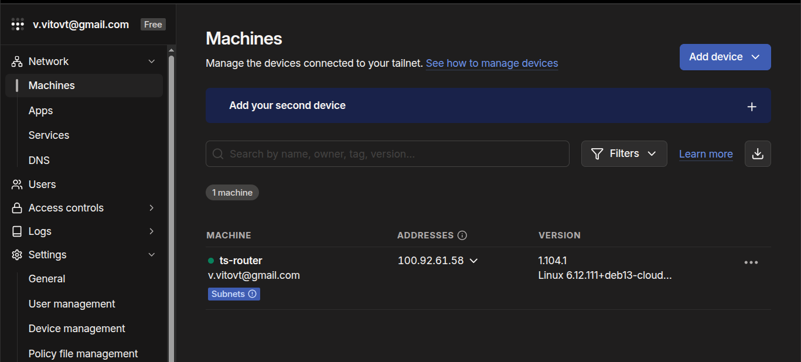
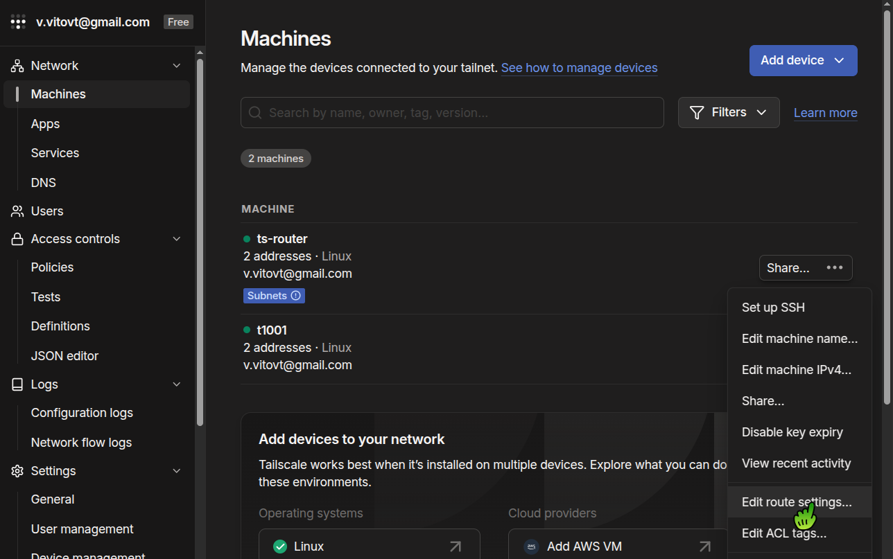
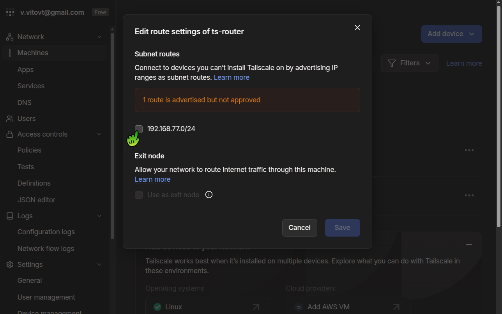
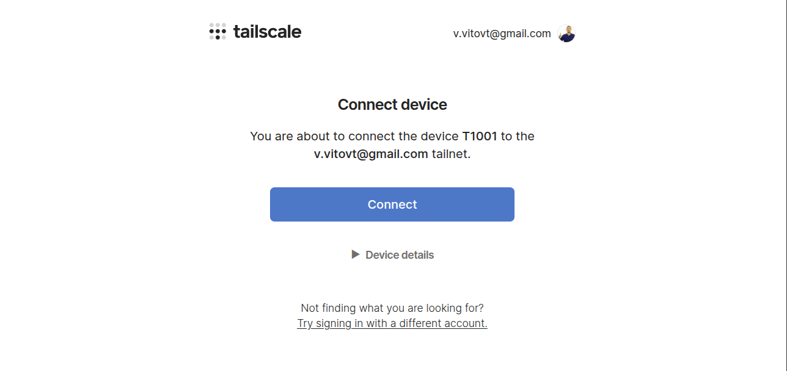

# Historical procedure record — 07-tailscale-private-access

Archived on 2026-10-24 before the operational-manual rewrite. This preserves
one-time decisions, commands, observations and original limitations. Statements
about current status describe their original checkpoint. Do not use this record
as the installation or incident-response entrypoint. Operator scripts remain
in their original locations.

Current procedure: [07-tailscale-private-access.md](../../../../runbooks/07-tailscale-private-access.md).

---

# Provision the Tailscale subnet router

**Where:** Management VM 200, from the repository checkout. Install the client and test VPN connectivity on your PC/laptop.

This phase clones Debian 13 template **9013** into VM **250** (`192.168.77.250/24`) on `vnet77`, then advertises `192.168.77.0/24` through Tailscale. Step 7 already placed the local, Git-ignored credentials in `recovery/` and [installed Ansible and Terraform](../../../../runbooks/11-install-management-tools.md) on VM 200. Terraform reads the public key from that directory; Ansible uses its matching private key. The private key is never installed on VM 250.

## 1. Prepare infrastructure inputs

From the repository root on VM 200, load the prepared environment:

- [ ] Load the local inputs:

```bash
source recovery/.env
```

- [ ] Run `bash recovery/check_credentials.sh --tailscale` after restoring credentials. It makes a read-only Proxmox API request to check token access to template 9013. Keep the current API endpoint and node name in `recovery/.env`.
- [ ] Confirm VM ID **250** and `192.168.77.250` are free before a new installation. Keep Terraform state in a restricted location.
- [ ] Use the VM image storage selected when [creating template 9013](../../../../runbooks/03-create-debian13-template.md). Set its ID once as `DISK_STORAGE` in `recovery/.env`; that file exports `TF_VAR_cloud_init_datastore_id` for Terraform. The current host uses `vmdata`.

### If restoring an incomplete credential bundle

> [!NOTE]
> Run the credential checker without an argument to include GHCR and Kubernetes recovery YAML. Use `--offline` before VM 200 has private API access. [Create or replace the API token](../../../../runbooks/12-create-proxmox-api-token.md) if needed.

### If VM 250 already exists

> [!WARNING]
> Inspect it and reconcile recovered Terraform state before applying. Do not create a second VM with the same ID. On a replacement host, update `DISK_STORAGE` after the template storage preflight.

## 2. Create the router VM and one-use Tailscale key

### Terraform

The commands below use Terraform. If you installed OpenTofu, use `tofu` in place of `terraform`.

- [ ] Initialize, validate, and review the plan:

```bash
cd edge/tailscale/terraform
umask 077
terraform init
terraform fmt -check
terraform validate
terraform plan -out=router.tfplan
terraform show router.tfplan
```

- [ ] Review the plan: a fresh install should add VM 250 and one Tailscale auth key, with no tailnet policy replacement. Confirm template **9013**, bridge `vnet77`, Proxmox node, router address, and `initialization.datastore_id` matching `DISK_STORAGE`. The generated auth key expires after one hour.
- [ ] Apply the reviewed plan:

```sh
terraform apply router.tfplan
```

#### If Terraform reports missing `local-lvm` storage

> [!WARNING]
> Terraform tried to create the Cloud-Init drive on `local-lvm`, which does not exist on the current host. Set `DISK_STORAGE` in `recovery/.env` to the storage selected in [the template runbook](../../../../runbooks/03-create-debian13-template.md), then reload the environment before planning again.

```sh
│ Error: All attempts fail:
│ #1: the requested resource does not exist
│ received an HTTP 500 response - Reason: storage 'local-lvm' does not exist
│
│   with proxmox_virtual_environment_vm.ts_router,
│   on main.tf line 25, in resource "proxmox_virtual_environment_vm" "ts_router":
│   25: resource "proxmox_virtual_environment_vm" "ts_router" {
│
```

The failed apply already created the Tailscale auth key.

- [ ] From `edge/tailscale/terraform`, check Terraform state and whether Proxmox left VM 250 behind:

```bash
terraform state list
ssh -i ../../../recovery/LIORA-id_ed25519 root@192.168.77.1 'qm status 250; qm config 250'
```

#### If VM 250 is absent after the failed apply

> [!IMPORTANT]
> Load the updated configuration and create a **new** plan. If the existing one-use key is older than one hour, add `-replace=tailscale_tailnet_key.router` to the plan command before applying.

- [ ] Review and apply the new plan:

```bash
source ../../../recovery/.env
terraform plan -out=router.tfplan
terraform show router.tfplan
terraform apply router.tfplan
```

Do not reuse the earlier saved plan: Terraform state changed when the auth key was created. Review the new plan before applying.

#### If VM 250 exists after the failed apply

> [!WARNING]
> Inspect its configuration and reconcile it with Terraform state before another plan or apply. Do not blindly create or delete it.

After Terraform succeeds, continue with Ansible below. A recovered apply can look like this:
```sh
$ terraform apply router.tfplan
proxmox_virtual_environment_vm.ts_router: Destroying... [id=250]
proxmox_virtual_environment_vm.ts_router: Destruction complete after 1s
proxmox_virtual_environment_vm.ts_router: Creating...
proxmox_virtual_environment_vm.ts_router: Still creating... [00m10s elapsed]
proxmox_virtual_environment_vm.ts_router: Still creating... [00m20s elapsed]
proxmox_virtual_environment_vm.ts_router: Still creating... [00m30s elapsed]
proxmox_virtual_environment_vm.ts_router: Still creating... [00m40s elapsed]
proxmox_virtual_environment_vm.ts_router: Still creating... [00m50s elapsed]
proxmox_virtual_environment_vm.ts_router: Still creating... [01m00s elapsed]
proxmox_virtual_environment_vm.ts_router: Still creating... [01m10s elapsed]
proxmox_virtual_environment_vm.ts_router: Still creating... [01m20s elapsed]
proxmox_virtual_environment_vm.ts_router: Still creating... [01m30s elapsed]
proxmox_virtual_environment_vm.ts_router: Creation complete after 1m34s [id=250]

Apply complete! Resources: 1 added, 0 changed, 1 destroyed.

Outputs:

ts_authkey = <sensitive>
ts_router_ip = "192.168.77.250"
```

### Ansible

- [ ] Register and configure the subnet router with the one-use auth key:

```bash
export TAILSCALE_AUTH_KEY="$(terraform output -raw ts_authkey)"
cd ../../..
ansible-playbook -i edge/tailscale/ansible/inventory.ini edge/tailscale/ansible/tailscale-router.yml --private-key recovery/LIORA-id_ed25519
unset TAILSCALE_AUTH_KEY
```

The auth key is passed to Ansible only for the router's first login. Terraform state contains the sensitive key; protect and back it up with the other recovery state.

#### If the one-use auth key expired before first login

> [!WARNING]
> Review a replacement plan with `terraform plan -replace=tailscale_tailnet_key.router` and apply it before rerunning Ansible. Replacing only VM 250 reuses the earlier key.

#### If router registration fails in Ansible

```sh
$ ansible-playbook -i edge/tailscale/ansible/inventory.ini
....
....
ok: [ts-router]

TASK [Register the subnet router on first login] ***********************************************************
[ERROR]: Task failed: Module failed: non-zero return code
Origin: /home/root-admin/fastapi-traefik-liora-infrastructure/edge/tailscale/ansible/tailscale-router.yml:68:7

66       no_log: true
67
68     - name: Register the subnet router on first login
        ^ column 7

fatal: [ts-router]: FAILED! => {"censored": "the output has been hidden due to the fact that 'no_log: true' was specified for this result", "changed": true}

PLAY RECAP **************************************************
ts-router                  : ok=10   changed=5    unreachable=0    failed=1    skipped=0    rescued=0    ignored=0
```
> [!WARNING]
> The `no_log: true` setting hides Tailscale's exact error. The one-use key expires one hour after Terraform creates it. If that hour has passed, replace the key before rerunning Ansible. A VM-only replacement reuses the previous key.

From `edge/tailscale/terraform` on VM 200:

- [ ] Plan a fresh key:

```sh
terraform plan -replace=tailscale_tailnet_key.router -out=renew-key.tfplan
terraform show renew-key.tfplan
```

- [ ] **Check that the plan replaces only the key, not VM 250**, then apply it:

```sh
terraform apply renew-key.tfplan
```
Then rerun the **Ansible** commands above.

## 3. Approve the advertised subnet route

- [ ] In the Tailscale admin console, open **Machines** and find `ts-router`. Its **Subnets** badge indicates that it is advertising `192.168.77.0/24`.
- [ ] Confirm tailnet grants permit the intended administrators to use this subnet. This Terraform module does not manage tailnet policy. [Tailscale subnet router guide](https://tailscale.com/docs/features/subnet-routers).



### If the advertised route is not auto-approved

> [!IMPORTANT]
> - [ ] Open the machine's **⋯** menu, choose **Edit route settings**, select `192.168.77.0/24`, and click **Save**.





## 4. Install a Tailscale client and verify private access

On your **PC/laptop**, install the client and connect it to the same tailnet as `ts-router`.

### Linux client

- [ ] Install Tailscale and connect to the same tailnet:

```bash
curl -fsSL https://tailscale.com/install.sh | sh
sudo tailscale up
```

On first login, `tailscale up` prints an authorization URL. Open it in a browser, sign in to the intended tailnet, and click **Connect** for this device. The screenshot shows this browser confirmation step.



- [ ] Enable subnet routes on Linux and check status:

```bash
sudo tailscale set --accept-routes
tailscale status
```

[Linux installation instructions](https://tailscale.com/docs/install/linux).

### macOS client

- [ ] Download and install [Tailscale for macOS](https://tailscale.com/download/mac). Complete VPN setup and sign in to the same tailnet. macOS accepts approved subnet routes by default. [macOS installation instructions](https://tailscale.com/docs/install/mac).

### Final tests

On VM 200, verify that Tailscale is running and IP forwarding is enabled on VM 250:

- [ ] Check the router from VM 200:

```bash
ssh -i recovery/LIORA-id_ed25519 root-admin@192.168.77.250 'sudo systemctl is-active tailscaled; sudo sysctl net.ipv4.ip_forward net.ipv6.conf.all.forwarding; sudo tailscale status'
```

From the repository root on your **PC/laptop**, test access through the VPN:

- [ ] Check the private destinations from your PC/laptop:

```bash
ssh -i recovery/LIORA-id_ed25519 root-admin@192.168.77.200
ssh -i recovery/LIORA-id_ed25519 root@192.168.77.1
ssh -i recovery/LIORA-id_ed25519 root-admin@192.168.77.250
```

#### If your PC has another route to `192.168.77.0/24`

> [!NOTE]
> Inspect the selected route before treating SSH success as proof that Tailscale carried the traffic.
