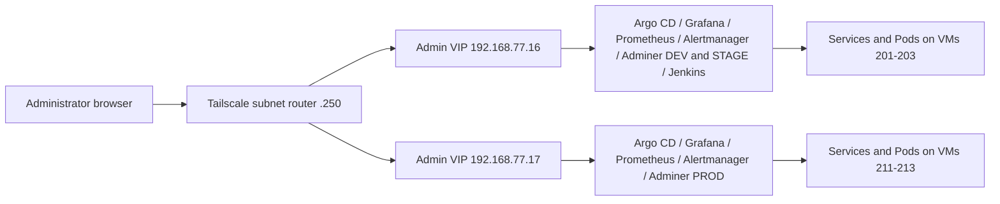

# Historical platform planning notes

Archived 2026-10-25. This records the former plan and superseded instructions.
Use [architecture](../../../../docs/ARCHITECTURE.md) for the desired system.

# Kubernetes implementation plan

Documentation alignment update: **2026-10-24**. Permanent procedures now
separate [fresh deployment](../../../../00-Installation_from-0.md),
[disaster recovery](../../../../01-Disaster_recovery.md) and
[backup/recovery operations](../../../../runbooks/19-cnpg-r2-backup-pitr.md).
Historical transitional commands/evidence remain in phase reports and their
[procedure archives](../../evidence/records/2026-10-24-operational-documentation-review.md#historical-procedure-preservation).

Phases 0–8, fresh CNPG installation (10.1), R2 backups/isolated PITR (10.2)
and the defined Phase 11 certificate/DHCP scope have completed checkpoints.
Phase 9 remains open. The latest Jenkins review observed automatic STAGE
acceptance and manual DEV publication running; older Phase 9 sections below
retain their original checkpoint statements. Restart behavior, scheduling-policy
alignment, remaining acceptance/failure checks, manual PROD and rollback work
are not closed by this documentation update.

The [recovery capability register](../../evidence/records/2026-10-24-operational-documentation-review.md#recovery-capability-register)
separates implemented isolated PITR from full live disaster restoration, generic
Jenkins backup/restore, etcd/off-host kit work and full-system recovery exercises.

## Fixed node-memory configuration — 2026-10-25

The owner requires 8 GiB fixed RAM for all six K3s nodes, with no ballooning.
Implementation and local validation: [fixed-memory report](../../evidence/records/2026-10-25-k3s-fixed-memory.md).
The Terraform module uses `memory_mb = 8192` and `memory.floating = 0`, rejects
lower memory overrides and removes `memory_min_mb`. Examples, architecture and
VM provisioning instructions use the same policy. Historical incident reports
retain the original 2 GiB ballooning configuration and its symptoms.

This change updates provisioning code; it does not apply Terraform, restart
nodes or establish the current guest/kubelet memory state. Review private tfvars
before the next plan and verify guest/Kubernetes capacity during the planned
infrastructure maintenance. Preserve cluster data and existing state.

## Target architecture

Current operating-model decisions are recorded in
[the owner decision update](../../decisions/2026-10-24-operating-model.md). They supersede
earlier ingress, Secret-management and Adminer targets in historical sections.

The final state uses two independent K3s clusters and three application
environments. DEV and STAGE share one cluster but have separate namespaces and
data. PROD runs on its own cluster.

| Component | Dev/stage cluster | Prod cluster |
| --- | --- | --- |
| K3s | VMs 201–203; API VIP `192.168.77.11` | VMs 211–213; API VIP `192.168.77.12` |
| Private administration | Admin VIP `192.168.77.16`; services-only kube-vip | Admin VIP `192.168.77.17`; independent services-only kube-vip |
| Application | `app-dev` and `app-stage` namespaces | `app-prod` namespace |
| GitOps | Own Argo CD, AppProject, and root Application | Independent Argo CD, AppProject, and root Application |
| Sync | STAGE direct digest commits after CI; DEV manual; auto-sync/self-heal and reviewed pruning | Manual reviewed promotion after acceptance; auto-sync/self-heal, no automatic pruning |
| Secrets | Private recovery inputs; Ansible/helpers/manual provisioning; GHCR credentials per namespace | Independent private PROD inputs and Secret provisioning |
| Data | Separate DEV and STAGE databases | PROD database with tested backups and restore |
| Monitoring | Cluster monitoring and administrative Grafana | Separate monitoring and controlled access to PROD metrics |
| Jenkins | One controller in namespace `jenkins`; own persistent volume; CI migration in Phase 9 | No separate Jenkins controller; reviewed promotion and local Argo CD deploy PROD |

The public path uses Cloudflare protection/Access for DEV/STAGE and DNS-only
access for PROD → Proxmox TCP/80,443 DNAT →
HAProxy edge VM 240 → the selected cluster's Traefik ingress → application
Services. Public ingress uses node pools `.201`–`.203` and `.211`–`.213`,
separate from API VIPs and the new Admin VIPs. Keep this working path unchanged
while operating private administration. Dedicated ingress VIPs are not planned.
The owner confirms that DEV/STAGE Cloudflare protection/Access is enabled and
legacy VM100 administrative DNAT rules have been removed; these confirmations
are not new tests of the owner-managed configuration.

The database platform is CloudNativePG: DEV/STAGE each use one instance and
PROD uses two asynchronously replicated instances on distinct nodes. Phase 10.1
replaces the initial PostgreSQL Deployments with fresh databases under explicit
disposable-data authorization. R2 physical backup/WAL archiving and isolated
restoration are implemented in 10.2; continuing operations and full live recovery
are tracked separately. The original kube-vip
DaemonSets serve the API only, and K3s ServiceLB serves public Traefik. Independent
services-only DaemonSets now serve administrative Services in each cluster;
do not repurpose the API DaemonSets or change public ingress ownership.

### Agreed private access and service addresses

Trusted administrators reach the whole `192.168.77.0/24` subnet through the
existing Tailscale router. Use browser access by IP and port, with no private
ingress, DNS records, additional reverse proxy, SSH tunnel or manual
port-forward. The operator confirms `.16` and `.17` are available and assigns
them to this purpose. Both are now deployed and locally verified; external
Tailscale browser access and passwords were confirmed by the operator on
2026-10-22.



| Interface | DEV/STAGE endpoint | PROD endpoint | Current state / native service |
| --- | --- | --- | --- |
| Kubernetes API | `https://192.168.77.11:6443` | `https://192.168.77.12:6443` | Existing; API VIPs stay unchanged |
| Argo CD | `https://192.168.77.16:8080` | `https://192.168.77.17:8080` | Deployed; native HTTPS server |
| Grafana | `http://192.168.77.16:3000` | `http://192.168.77.17:3000` | Deployed; native HTTP and Grafana login |
| Prometheus | `http://192.168.77.16:9090` | `http://192.168.77.17:9090` | Deployed; native HTTP |
| Alertmanager | `http://192.168.77.16:9093` | `http://192.168.77.17:9093` | Deployed; native HTTP |
| Adminer DEV | `http://192.168.77.16:8081` | — | Existing `app-dev/adminer:80`; database login |
| Adminer STAGE | `http://192.168.77.16:8082` | — | Existing `app-stage/adminer:80`; database login |
| Adminer PROD | — | `http://192.168.77.17:8081` | Existing `app-prod/adminer:80`; database login |
| Jenkins | `http://192.168.77.16:8085` | — | Controller/UI deployed; working CI migration in Phase 9 |

Use the HTTP/HTTPS and authentication supplied by each service. Do not add TLS
termination, a private CA, new certificates, SSO or an authentication proxy for
Admin VIP access. Argo CD currently has its bootstrap self-signed certificate;
an IP URL is not a promise of warning-free browser TLS. Configure native base
URLs and redirects for the chosen external IP and port where required.
Retain native logins for Argo CD, Grafana, Jenkins and Adminer. Prometheus and
Alertmanager retain their native access model inside the trusted subnet.

No additional Tailscale grants/ACL restrictions or firewall hardening are part
of this increment. Do not create public NAT or HAProxy routes to Admin VIPs.
Record any NodePort allocation required by the implementation; do not describe
VIP access as restricting other private access paths. PostgreSQL, Redis, Docker
daemons and metrics endpoints do not receive administrative browser endpoints.

### Admin VIP ownership and implementation constraints

- Use kube-vip **v1.2.3**, services-only mode, with one common service leader
  per cluster for all Services sharing its Admin VIP. Its election and lease
  must be independent of the existing API leader and `plndr-cp-lock`.
- Set the intended VIP explicitly on every administrative LoadBalancer
  Service; use distinct exposed ports on each shared VIP, including the two
  nonprod Adminer Services in their separate namespaces.
- Check the exact v1.2.3 configuration and shared-VIP election behavior before
  applying it. Do not assume independent per-Service leaders can safely own
  the same address. If the agreed ownership cannot be implemented as planned,
  report the discrepancy before changing the architecture.
- Give the new DaemonSet distinct names, labels/selectors and appropriate
  service-account/RBAC resources. Avoid hostNetwork listener conflicts: the
  existing API kube-vip exposes metrics on `2112`.
- Use strict LoadBalancer class handling so services-only kube-vip does not
  claim public Traefik and ServiceLB creates no administrative DaemonSets.
  The installed K3s EndpointSlice worker still attempts foreign status writes;
  the operator approved a native status-owner admission guard, verified on
  NONPROD before PROD. Only kube-vip-admin may update this class's status.
  Record its denied-write retries and preserve both API DaemonSets, their
  leases and public ingress. See the [decision](../../decisions/admin-vip-status-ownership.md).
- One shared leader is an address-ownership choice. It does not establish
  service, storage or host high availability. Failover, reboot, outage timing,
  load and resilience tests are deferred and are not Phase 8 acceptance gates.

### Remaining infrastructure and later target components

| Component | Address / placement | Target or current responsibility |
| --- | --- | --- |
| Public application | `dev.liora.aprt.info`, `stage.liora.aprt.info`, `liora.aprt.info` over HTTPS | Existing application-only HAProxy/Traefik path |
| Proxmox | `192.168.77.1`; native management UI on 8006 | Existing host administration; outside Admin VIPs |
| Management VM 200 | `192.168.77.200` | Terraform, Ansible and explicit cluster kubeconfigs |
| HAProxy VM 240 | `192.168.77.240` | Application-only HTTP redirect and TLS passthrough |
| Tailscale router VM 250 | `192.168.77.250` | Existing subnet access |
| Application internals | Separate namespaces and PVCs | Frontend, backend, PostgreSQL, Adminer and prestart Job remain |
| Cluster internals | Each independent K3s cluster | API/etcd, CoreDNS, Metrics Server, local-path provisioner, Traefik and ServiceLB remain |
| Argo CD internals | Each cluster's `argocd` namespace | Independent controller, repo server, Redis, Dex, ApplicationSet and notifications components |
| Monitoring internals | Each cluster's `monitoring` namespace | Prometheus Operator, kube-state-metrics, Node Exporter, scrape configuration, dashboards and alerts |
| CI agents / registry publisher / build daemon | DEV/STAGE CI platform; Phase 9 | Preserve existing CI/publisher separation; no extra browser ports |
| GitHub / GHCR | External existing services | Source, reviewed promotion changes and container registry |
| Slack | Existing kind destination available; new-cluster destination not yet confirmed | Configure delivery only after destination agreement; no assumption of verified notification receipt |
| Private Secret provisioning | Ansible, reviewed helpers or manual bootstrap from ignored `recovery/` inputs | No live Secret payloads in Git; protect the external recovery kit |
| CloudNativePG | Per-environment namespaces; Phase 10.1 | Fresh PostgreSQL 16 databases; DEV 1, STAGE 1, PROD 2 async instances on different nodes |
| R2 database backups | Phase 10.2 complete | Physical backups/WAL and isolated PITR passed for all environments; monthly exercises and retention-window aging continue |

VM 100, its legacy kind deployment and existing public administrative NAT
rules are outside this implementation's change scope. The operator will retire
them after the replacement platform and CI are working. Phase 8 alone does not
make VM 100 ready for shutdown, because working CI moves in Phase 9.

### Target repository layout

```text
docs/testreports/           Plans and phase reports
kubernetes/
  apps/liora/
    base/
    components/cloudnative-pg/ database Cluster, connection patches and readiness wave
    overlays/dev/
    overlays/stage/
    overlays/prod/
  gitops/argocd/
    nonprod/                 root app, project, DEV/STAGE apps, bootstrap
    prod/                    independent root app, project, PROD app, bootstrap
  platform/
    cloudnative-pg/          shared pinned operator installed independently per cluster
    base/                    shared platform resources where appropriate
    nonprod/
      admin-access/          services-only kube-vip and private access resources
      monitoring/            nonprod storage, retention, dashboards and alerts
      jenkins/               controller, JCasC, storage and administrative Service
    prod/
      admin-access/          independent VIP ownership and private access resources
      monitoring/            independent PROD monitoring configuration
scripts/kubernetes/          reusable operator helpers
runbooks/                    installation and recovery procedures
.local-work/                 ignored tools, rendered output and operator evidence
```

The Phase 8 platform directories now exist alongside preserved upstream source. Keep
namespace-specific administrative Services with clear, single ownership:
application namespace exposure belongs with its environment overlay; platform
configuration must not silently compete with an existing Argo CD owner.

The Phase 0 baseline report and migration instructions accompany this plan.
The application base and overlays have been imported with selected history;
see [Phase 1 report](../../phases/phase-01/REPORT.md). All three overlays render with real,
pinned images, including the approved PROD pair. DEV, STAGE and PROD are
deployed and privately verified in Phases 3–5, including mutual isolation.
PROD uses one backend worker per Pod with two replicas after its compatibility
fix. The migration is integrated into the original checkout on `main`. Never
commit live credentials, controller private keys, or state.

### Target ownership and source files

- The application repository retains application code, tests, image builds,
  release tags, and the Jenkins pipeline that publishes images. This
  infrastructure repository owns deployed image digests, Kustomize overlays,
  Argo CD configuration, cluster services and Jenkins deployment/bootstrap
  configuration. Work in the original infrastructure checkout with ignored
  `.local-work/` tools; no temporary working checkout is needed.
- The first migration copies `deploy/base/` and
  `deploy/overlays/{dev,stage,prod}/` from the application repository. The
  Phase 10 CNPG replacement removes the legacy database ConfigMap, Deployment
  and PVC from the active base, retains `service-db.yaml` as the stable primary
  endpoint and selects the database component independently per overlay.
  Keep private Adminer in every environment, including PROD, as an accepted
  startup-stage operational trade-off; removal is not a migration milestone.
- Adapt `argocd/app-dev.yaml`, `app-stage.yaml`, and `project.yaml` for
  the nonprod cluster. Create independent PROD equivalents, bootstrap
  resources, and root Applications. Each Argo CD points to this repository
  and deploys to its own cluster via `https://kubernetes.default.svc`.
  The existing `argocd/applicationset.yaml` cannot be copied unchanged:
  it creates all three environments in one cluster.
- Adapt `monitoring/values.yaml`, `kustomization.yaml`,
  `dashboards/platform.yaml`, `monitors/{argocd,traefik}.yaml`, and
  `rules/dev-stage.yaml` when adding monitoring. Replace kind-specific
  storage assumptions and create distinct PROD settings.
- Treat `infra/jenkins-host/` in the application repository as the source of
  the working Jenkins proof of concept. Preserve as much as possible: pinned
  controller/agent/build-daemon images, Dockerfiles and tool/plugin locks,
  JCasC, Job DSL, pipeline definitions, credential IDs/scopes and the separation
  between CI and trusted publication. Adapt deployment details for K3s rather
  than replacing the working design. Record source revisions, path mappings
  and intentional deviations; preserve selected source history when importing
  platform files. The currently reviewed application source is
  `b98a22e48527c256193ed65c10307eb574b27ab6`; recheck before importing.
- Keep live Jenkins home, build history, artifacts, credentials and encryption
  keys as private operator data. Preserve them during Phase 9 migration and
  keep a consistent recovery copy; do not copy them into tracked manifests.
  Phase 8 must not start migrated polling, builds or publication alongside the
  existing jobs on VM 100.
- Move promotion to reviewed changes in this repository. Adapt
  `ci/promote.py`, `promote-stage.sh`, `publish.sh`, `registry.py`, and
  `Jenkinsfile.promote` without executing trusted publishing code from an
  untrusted application checkout. Add rendering and placeholder-image checks
  for all three overlays. The GitOps GitHub App needs access to this repository.
- Do not deploy the application's historical `k8s/` tree, legacy encrypted
  credential manifests, or application `.env` files. Review `infra/jenkins-host/`
  separately from the Kubernetes manifests.

## Implementation order

Write all new implementation plans and phase reports in `docs/testreports/`.

First run the application's **current deployment** on the new clusters with the
fewest necessary changes. Verify DEV, STAGE, and PROD independently. Add GitOps,
public access, monitoring, and platform replacements in later, separate steps.
Complete the check for each phase before starting the next.

The operator authorized execution of this plan on 2026-10-21. Execute Phase 8
substeps in order, keep changes small and report actual readiness separately
from deferred tests. VM 100 retirement and legacy NAT removal remain operator
work outside these steps. Do not begin Phase 9 as part of Phase 8.

Copy deployment files from the
[application repository](https://github.com/fastapi-traefik-devops/fastapi-traefik-liora-application).
It was reviewed at commit `3a610ebb14f265fcdeb5a1d4d59da9fa543648c5`;
record the actual source commit when copying. Its historical `k8s/` tree and
this repository's `examples/kubernetes/` are references, not deployment sources.
